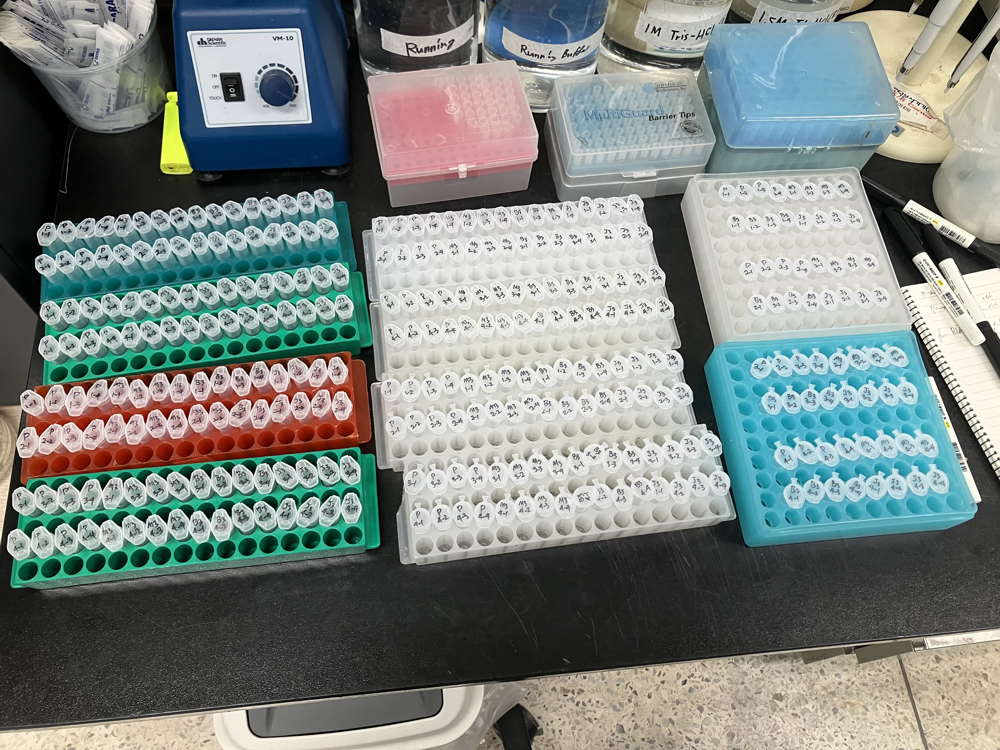
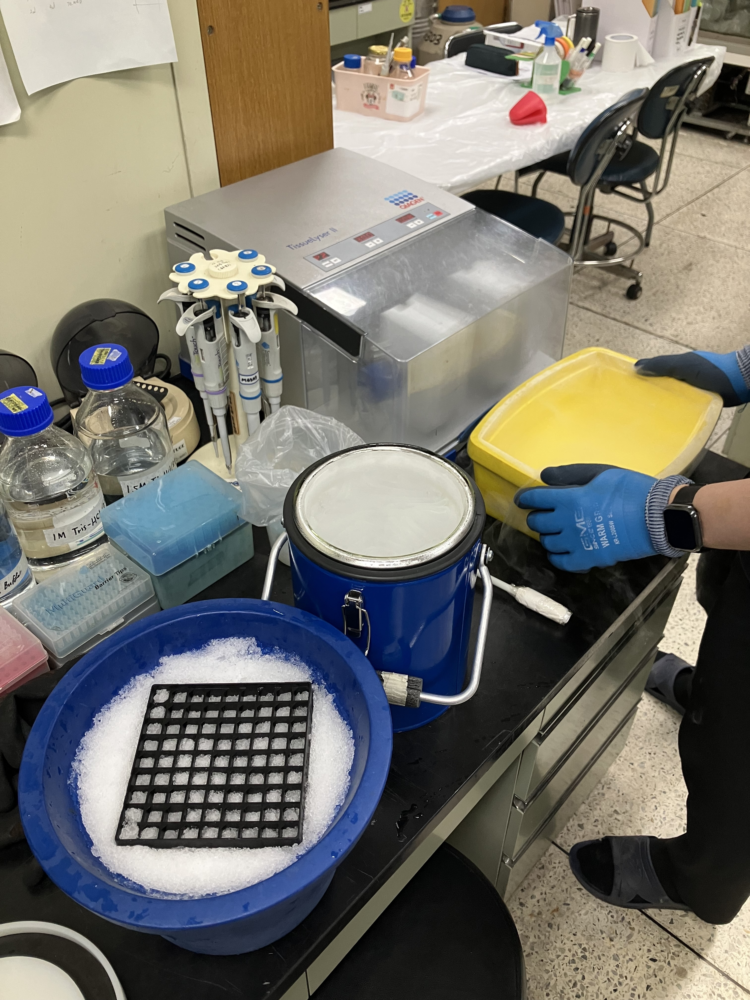
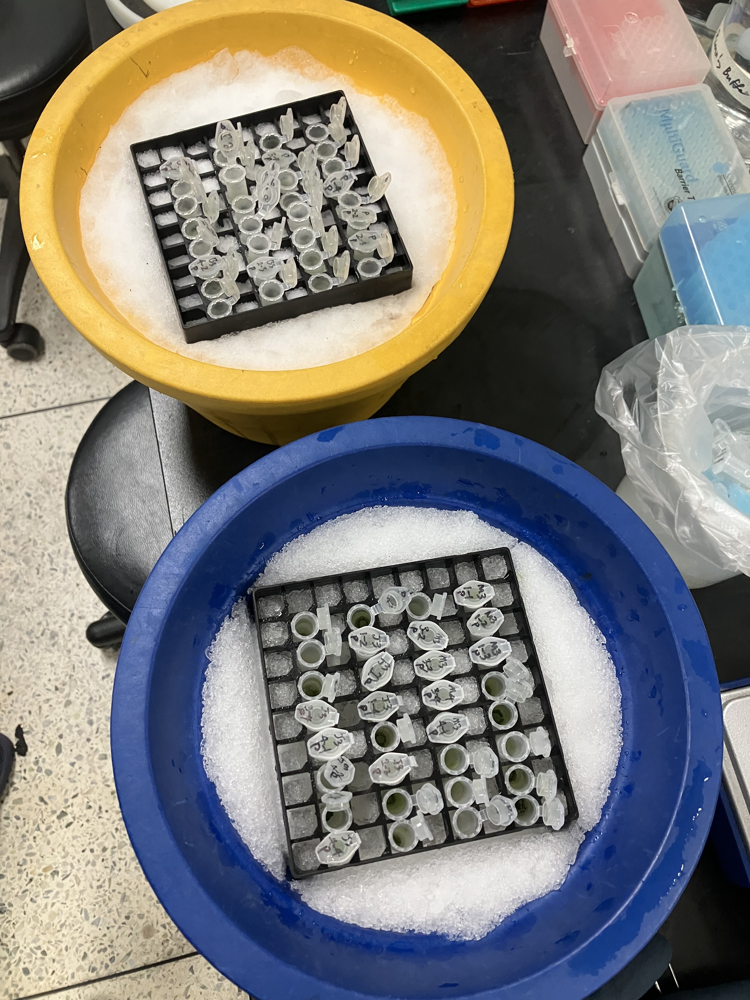

# Tomato Leaf Protein Extraction (2026-05-28)

**Date:** 2026-05-28
**Material:** tomato leaves, 64 samples (P and F3 generations)
**Method:** TissueLyser grinding, detergent extraction buffer, NanoDrop A280
**Related log:** 2026-05-29 (RNA extraction from the same sample set)

---

## Background

This work is part of a multi-generation experiment on tomato plants grown with soil suspensions from two sites. Earlier observations in this project (not part of this repository): plants grown with Gyeongju (GJ) soil were larger (shoot length, root length, fresh weight and dry weight), and plants grown with Gijang B (GB) soil ripened earlier.

* **P (parent) generation:** treated with GB or GJ soil.
* **F1 and F2:** treatment continued with the same soil.
* **F3:** no soil treatment, to test for effects carried over from earlier generations.

## Samples

| Group | Description |
| :--- | :--- |
| `M3` | MES buffer control, F3 |
| `B3` | Gijang B soil, F3 |
| `J3` | Gyeongju soil, F3 |
| `P` | parent generation, untreated control |

4 groups × 4 sets × 4 biological replicates = 64 samples. Sample IDs are `<group> <set>-<replicate>`, for example `P 1-1` to `P 4-4`. One set contains one sample of each group.

---

## Reference protocol

### 1. Extraction buffer

| Component | Stock | Per 1 mL | Final | Per 10 mL | Per 50 mL | Role |
| :--- | :---: | :---: | :---: | :---: | :---: | :--- |
| Tris-HCl (pH 7.5) | 1 M | 20 µL | 20 mM | 200 µL | 1 mL | buffer |
| EDTA (pH 8.0) | 0.5 M | 2 µL | 1 mM | 20 µL | 100 µL | chelator; supports the protease inhibitors |
| NaCl | 1 M | 150 µL | 150 mM | 1.5 mL | 7.5 mL | salt; protein solubility |
| Triton X-100 | — | 1 µL | 0.1% (v/v) | 10 µL | 50 µL | non-ionic detergent; solubilizes membranes |
| DTT | 1 M | 5 µL | 5 mM | 50 µL | 250 µL | reducing agent (disulfide bonds) |
| SDS (10%) | 0.1 g/mL | 10 µL | 0.1% (w/v) | 100 µL | 500 µL | denaturing detergent |
| Distilled water (DW) | — | 312 µL | — | 3.12 mL | 15.6 mL | — |
| Protease inhibitor | 2X | 500 µL | 1X | 5 mL | 25 mL | protects proteins from degradation |
| **Total** | — | **1 mL** | — | **10 mL** | **50 mL** | — |

### 2. Extraction

1. Transfer the sample powder into a tube and add 300 µL of extraction buffer. Alternatively, add the buffer first and then grind the sample in it. Keep the powder-to-buffer ratio close to 1:1.
2. Vortex until the sample is fully suspended.
3. Centrifuge at 13,000 rpm, 4 °C, for 20 min (up to 30 min).
4. Transfer 200 µL of supernatant into a new 1.5 mL tube. Store two 200 µL aliquots per sample in PCR tubes (enough for Western blot practice, or if the target protein is abundant).
5. Measure the protein concentration, normalize all samples to the same concentration, aliquot 20 µL working volumes for Western blotting and store at −20 °C.

---

## Bench record and deviations

1. **Tubes**
   * 64 × 1.5 mL and 64 × 2.0 mL tubes, labeled with the sample ID and the suffix `p` to separate them from the RNA sets (for example `P 1-1 p`, `M3 3-2 p`).
   * One small glass bead in each 2.0 mL tube for grinding.

   

2. **Extraction buffer**
   * Recipe as in the reference table. A base mixture (Tris-HCl, EDTA, NaCl, Triton X-100, SDS and DW) was prepared in advance; DTT and protease inhibitor were added just before use.
   * 10 mL working buffer: 4.95 mL base mixture + 50 µL 1 M DTT + 5.0 mL 2X protease inhibitor.
   * 10 mL was prepared for the 6.4 mL needed (64 samples × 100 µL).

3. **Sampling and freezing**
   * Ice buckets filled with liquid nitrogen (LN2).
   * Plants were chosen at random within each group. The leaf edge was cut once and the piece put directly into the labeled 2.0 mL tube with a bead.
   * Caps were closed tightly before immersion: LN2 that enters a tube can make it burst when it warms up.
   * Tubes were frozen in LN2.

4. **Grinding (TissueLyser)**
   * Both adapter sets were pre-chilled in LN2. The 64 samples were ground in 4 batches of 16, one pre-chilled adapter at a time, to keep the tissue frozen.
   * Per batch: tubes loaded into the adapter in the LN2 bath; 30 Hz for 20 s; adapter re-chilled in LN2; 30 Hz for 20 s again; tubes moved to ice.

   

5. **Buffer addition and venting**
   * 100 µL of working buffer was added to each tube directly after grinding, while the powder was still frozen.
   * Volume: the usual volume is 100–150 µL; 100 µL was used because the tissue pieces were small, to keep the protein concentration high.
   * Caps were left slightly open on ice so that pressure from the temperature change (LN2 to ice) could escape and the caps would not pop open.

   

6. **Vortexing and centrifugation**
   * Each sample was vortexed for more than 10 s.
   * Samples were processed in three batches (24, 24 and 16 samples); waiting samples stayed on ice in the buffer.
   * First spin: 13,000 rpm, 4 °C, 10 min (pellets debris and beads). The supernatant was transferred to the labeled 1.5 mL tubes; the 2.0 mL tubes were kept to recover and wash the beads.
   * Second spin: 13,000 rpm, 4 °C, 5 min. The cleared supernatant was transferred to 8-strip PCR tubes.
   * Deviation: 10 + 5 min of centrifugation instead of 20 min.
   * Tubes were kept on ice between steps.

7. **Pooling by set**
   * 10 µL of each of the four replicates of a set were combined into a 40 µL pool (for example `P 1-1` to `P 1-4` → `P1`).
   * Pools: `P1`–`P4`, `M1`–`M4`, `B1`–`B4` and `J1`–`J4`, kept on ice.

8. **Protein measurement (NanoDrop, A280)**
   * Pedestal cleaned with a wipe moistened with 70% ethanol.
   * Blank: 1 µL of the working buffer.
   * 1 µL of each pool was measured three times; the pedestal was cleaned between samples.
   * The readings are not recorded in this log.

---

## Deviations from the reference protocol

| Step | Reference | This run |
| :--- | :--- | :--- |
| Buffer volume | 300 µL | 100 µL |
| Centrifugation | 13,000 rpm, 20–30 min | 13,000 rpm, 10 min, then 5 min after transfer |
| Quantification | each sample | pools of four replicates |
