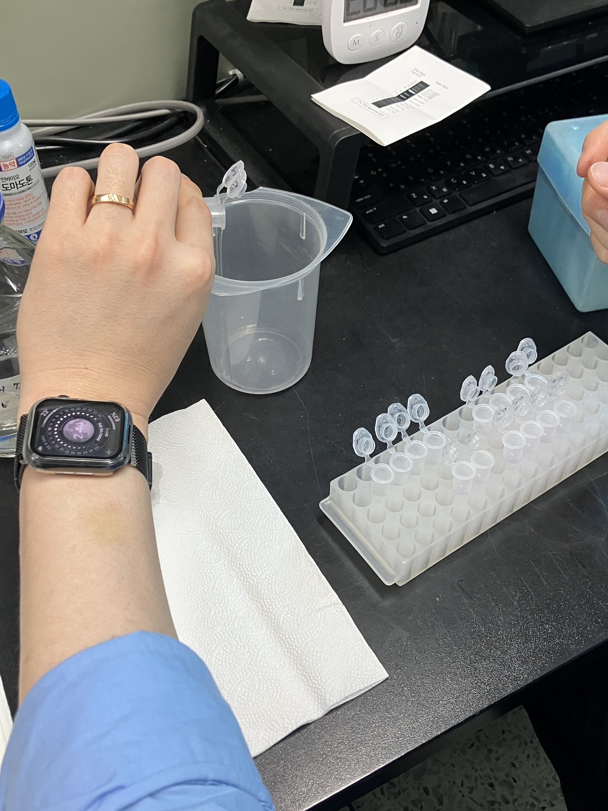
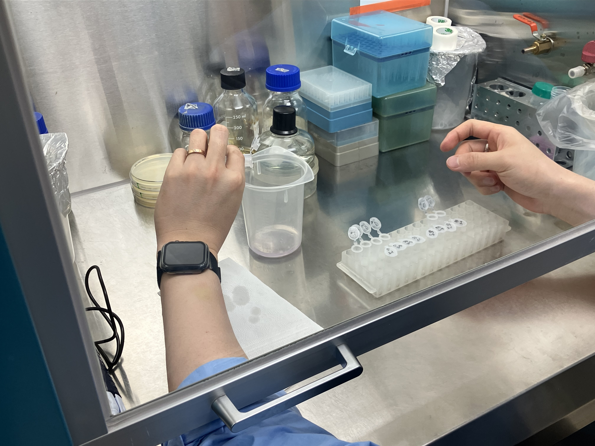
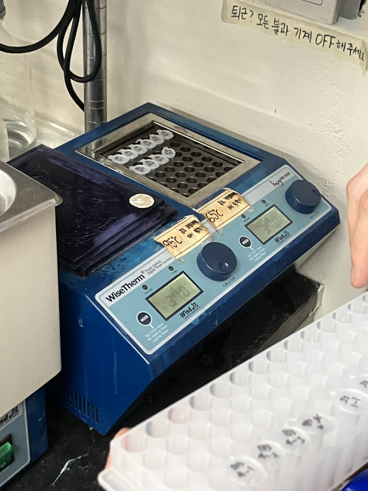
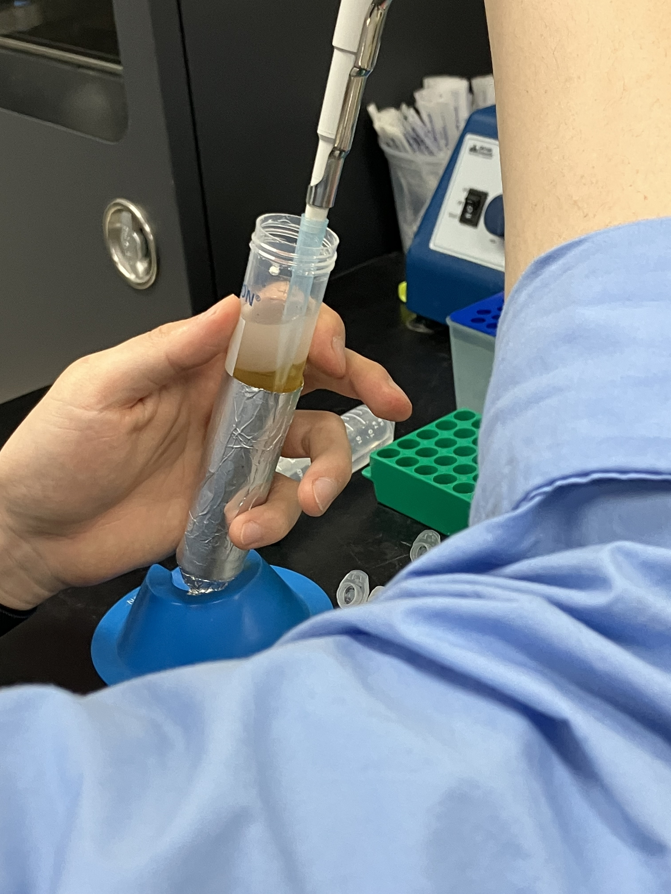
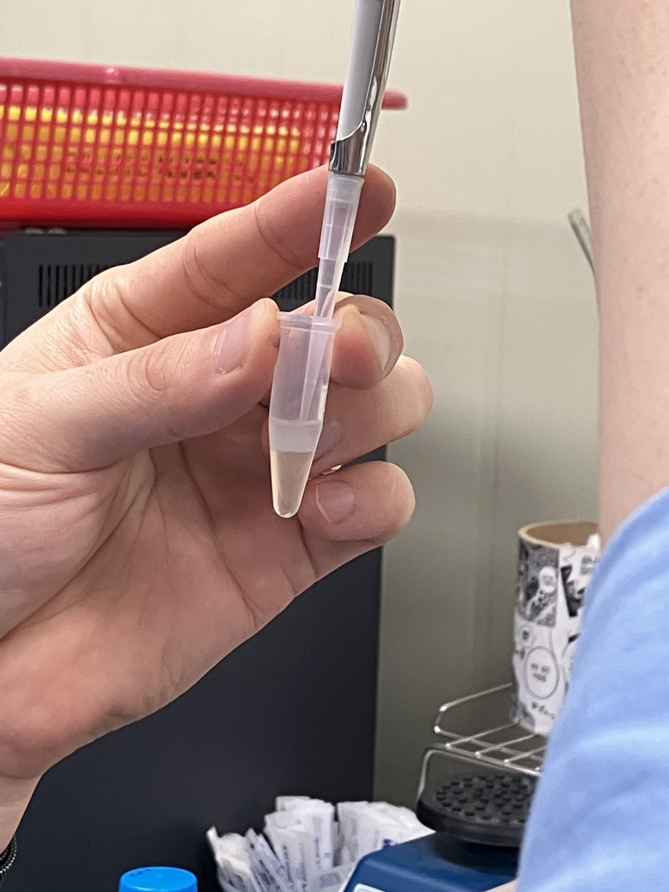

# Tomato Leaf RNA Extraction and DNase Treatment (2026-05-29)

**Date:** 2026-05-29 (precipitation continued overnight)
**Material:** tomato leaves, 64 samples (P and F3 generations)
**Method:** TissueLyser grinding, TRIzol, TURBO DNase, PCI clean-up, ethanol precipitation
**Related log:** 2026-05-28 (protein extraction from the same sample set; background and design)

---

## Samples

Same design as 2026-05-28: groups `M3` (MES buffer control, F3), `B3` (Gijang B soil, F3), `J3` (Gyeongju soil, F3) and `P` (parent generation, untreated control); 4 sets × 4 biological replicates per group (`P 1-1` to `J3 4-4`), 64 samples in total.

---

## Reference protocol

### 1. RNA extraction (TRIzol)

All reagents and plasticware are treated with DEPC for at least 2 days and then autoclaved (DEPC water: 1 mL DEPC in 1 L distilled water, at least 2 days, then autoclave).

1. Grind 0.1 g of tissue in liquid nitrogen (LN2).
2. Add the powder to a 2 mL tube with 1 mL TRIzol, vortex and incubate at room temperature (RT) for 5 min. (TRIzol contains phenol and guanidinium thiocyanate; it denatures proteins and dissolves lipids.)
3. Centrifuge at 13,000 rpm, 4 °C, 15 min.
4. Transfer the supernatant (~1 mL) to a new DEPC-treated tube; RT, 5 min.
5. Add 200 µL chloroform, mix by inversion; RT, 2 min. (Chloroform separates the mixture into an aqueous phase with the RNA and an organic phase.)
6. Centrifuge at 13,000 rpm, 4 °C, 15 min.
7. Transfer the aqueous phase (~500 µL) to a new tube and add 500 µL isopropanol.
8. Incubate 5 min, then centrifuge at 13,000 rpm, 4 °C, 15 min.
9. Discard the supernatant and add 1 mL of 75% ethanol (made with DEPC water).
10. Incubate at −20 °C for 2 h or overnight.
11. Centrifuge at 13,000 rpm, 4 °C, 15 min.
12. Discard the supernatant, air-dry the pellet (not longer than 30 min) and dissolve it in 50 µL DEPC water.
13. Store at −80 °C.

### 2. DNase treatment and clean-up

| Component | Volume |
| :--- | :---: |
| 10X reaction buffer | 3 µL |
| TURBO DNase | 2 µL |
| Total RNA | 25 µL |
| **Total** | **30 µL** |

1. Mix gently by pipetting; 37 °C, 30 min.
2. Add 270 µL DEPC water (total 300 µL).
3. Add 300 µL PCI (phenol:chloroform:isoamyl alcohol 25:24:1) and mix by inversion.
4. Centrifuge at 13,000 rpm, 4 °C, 15 min.
5. Transfer 200 µL of the aqueous phase to a new 1.5 mL tube and add 20 µL 3 M sodium acetate (pH 5.2, RNA grade), 1 µL glycogen (10 mg/mL) and 500 µL absolute ethanol. Mix by inversion; −20 °C overnight.
6. Centrifuge at 13,000 rpm, 4 °C, 15 min.
7. Remove the supernatant, add 1 mL of 70% ethanol (DEPC water) and centrifuge for 1 min.
8. Repeat step 7 once.
9. Air-dry the pellet, dissolve in 50 µL DEPC water and store at −20 °C.

---

## Bench record and deviations

1. **Tubes**
   * 64 × 2.0 mL and 128 × 1.5 mL tubes, labeled `P 1-1` to `P 4-4`, `M3 1-1` to `M3 4-4`, `B3 1-1` to `B3 4-4` and `J3 1-1` to `J3 4-4`.
   * One small glass bead in each 2.0 mL tube.
   * All tubes and tips had been DEPC-treated for at least 2 days and autoclaved.

2. **Sampling and grinding**
   * Leaf pieces were put directly into the DEPC-treated 2.0 mL tubes with beads. Caps were closed tightly before the tubes went into LN2 (LN2 inside a tube can make it burst on warming).
   * TissueLyser adapters were pre-chilled in LN2. The 64 samples were ground in 4 batches of 16: 30 Hz for 20 s, adapter re-chilled in LN2, 30 Hz for 20 s again; tubes then moved to ice.

3. **TRIzol lysis**
   * 1.0 mL TRIzol was added to each tube directly after grinding, while the tissue was frozen.
   * Vortexed about 10 s; RT, 5 min.
   * Centrifuged at 13,000 rpm, 4 °C, 15 min.

4. **First supernatant (deviation)**
   * 800 µL of supernatant per sample was transferred to the first set of DEPC-treated 1.5 mL tubes, instead of ~1 mL, because less liquid could be recovered from the small leaf samples.
   * RT, 5 min.

5. **Chloroform**
   * 200 µL chloroform per tube; mixed by inverting repeatedly; RT, 2 min.
   * Centrifuged at 13,000 rpm, 4 °C, 15 min. This gave a lower organic phase, a white interphase and a clear upper aqueous phase with the RNA.

6. **Aqueous phase (deviation)**
   * A second set of 64 DEPC-treated 1.5 mL tubes was used.
   * The aqueous phase was taken from the top down, with the tip kept in the centre of the tube to avoid the interphase and material on the tube wall.
   * 450 µL was recovered per sample instead of ~500 µL, to avoid the interphase.

7. **Isopropanol precipitation (deviation)**
   * 450 µL isopropanol per tube (1:1 with the aqueous phase); mixed by inversion.
   * The samples were kept at −20 °C overnight instead of 5 min at RT, because of the lab schedule and to improve precipitation from the smaller volume.

8. **Pelleting and ethanol wash**
   * Processed in three batches (24, 24 and 16 samples).
   * Centrifuged at 13,000 rpm, 4 °C, 15 min. The supernatant was decanted and the rim of each inverted tube was touched to a clean wipe to remove remaining liquid without touching the pellet.
   * 1.0 mL of 75% ethanol (DEPC water) per tube; centrifuged at 13,000 rpm, 4 °C, 15 min.

   

9. **Removing the ethanol**
   * Ethanol decanted and the rims blotted on a wipe.
   * An extra spin (13,000 rpm, 4 °C, 2 min) collected the ethanol from the tube walls at the bottom, where it was removed with a fine tip.

10. **Drying**
    * Tubes were moved to a clean bench; the last traces of ethanol were removed with a fine tip.
    * The pellets were air-dried with open caps for 5 min at RT, until they turned semi-translucent (not over-dried).

    

11. **Resuspension (deviation)**
    * 30 µL of autoclaved distilled water (DW, not DEPC-treated) was added to each pellet, instead of 50 µL DEPC water, to get a higher concentration.
    * DW was used because, in this lab's experience, NanoDrop baselines are more stable for RNA dissolved in DW.
    * Samples were kept at 4 °C.

12. **Dissolving the pellets**
    * Pellets were dissolved by gentle pipetting, about 100 strokes per sample, then kept at 4 °C overnight.

13. **DNase reaction setup**
    * 25 µL of each RNA sample was transferred into a new set of 64 DEPC-treated 1.5 mL tubes.
    * Master mix: 210 µL 10X reaction buffer (vortexed before use) + 140 µL TURBO DNase (kept on ice) = 350 µL.
    * 5 µL of master mix per sample (30 µL reactions), mixed by gently stirring with the tip rather than pipetting up and down.

14. **DNase digestion**
    * 37 °C for 30 min in a WiseTherm HB-96D dry bath.

    

15. **PCI clean-up**
    * 270 µL DEPC water per tube (300 µL total), then 300 µL PCI (600 µL total).
    * PCI was taken from the lower (organic) phase of the reagent bottle, below its protective aqueous layer; the tip was withdrawn slowly to avoid dripping.
    * Mixed by inverting thoroughly; centrifuged at 13,000 rpm, 4 °C, 15 min.

    

16. **Ethanol precipitation (order changed)**
    * A final set of 64 DEPC-treated 1.5 mL tubes, each with 500 µL absolute ethanol.
    * Salt–carrier mix, prepared twice (Mix 1 and Mix 2) to have enough volume: 800 µL 3 M sodium acetate (pH 5.2, RNA grade) + 40 µL glycogen (10 mg/mL) per tube.
    * 200 µL of the aqueous phase was transferred into the ethanol tubes, using the same top-down, centre-of-tube technique as in step 6.
    * 21 µL of the salt–carrier mix was added to each tube (200 µL aqueous phase + 500 µL ethanol + 21 µL mix). In the reference protocol, the salt, glycogen and ethanol are added to the aqueous phase.

    

17. **Overnight precipitation**
    * Tubes were inverted repeatedly to mix and stored at −20 °C overnight.

The log ends here. The remaining clean-up steps (reference section 2, steps 6–9) are not recorded.

---

## Deviations from the reference protocol

| Step | Reference | This run |
| :--- | :--- | :--- |
| First supernatant | ~1 mL | 800 µL |
| Aqueous phase after chloroform | ~500 µL | 450 µL (+ 450 µL isopropanol) |
| Isopropanol incubation | 5 min, RT | −20 °C, overnight |
| 75% ethanol at −20 °C | 2 h or overnight | not recorded; the overnight step was done at the isopropanol stage |
| Extra spin to remove ethanol | — | 13,000 rpm, 2 min |
| Resuspension | 50 µL DEPC water | 30 µL autoclaved DW |
| Precipitation after PCI | reagents added to the aqueous phase | aqueous phase added to ethanol, then salt–glycogen mix |
