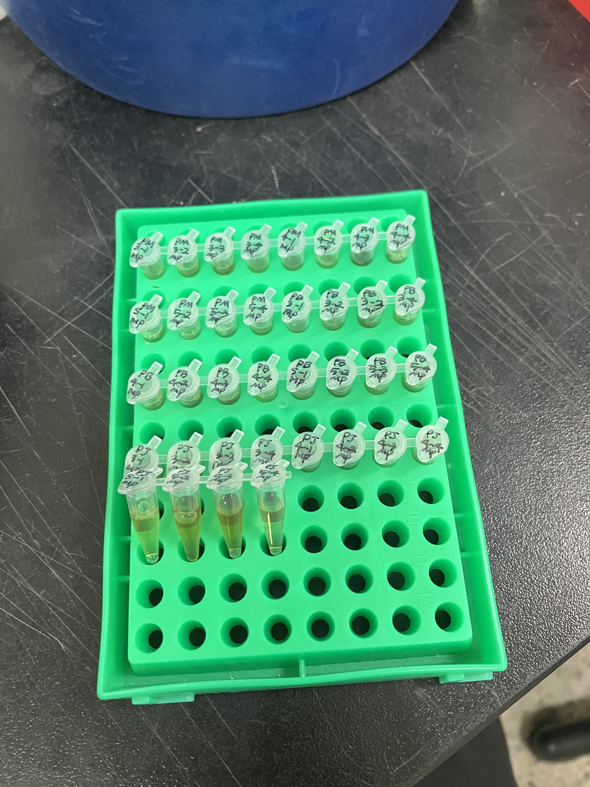

# Tomato Leaf Protein Extraction, P Generation (2026-06-24)

**Date:** 2026-06-24
**Material:** tomato leaves, 12 samples from the parent (P) generation
**Method:** mortar-and-pestle grinding in liquid nitrogen, detergent extraction buffer, NanoDrop A280
**Related logs:** 2026-05-28 (background, buffer and reference protocol); 2026-06-25 (RNA from the same samples)

---

## Samples

| Group | Description | Samples |
| :--- | :--- | :--- |
| `PM` | MES buffer control, P | `PM 3-1`, `PM 3-2`, `PM 3-3`, `PM 3-4` |
| `PJ` | Gyeongju soil, P | `PJ 4-1`, `PJ 4-2`, `PJ 4-3`, `PJ 4-4` |
| `PB` | Gijang B soil, P | `PB 5-1`, `PB 5-2`, `PB 5-3`, `PB 5-4` |

---

## Preparation

* **Consumables per sample:** 2 × 1.5 mL tubes, 1 PCR tube (plus extra PCR tubes for the pools).
* **Equipment:** mortars and pestles, metal spoons, liquid nitrogen (LN2) and ice buckets, vortex mixer, refrigerated centrifuge, NanoDrop.
* **Cleaning:** 70% ethanol and RNase ZAP for the bench, mortars, pestles and spoons.

## Reference protocol

Extraction buffer and procedure as in 2026-05-28 (300 µL buffer; 13,000 rpm, 4 °C, 20–30 min; 200 µL supernatant; normalize, aliquot 20 µL, store at −20 °C).

---

## Bench record and deviations

1. **Bench and tools**
   * Bench wiped with 70% ethanol and RNase ZAP.
   * Four mortar-and-pestle sets and metal spoons, cleaned with 70% ethanol and RNase ZAP.
   * Four buckets of LN2.

   

2. **Grinding**
   * Foil-wrapped leaf samples were taken from −20 °C and put directly into LN2.
   * Each sample was ground separately:
     * spoon chilled in LN2; mortar pre-chilled with LN2;
     * leaf unwrapped and ground with the pestle to a fine powder;
     * a labeled 1.5 mL tube was pre-chilled in LN2, emptied of LN2, and the powder was transferred with the cold spoon;
     * the tube was closed and returned to LN2.
   * Mortar, pestle and spoon were wiped with 70% ethanol between samples.

   

3. **Buffer addition (deviation)**
   * 12.0 mL of working buffer was prepared; DTT and protease inhibitor were added just before use.
   * Tubes were moved from LN2 to ice, with caps left slightly open so that pressure from the temperature change could escape.
   * 200 µL of working buffer was added to each tube while the powder was frozen (reference: 300 µL).

4. **Vortexing and centrifugation (deviation)**
   * Each sample was vortexed for more than 10 s and centrifuged at 13,000 rpm, 4 °C, 15 min.
   * The powder had not fully mixed with the buffer, so each sample was vortexed again for more than 10 s to resuspend the pellet and centrifuged at 13,000 rpm, 4 °C, 10 min.

5. **Second clearing spin**
   * 150 µL of supernatant was transferred to a new labeled 1.5 mL tube and centrifuged at 13,000 rpm, 4 °C, 5 min.

6. **Transfer and pooling**
   * 150 µL of the cleared supernatant was transferred to PCR tubes.
   * Pools for quantification: 30 µL from each of the four replicates of a group, 120 µL per pool:
     * `PM`: `PM 3-1` to `PM 3-4`;
     * `PJ`: `PJ 4-1` to `PJ 4-4`;
     * `PB`: `PB 5-1` to `PB 5-4`.

   

7. **Protein measurement (NanoDrop, A280)**
   * Pedestal cleaned with 70% ethanol; blank with 1 µL of the working buffer.
   * The three pools (`PM`, `PJ`, `PB`) were measured. The readings are not recorded in this log.

8. **Storage**
   * All tubes, individual samples and pools, were stored at −20 °C.

---

## Deviations from the reference protocol

| Step | Reference | This run |
| :--- | :--- | :--- |
| Buffer volume | 300 µL | 200 µL |
| Centrifugation | 13,000 rpm, 20–30 min | 15 min; vortexed again; 10 min; then 5 min after transfer |
| Quantification | each sample | pools of four replicates |
