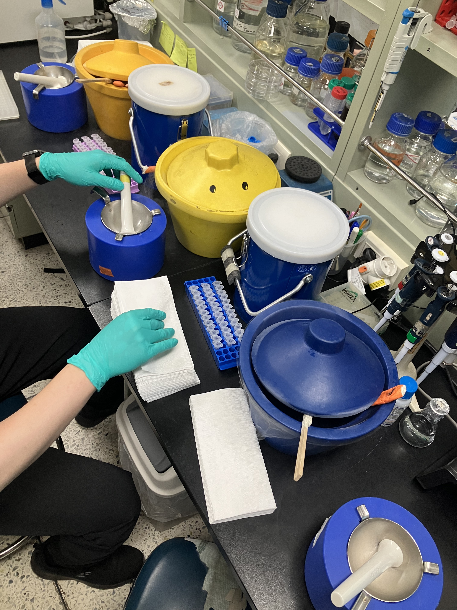
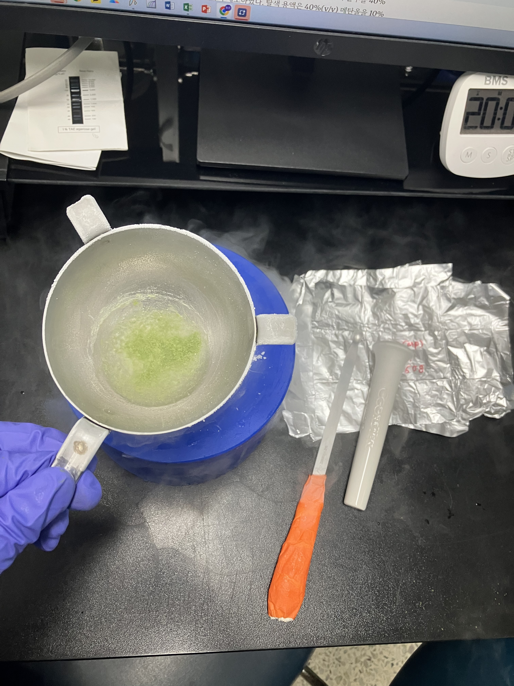

# Tomato Leaf RNA Extraction and DNase Treatment, P Generation (2026-06-25)

**Date:** 2026-06-25 (overnight steps on the following days)
**Material:** tomato leaves, 12 samples from the parent (P) generation
**Method:** mortar-and-pestle grinding in liquid nitrogen, TRIzol, TURBO DNase, PCI clean-up, ethanol precipitation
**Related logs:** 2026-05-29 (reference protocol); 2026-06-24 (protein from the same samples)

---

## Samples

| Group | Description | Samples |
| :--- | :--- | :--- |
| `PM` | MES buffer control, P | `PM 3-1` to `PM 3-4` |
| `PJ` | Gyeongju soil, P | `PJ 4-1` to `PJ 4-4` |
| `PB` | Gijang B soil, P | `PB 5-1` to `PB 5-4` |

---

## Preparation

* **Consumables per sample:** 1 × 2.0 mL tube, 3 × 1.5 mL tubes, 1 PCR tube; all DEPC-treated and autoclaved.
* **Equipment:** mortars and pestles, metal spoons, liquid nitrogen (LN2) and ice buckets, vortex mixer, refrigerated centrifuge, dry bath at 37 °C, clean bench.
* **Cleaning:** 70% ethanol and RNase ZAP for the bench, mortars, pestles and spoons.

## Reference protocol

TRIzol extraction and DNase treatment as in 2026-05-29.

---

## Bench record and deviations

1. **Bench and tubes**
   * Bench wiped with 70% ethanol and RNase ZAP.
   * 12 × 2.0 mL and 24 × 1.5 mL tubes labeled (`PM 3-1~4`, `PJ 4-1~4`, `PB 5-1~4`); all plasticware DEPC-treated and autoclaved.
   * Four mortar-and-pestle sets and spoons cleaned with 70% ethanol and RNase ZAP; buckets of LN2.

   

2. **Grinding**
   * As in 2026-06-24: foil-wrapped leaves from −20 °C into LN2; each sample ground separately in a pre-chilled mortar to a fine powder and transferred with a cold spoon into a pre-chilled 2.0 mL tube; tube closed and returned to LN2; tools wiped with 70% ethanol between samples.

   

3. **TRIzol lysis**
   * Tubes were moved from LN2 to ice, with caps left slightly open to let pressure escape.
   * 1.0 mL TRIzol per tube; vortexed; RT, 5 min.
   * Centrifuged at 13,000 rpm, 4 °C, 15 min.

4. **First supernatant (deviation)**
   * 850 µL of supernatant per sample was transferred to the first set of DEPC-treated 1.5 mL tubes (reference: ~1 mL).
   * RT, 5 min.

5. **Chloroform**
   * 200 µL chloroform per tube; mixed by inverting repeatedly; RT, 2 min.
   * The centrifugation after chloroform is not recorded separately.

6. **Aqueous phase**
   * A second set of 12 DEPC-treated 1.5 mL tubes was used.
   * After centrifugation there was a lower organic phase, a white interphase and a clear upper aqueous phase.
   * 500 µL of aqueous phase was taken per sample, from the top down with the tip in the centre of the tube, without disturbing the interphase or touching the tube wall.

7. **Isopropanol precipitation**
   * 500 µL isopropanol (1:1); mixed by inversion; RT, 5 min.
   * Centrifuged at 13,000 rpm, 4 °C, 15 min.

8. **Ethanol wash and overnight step**
   * Supernatant decanted; rims blotted on a clean wipe.
   * 1.0 mL of 75% ethanol (DEPC water) per tube; centrifuged at 13,000 rpm, 4 °C, 15 min.
   * The samples were then kept at −20 °C overnight.

9. **Pelleting after the overnight step**
   * Centrifuged at 13,000 rpm, 4 °C, 15 min.
   * Ethanol decanted carefully; rims blotted on a wipe.
   * Extra spin at 13,000 rpm, 4 °C, 2 min to collect the remaining ethanol at the bottom of the tube.

10. **Drying**
    * Tubes were moved to a clean bench; the remaining ethanol was removed with a fine tip.
    * Pellets were air-dried with open caps for 5 min at RT.

11. **Resuspension (deviation)**
    * 50 µL of autoclaved distilled water (DW, not DEPC-treated) per pellet, for the same reason as in 2026-05-29 (more stable NanoDrop baselines in this lab).
    * Kept at 4 °C, then dissolved by gentle pipetting.

12. **DNase reaction setup**
    * 25 µL of each RNA sample was transferred to a labeled PCR tube; the other 25 µL stayed in the original tube (two 25 µL aliquots per sample).
    * Master mix: 120 µL 10X reaction buffer + 80 µL TURBO DNase = 200 µL.
    * 5 µL of master mix was added to one 25 µL aliquot per sample (12 reactions of 30 µL) and mixed by slowly stirring with the tip.

13. **DNase digestion**
    * 37 °C for 30 min in a dry bath.

14. **PCI clean-up**
    * 270 µL DEPC water per tube (300 µL), then 300 µL PCI (600 µL).
    * PCI was taken from the lower (organic) phase of the reagent bottle; the tip was withdrawn slowly.
    * Mixed by inverting thoroughly; centrifuged at 13,000 rpm, 4 °C, 15 min.

15. **Ethanol precipitation (order as in 2026-05-29)**
    * A final set of 12 DEPC-treated 1.5 mL tubes, each with 500 µL absolute ethanol.
    * Salt–carrier mix: 800 µL 3 M sodium acetate (pH 5.2, RNA grade) + 40 µL glycogen (10 mg/mL) = 840 µL.
    * 200 µL of aqueous phase was transferred into the ethanol tubes (top-down, centre of the tube).
    * 21 µL of salt–carrier mix was added to each tube.

16. **Overnight precipitation**
    * Tubes were inverted repeatedly and stored at −20 °C overnight.

The log ends here. The remaining clean-up steps (reference steps 6–9 of the DNase section) are not recorded.

---

## Deviations from the reference protocol

| Step | Reference | This run |
| :--- | :--- | :--- |
| First supernatant | ~1 mL | 850 µL |
| Ethanol wash | ethanol added, −20 °C (2 h or overnight), then centrifuged | centrifuged, then −20 °C overnight, then centrifuged again |
| Resuspension | 50 µL DEPC water | 50 µL autoclaved DW |
| Precipitation after PCI | reagents added to the aqueous phase | aqueous phase added to ethanol, then salt–glycogen mix |
