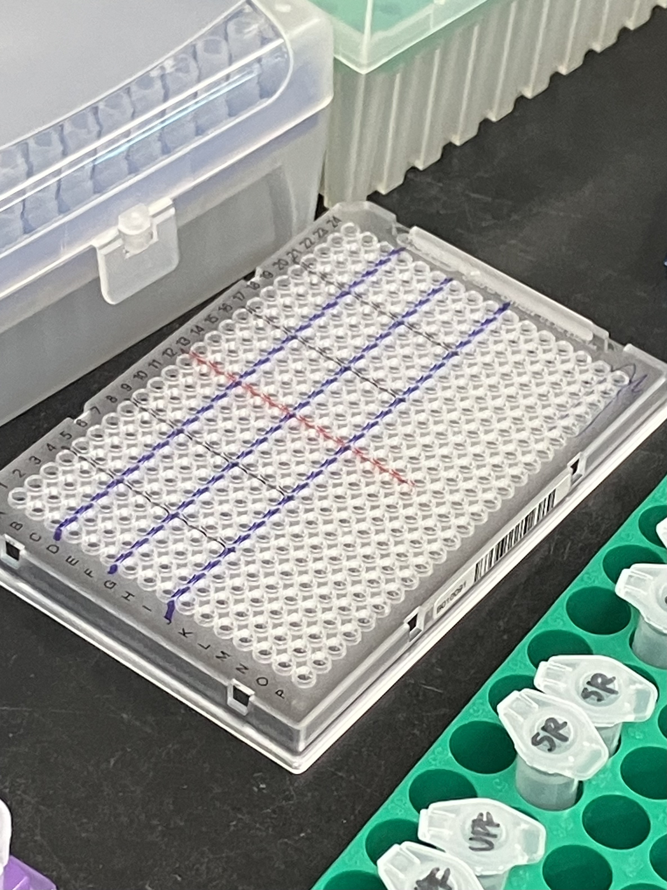
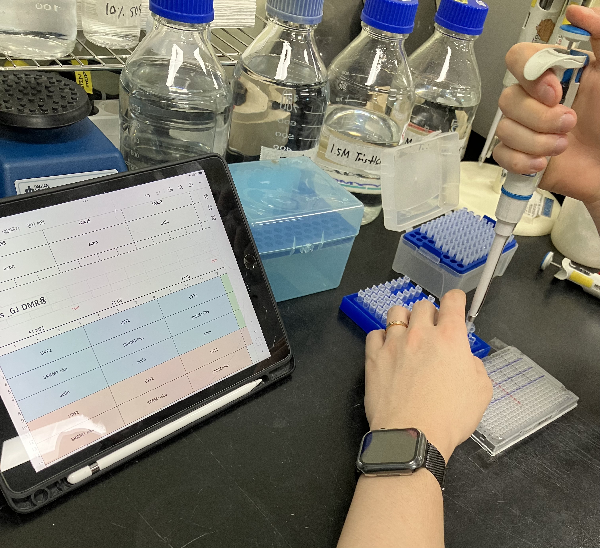
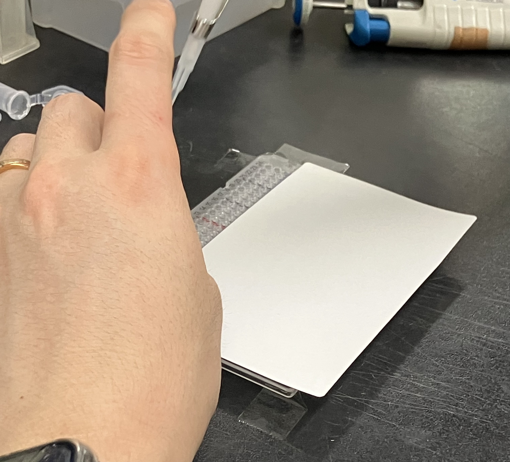
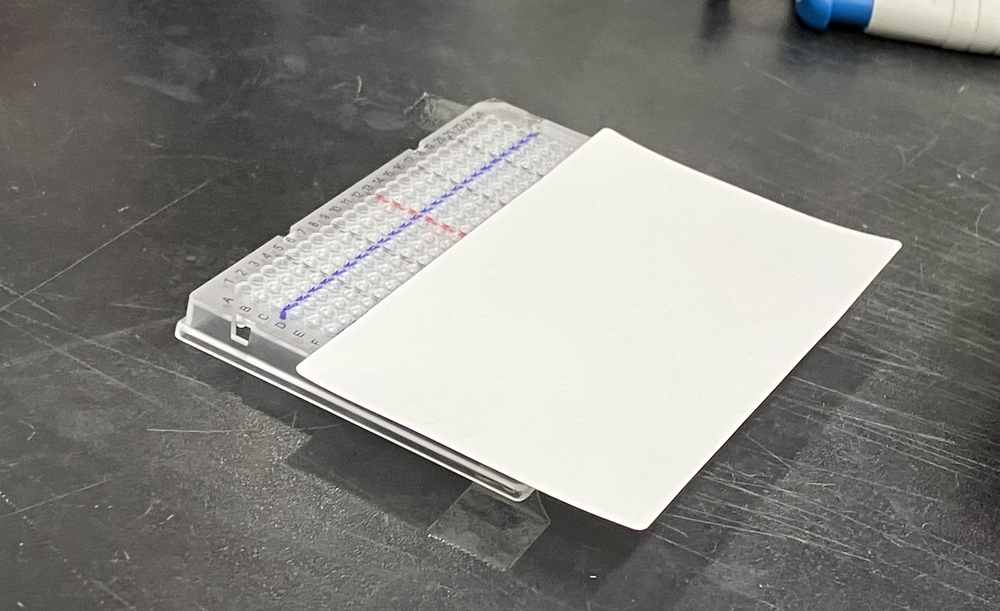
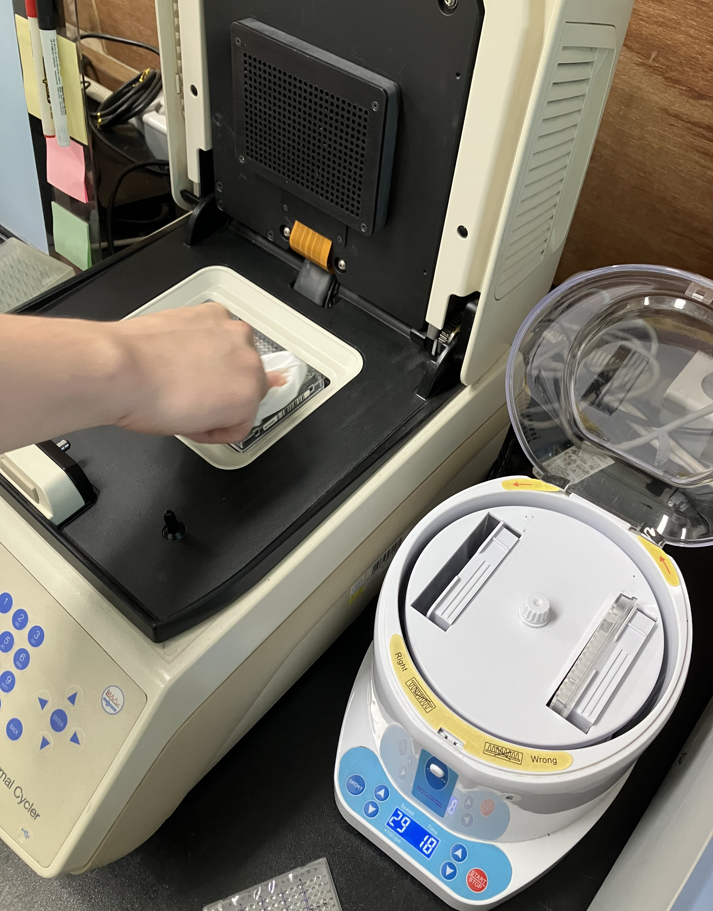
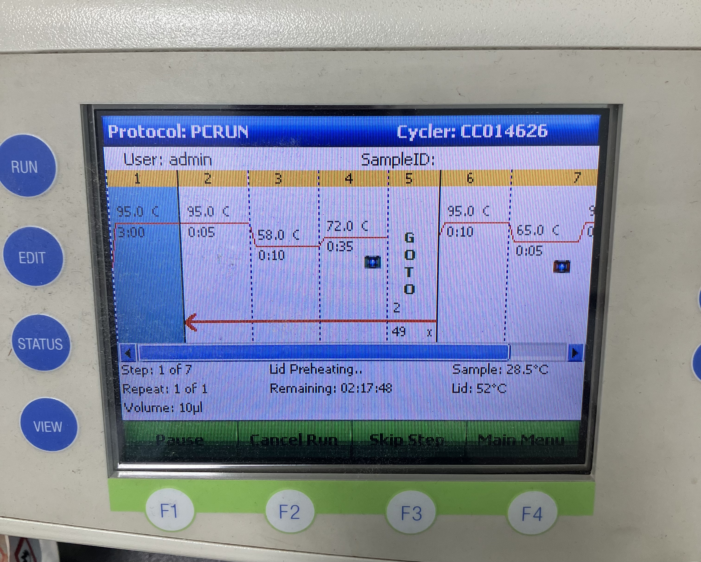
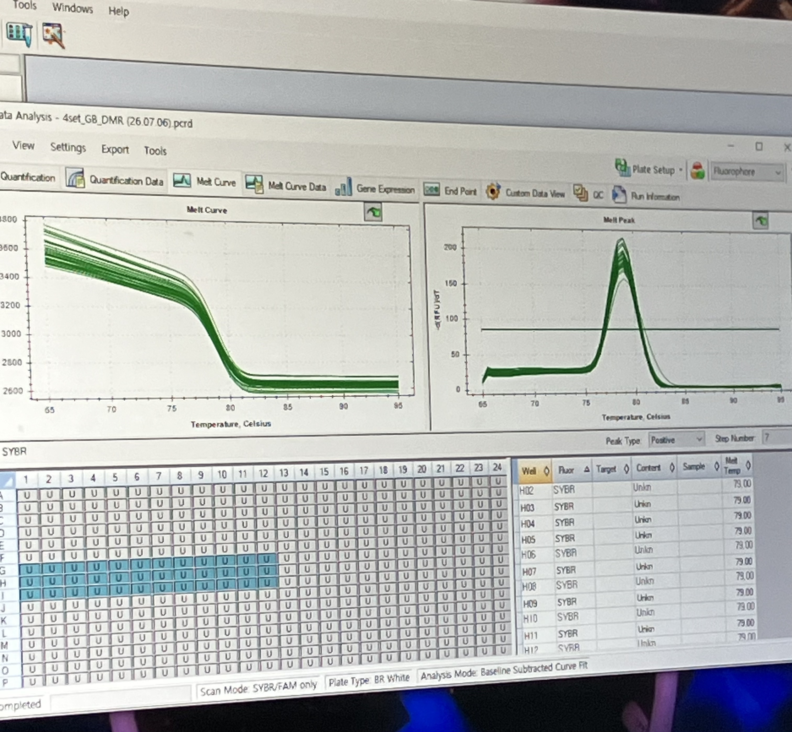

# Tomato F1 qPCR (2026-07-07)

**Date:** 2026-07-07
**Material:** DNA from leaves of 24 F1 plants (MES control, GB soil, GJ soil; sets 4 and 5, four plants each)
**Targets:** *UPF2*, *SRRM1-like*; reference gene *Actin*
**Format:** 384-well plate, SYBR Green, 10 µL reactions, three technical replicates per sample

---

## Background

F1 generation of the multi-generation soil experiment (design in 2026-05-28): the parents were treated with Gijang B (GB) or Gyeongju (GJ) soil or with MES buffer only.

## Samples

| Group | Set 4 | Set 5 |
| :--- | :--- | :--- |
| F1 MES (control) | 4-1, 4-2, 4-3, 4-4 | 5-1, 5-2, 5-3, 5-4 |
| F1 GB | 4-1, 4-2, 4-3, 4-4 | 5-1, 5-2, 5-3, 5-4 |
| F1 GJ | 4-1, 4-2, 4-3, 4-4 | 5-1, 5-2, 5-3, 5-4 |

The 24 DNA samples were stored at −20 °C in 0.2 mL PCR tubes.

---

## Preparation

* **Template:** the 24 F1 DNA samples.
* **Primers:** forward and reverse primers for *UPF2*, *SRRM1-like* and *Actin*, 10 pmol stocks.
* **Plate:** one 384-well qPCR plate, marked with a fine permanent marker into a 3 × 6 grid of blocks.
* **Tubes:** 6 × 1.5 mL tubes for master mixes (one per gene and set).
* **Other:** tape to fix the plate to the bench; adhesive sealing film to cover finished rows during loading.

---

## Reference protocol

Reaction (1X) and master mix for 40 reactions (40X, including replicates and extra volume):

| Component | Stock | 1X | 40X |
| :--- | :---: | :---: | :---: |
| Template DNA | 50 ng/µL | 2.0 µL | — |
| Forward primer | 5 pmol | 1.0 µL | 40.0 µL |
| Reverse primer | 5 pmol | 1.0 µL | 40.0 µL |
| SYBR Green master mix | — | 5.0 µL | 200.0 µL |
| Distilled water (DW) | — | 1.0 µL | 40.0 µL |
| **Master mix subtotal** | — | **8.0 µL** | **320.0 µL** |
| **Total reaction** | — | **10.0 µL** | — |

The master mix (8.0 µL per well) is prepared in bulk, mixed by vortexing, and dispensed into the plate before the template (2.0 µL per well) is added.

---

## Plate layout

Each block is 3 rows (technical replicates) × 4 columns (biological replicates). Rows A–I and all 24 columns are used (216 wells).

| Rows | Columns 1–12 (set 4) | Columns 13–24 (set 5) |
| :--- | :--- | :--- |
| A–C: *UPF2* | 1–4 MES, 5–8 GB, 9–12 GJ (4-1 to 4-4) | 13–16 MES, 17–20 GB, 21–24 GJ (5-1 to 5-4) |
| D–F: *SRRM1-like* | 1–4 MES, 5–8 GB, 9–12 GJ | 13–16 MES, 17–20 GB, 21–24 GJ |
| G–I: *Actin* | 1–4 MES, 5–8 GB, 9–12 GJ | 13–16 MES, 17–20 GB, 21–24 GJ |

The plate map does not include no-template controls.

---

## Bench record and deviations

1. **Bench**
   * Bench, pipettes and equipment wiped with 70% ethanol to remove nucleic acids and amplicons.

2. **Plate marking**
   * The 384-well plate (16 rows × 24 columns) was divided with a fine marker into a 3 × 6 grid matching the layout above, to reduce loading errors.

   

3. **Primer–water mixes (deviation)**
   * Primer and water tubes were vortexed before use.
   * Per tube: 40.0 µL forward primer + 40.0 µL reverse primer + 40.0 µL DW; six tubes in total (one per gene and set).
   * Deviation: primer stocks of 10 pmol were used instead of the 5 pmol in the reference protocol, with the same volumes, to improve amplification.

4. **SYBR Green master mix**
   * SYBR Green master mix was added last to limit its exposure to light: 200.0 µL per tube (320.0 µL per tube in total).
   * Tubes were vortexed and kept in the dark until loading.

5. **Fixing the plate**
   * The plate was taped to the bench so that it would not move during manual pipetting.

6. **Template loading**
   * 2.0 µL of template DNA per well, following the plate map. The tip touched the same position on the well wall for every well.

   

7. **Master mix loading (order changed)**
   * 8.0 µL of master mix per well, row tier by row tier from the bottom up: rows G–I (*Actin*), then D–F (*SRRM1-like*), then A–C (*UPF2*).
   * After each tier was loaded, it was covered with adhesive sealing film to protect the SYBR Green from light while the next tier was loaded.
   * The master mix was placed on the well wall opposite the template droplet, so that the two mixed only at the spin-down. This was intended to limit polymerase activity before cycling.
   * In the reference protocol, the master mix goes into the plate before the template.

   

   

8. **Sealing**
   * The whole plate was covered with optical sealing film and pressed down by hand and with a tissue over every well, to prevent evaporation and cross-contamination during cycling.

9. **Spin-down**
   * The seal was checked; the plate was centrifuged briefly to bring the template and master mix droplets together at the bottom of the wells and remove air bubbles.

10. **Cleaning the film**
    * The top of the sealing film was wiped with 70% ethanol and a clean tissue to remove fingerprints and dust before loading.

    

11. **Run**
    * Protocol `PCRRUN` (user profile `admin`), reaction volume set to 10 µL.
    * Initial denaturation: 95.0 °C, 3:00 min.
    * 50 cycles: 95.0 °C for 5 s, 58.0 °C for 10 s, 72.0 °C for 35 s with a plate read.
    * Melt curve: 95.0 °C for 10 s, 65.0 °C for 5 s, then a ramp to 95.0 °C with continuous reading.

    

12. **Data export and replicate check**
    * Ct values were exported to Excel.
    * Rule for technical replicates: if the three wells of a sample showed irregular amplification curves, baseline shifts or outlying values, all three wells of that sample were excluded. Single wells were not removed on their own.

    

13. **Relative quantification (2^−ΔΔCt)**
    * Mean Ct of the retained technical replicates per sample.
    * ΔCt = Ct(target) − Ct(*Actin*), per sample.
    * ΔΔCt = ΔCt(F1 GB or F1 GJ) − ΔCt(F1 MES).
    * Fold change = 2^−ΔΔCt.

Ct values, excluded samples and fold changes are not included in this log.

---

## Deviations from the reference protocol

| Step | Reference | This run |
| :--- | :--- | :--- |
| Primer stocks | 5 pmol | 10 pmol (same volumes) |
| Loading order | master mix first, then template | template first, then master mix on the opposite well wall |
