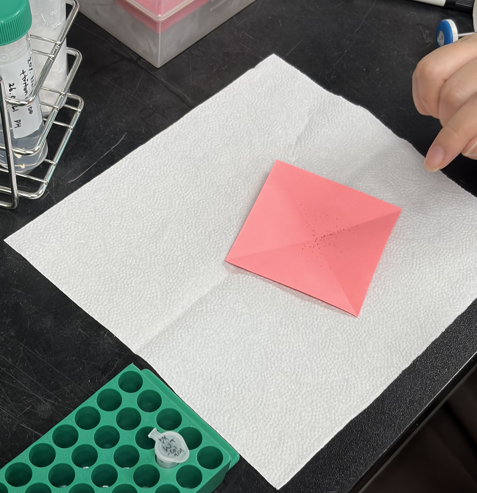

# Arabidopsis Seed Sterilization and Stratification for Infection Assays (2026-07-21)

**Date:** 2026-07-21 (stratification until 2026-07-24)
**Material:** *Arabidopsis thaliana* Col-0 seeds from the bulk stock
**Plan:** 3 trays × 12 cells (36 cells) × 10 seeds = 360 seeds; about 150 seeds in each of 3 tubes (about 450 in total) to allow for losses and for discarded floating seeds
**Next step:** sowing on 2026-07-24

---

## Preparation

* **Consumables:** 3 autoclaved 1.5 mL tubes, 1 sterile 50 mL Falcon tube, glassine paper, white napkins.
* **Reagents:** Col-0 seeds (bulk stock), sodium hypochlorite (NaClO), triple-distilled water (3DW), Triton X-100.

---

## Reference protocol

### 1. Sterilization solution (30 mL)

| Component | Stock | Volume | Final | Role |
| :--- | :---: | :---: | :---: | :--- |
| NaClO | undiluted stock | 6.0 mL | 20% (v/v) | disinfectant |
| 3DW | — | 24.0 mL | 80% (v/v) | diluent |
| Triton X-100 | pure | 1–2 drops (~30 µL) | ~0.1% (v/v) | wetting agent |
| **Total** | — | **30.0 mL** | — | — |

### 2. Sterilization and stratification

1. Put about 150 seeds into an autoclaved 1.5 mL tube, pouring them from folded glassine paper over a white napkin.
2. Add 1.0 mL of 20% NaClO, vortex briefly, pulse-spin, and leave at room temperature (RT) for exactly 1 min.
3. Remove the solution immediately and discard floating seeds.
4. Wash at least 3 times with 1.0 mL sterile 3DW (vortex, stand 1 min, pulse-spin, remove the liquid). No chlorine smell should remain.
5. Resuspend the seeds in 1.0 mL sterile 3DW and keep at 4 °C in the dark for 3 days (72 h).

---

## Bench record and deviations

1. **Seed stock (deviation)**
   * Col-0 seeds were taken from the bulk stock.
   * The bulk stock is kept at room temperature in a 50 mL Falcon tube because of its volume. Seeds should be stored at 4 °C; small working aliquots for treatments must be kept at 4 °C.

2. **Materials**
   * Three autoclaved 1.5 mL tubes and one sterile 50 mL Falcon tube; NaClO, 3DW and Triton X-100.

3. **Sterilization solution**
   * In the Falcon tube: 6 mL NaClO + 24 mL 3DW (1:4, 20% v/v) + 1–2 drops Triton X-100; vortexed.
   * Triton X-100 lowers the surface tension so that the solution wets the seed coat completely.
   * Labeled "20% NaClO + Triton X-100 2026.07.21. DH".

4. **Seed aliquots**
   * 120 seeds are needed per tray (12 cells × 10 seeds); about 150 seeds were put into each of the three tubes to allow for losses.
   * The seeds were poured through a diagonally folded glassine paper into the tube. The white napkin underneath gives contrast and catches spilled seeds; without it, seeds that jump away (for example from static) are easily lost, which matters for lines with few seeds.
   * The number of seeds was estimated by eye (about 150 per tube), because wild-type seed is plentiful. Seeds of treatment lines with limited stock must be counted exactly before sterilization.

   

5. **Sterilization**
   * 1.0 mL of the sterilization solution per tube; brief vortex and pulse-spin to wet and submerge the seeds.
   * Exactly 1 min, to sterilize the surface without harming the embryo.

6. **Removing the solution and floating seeds**
   * The solution was removed with a pipette immediately after 1 min.
   * Floating seeds were removed with it on purpose; they are often light or damaged and germinate poorly.
   * The tip was positioned so that the settled seeds were not disturbed or taken up.

7. **Washing**
   * Three washes: 1.0 mL sterile 3DW, brief vortex, 1 min at RT, gentle pulse-spin, liquid removed.

8. **Chlorine check**
   * After the third wash the seeds were checked by smell; no chlorine smell remained, so three washes were enough in this run. More washes are needed if a chlorine smell remains.

9. **Stratification**
   * 1.0 mL sterile 3DW per tube; tubes kept at 4 °C in the dark for 3 days (72 h) to break dormancy and synchronize germination.
