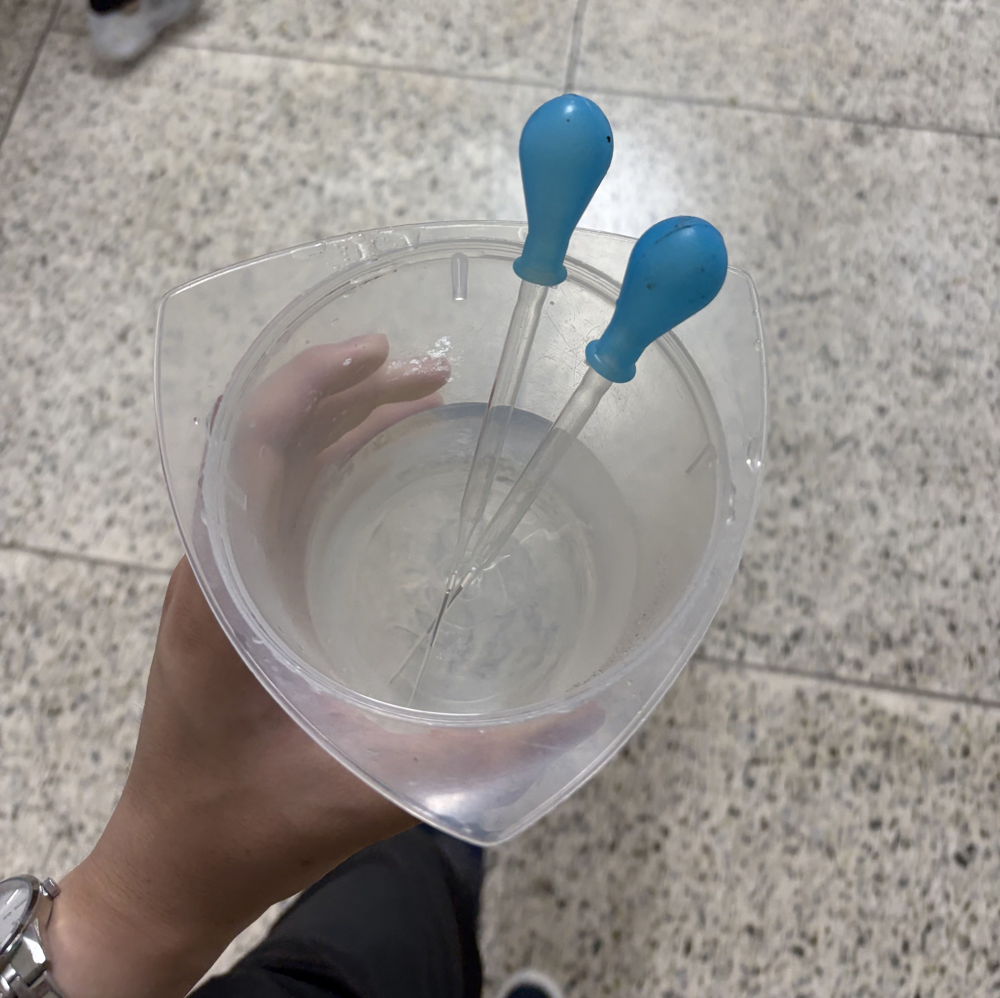
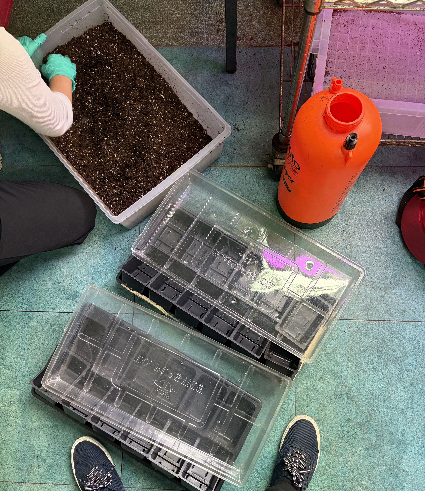
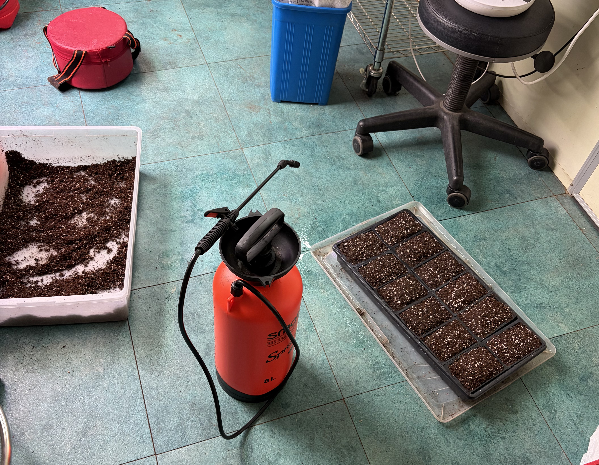
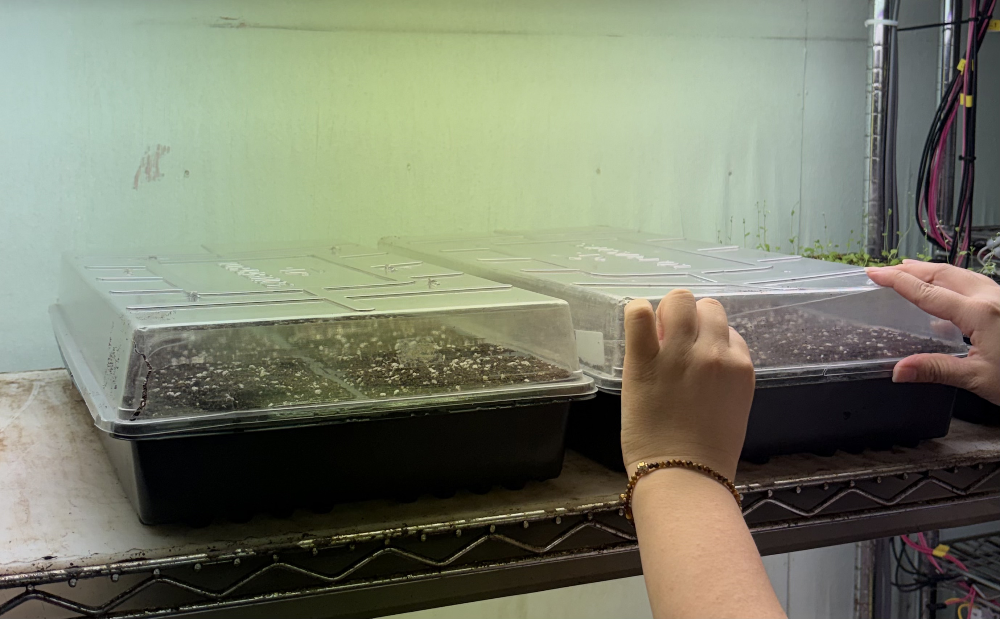

# Arabidopsis Sowing (2026-07-24)

**Date:** 2026-07-24
**Material:** stratified *Arabidopsis thaliana* Col-0 seeds (2026-07-21)
**Layout:** 2 trays × 12 cells, 12 seeds per cell in a 3 × 4 grid (288 seeds)
**Growth:** growth chamber, 12 h light / 12 h dark; perforated transparent domes for the first 7 days

Note: the seeds were prepared on 2026-07-21 for 3 trays with 10 seeds per cell; 2 trays with 12 seeds per cell were sown.

---

## Preparation

* **Consumables:** two 12-cell trays with base trays and perforated transparent domes, glass Pasteur pipettes, a plastic mixing container, a fine sprayer, fine forceps.
* **Reagents:** Col-0 seeds, 70% ethanol, sodium hypochlorite (NaOCl), triple-distilled water (3DW), single-distilled water (1DW), dry potting soil.

---

## Reference protocol

1. **Stratification:** sterilized seeds in 1.0 mL sterile 3DW, 4 °C in the dark for 72 h.
2. **Sowing pipette:** break off the tip of a glass Pasteur pipette to widen the opening; rinse with sterile 3DW to remove glass fragments.
3. **Soil:** mix the soil with 1DW until damp and crumbly. Fill NaOCl-cleaned 12-cell trays loosely, without pressing, leaving a mound in the centre of each cell.
4. **Watering:** mist the trays with 1DW until the mounds settle flat and the soil is saturated.
5. **Sowing:** sow 12 seeds per cell in a 3 × 4 grid with the modified pipette; separate clumped seeds with fine forceps.
6. **Growth:** cover the trays with perforated domes and place them in a growth chamber (12 h light / 12 h dark). After 7 days, remove the domes and start bottom watering.

---

## Bench record

1. **Stratification**
   * After sterilization (2026-07-21), each tube of seeds was covered with 1.0 mL sterile 3DW and kept at 4 °C in the dark for 72 h.

2. **Sowing pipette and trays**
   * The stratified seeds were taken from 4 °C after 72 h.
   * The narrow tip of a glass Pasteur pipette was broken off so that seeds pass through without sticking or clogging; the pipette was rinsed with sterile 3DW to remove glass fragments and wet the inside.
   * Two 12-cell trays (24 cells) were set out.

   

3. **Soil**
   * A large plastic container was cleaned with 70% ethanol.
   * Dry soil was mixed with 1DW to a damp, crumbly consistency. Arabidopsis soil was kept drier than soil for tomato, to avoid compaction.

4. **Filling the trays**
   * The NaOCl-cleaned trays were filled loosely with soil, without pressing, to keep the soil aerated.
   * The soil in each cell was shaped into a slight mound in the centre so that water would not pool.

   

5. **Watering before sowing**
   * The trays were placed in the base tray and misted with 1DW using a fine sprayer.
   * Misting let the loose soil settle and flattened the mounds into even seed beds; it was continued until the soil was saturated.

   

6. **Sowing**
   * The seed suspension was drawn into the modified pipette, and seeds were released one at a time with gentle pressure pulses.
   * 12 seeds per cell were placed in a 3 × 4 grid so that seedlings would not shade or crowd each other.
   * Where liquid released several seeds at once, the seeds were moved into place with fine forceps.

7. **Domes**
   * The trays were covered with perforated transparent domes to keep the humidity high and stop the young seedlings from drying out.

8. **Growth chamber**
   * The covered trays were placed in a growth chamber with 12 h light / 12 h dark and checked daily for germination and seedling growth.
   * Plan: domes stay on for 7 days; then they are removed and bottom watering starts.

   
