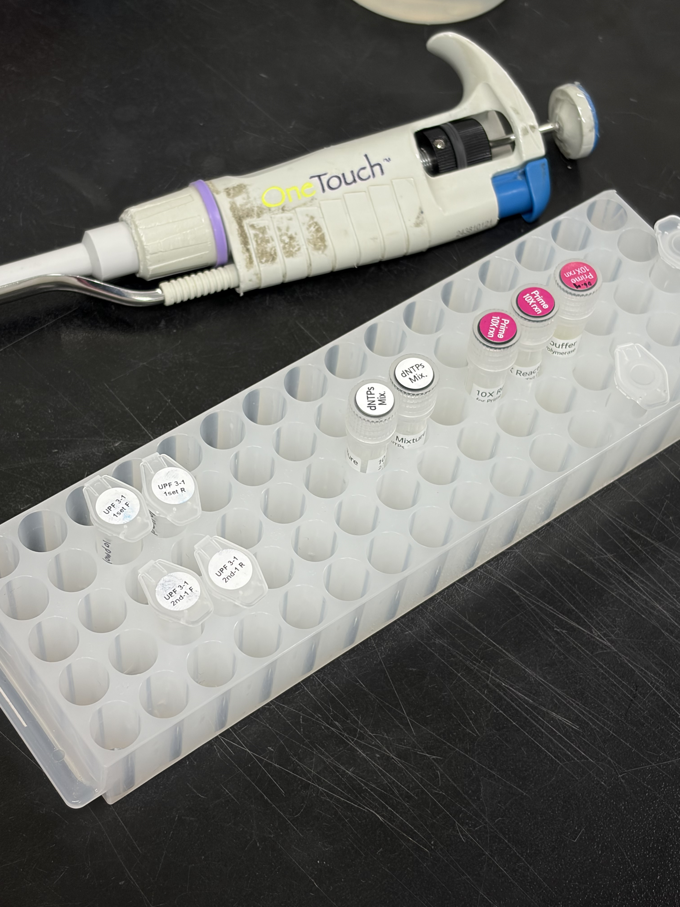
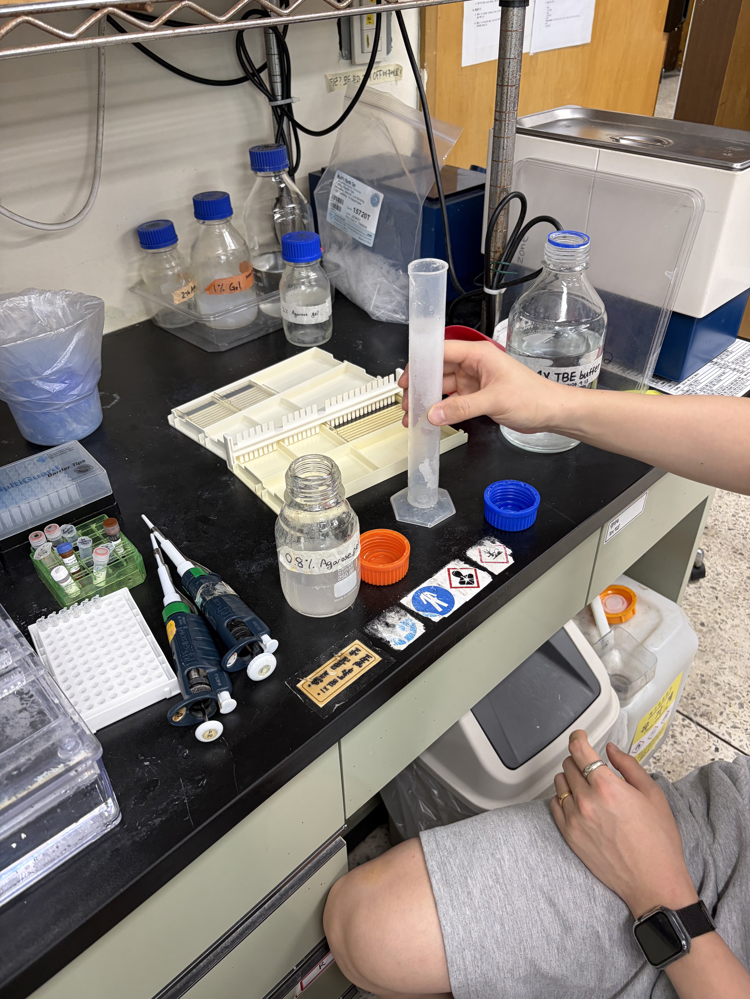
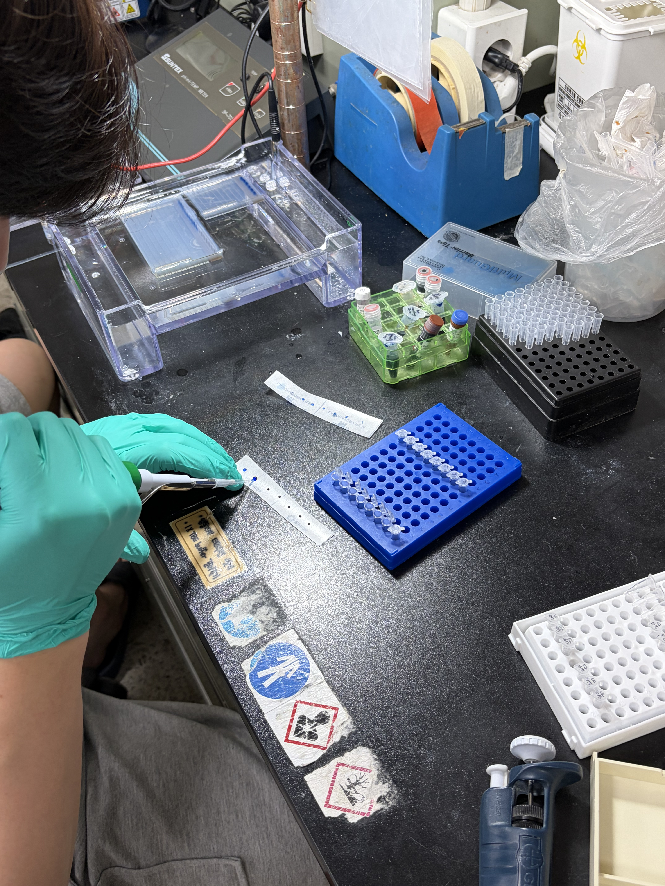
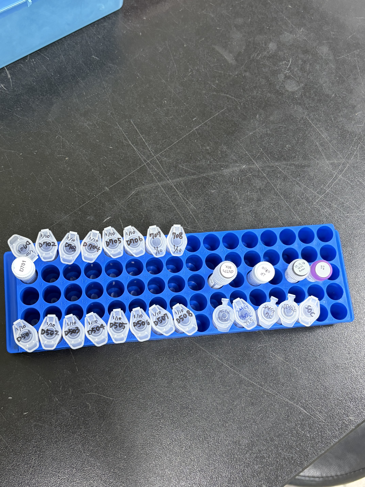
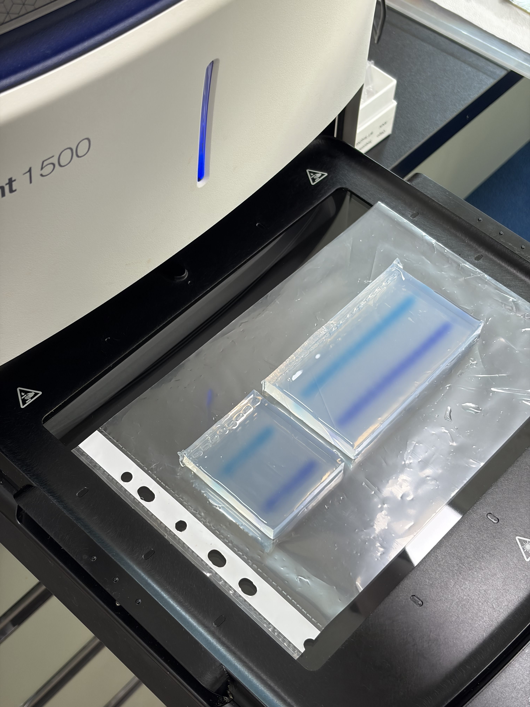
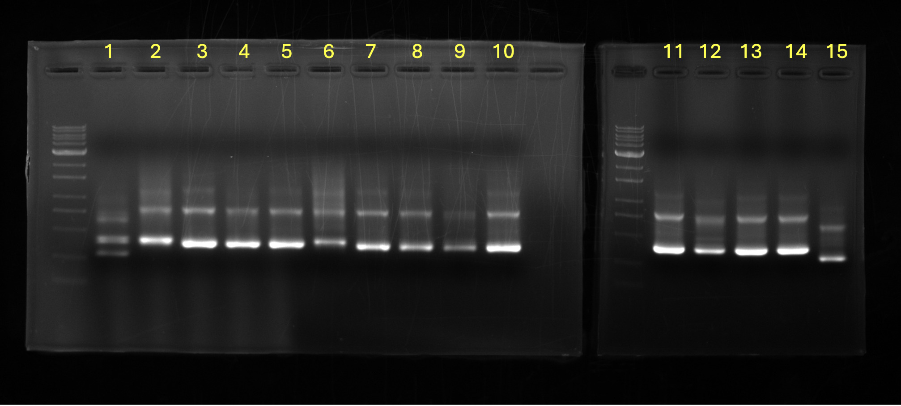

# *SlUPF3a* Knockout Candidates in Micro-Tom: DNA Extraction and Amplicon Library PCR (2026-07-28)

**Date:** 2026-07-28 (DNA precipitation overnight; PCR, gels and gel extraction on the following days)
**Material:** leaves of 15 candidate *SlUPF3a* knockout lines of *Solanum lycopersicum* cv. Micro-Tom (samples 1–15)
**Steps:** CTAB DNA extraction → 1st PCR (target locus) → 2nd PCR (nested) → 3rd PCR (dual indexes) → gel extraction → NanoDrop
**Result:** 15 indexed amplicons, 3.5–106.2 ng/µL (Section "Results")

---

## Background

*SlUPF3a* knockout mutants have been studied in tomato cv. Money Maker. Here, 15 independent candidate *SlUPF3a* knockout lines in the dwarf cultivar Micro-Tom, grown in a growth chamber, were prepared for amplicon deep sequencing of the target site, to characterize the mutations and editing in each line.

---

## Preparation

* **Consumables per sample:** 2 × 1.5 mL tubes (lysis; precipitation), 2 × 2.0 mL tubes (two PCI extractions), 3 PCR strip tubes (1st, 2nd and 3rd PCR), 1 silica gel-extraction column.
* **Equipment:** dry bath (65 °C for lysis; 50 °C for dissolving gel slices), motorized handheld drill with autoclaved tips, thermocycler, electrophoresis system and gel casting tray, iBright 1500 imaging system, UV transilluminator and UV-protective glasses, NanoDrop.

---

## Reference protocols

### 1. Genomic DNA extraction (CTAB)

As in 2026-06-18 (steps 1–14): 1 mL CTAB buffer + 5 µL β-mercaptoethanol; 65 °C for 1 h with inversion every 10 min; 13,000 rpm, 4 °C, 10 min; 700 µL supernatant + 700 µL PCI, 13,000 rpm, 10 min; 500 µL aqueous phase + 500 µL PCI, 12,000 rpm, 10 min; 450 µL aqueous phase + 450 µL isopropanol; −20 °C overnight.

### 2. Ethanol wash and resuspension

1. Centrifuge the overnight precipitation at 13,000 rpm, 4 °C, 10 min.
2. Decant, blot the rims of the inverted tubes on a clean wipe, and add 1 mL of 70% ethanol.
3. Centrifuge at 13,000 rpm, 4 °C, 1 min.
4. Decant, add another 1 mL of 70% ethanol, and centrifuge at 13,000 rpm, 4 °C, 1 min.
5. Decant and spin again at 13,000 rpm, 4 °C, 1 min to collect the remaining ethanol.
6. In a clean bench, remove the remaining ethanol with a pipette without touching the pellet.
7. Air-dry with open caps for 5 min at room temperature (RT).
8. Dissolve the DNA in 40 µL sterile distilled water (DW) and store at 4 °C.

### 3. PCR mix (per reaction)

| Component | Note | Volume (µL) |
| :--- | :--- | ---: |
| Genomic DNA (or previous PCR product) | template | 2.00 |
| dNTP mix | — | 2.00 |
| Reaction buffer | 10X Prime Rxn buffer | 2.00 |
| Forward primer | working stock | 1.00 |
| Reverse primer | working stock | 1.00 |
| Taq DNA polymerase | recombinant Taq | 0.25 |
| Water | triple-distilled water (3DW) | 11.75 |
| **Total** | — | **20.00** |

### 4. Cycling

| Stage | Temperature | Time | Cycles |
| :--- | :--- | :--- | :--- |
| Initial denaturation | 95 °C | 5 min | 1 |
| Denaturation | 95 °C | 30 s | 30 |
| Annealing | 58 °C | 1 min | |
| Extension | 72 °C | 30 s | |
| Final extension | 72 °C | 5 min | 1 |
| Hold | 12 °C | ∞ | 1 |

### 5. 0.8% agarose gel

1. Dissolve 0.8 g agarose in 100 mL 1X TBE (0.8% w/v) in the microwave until clear.
2. Cool to about 50–55 °C, add 5 µL nucleic acid gel stain and swirl gently without making bubbles.
3. Pour into the casting tray, insert the comb, remove bubbles with a pipette tip, cover, and let set at RT.
4. Place the gel in the tank and add 1X TBE until it is just above the gel surface.
5. Mix samples with 6X loading dye at 5:1 (10 µL + 2 µL for analytical gels; 20 µL + 4 µL for preparative gels).
6. Load 5 µL DNA ladder in the leftmost lane and the samples in the other lanes.
7. Run at 100 V for 40 min.

### 6. Gel extraction (silica column)

1. Cut the target band out of the gel with a clean scalpel and put the slice into a sterile 1.5 mL tube.
2. Add 350 µL Gel Dissolving Buffer (GDB).
3. Incubate at 50 °C for 10 min, inverting every 2 min, until the gel has dissolved.
4. Add 110 µL isopropanol (about 1/3 of the GDB volume) and mix by inversion.
5. Load the mixture (about 500 µL) onto a silica column in a collection tube.
6. Centrifuge at 13,000 rpm, 4 °C, 1 min; discard the flow-through.
7. Add 700 µL Wash Buffer (NSW); centrifuge at 13,000 rpm, 4 °C, 1 min.
8. Discard the flow-through; dry spin at 13,000 rpm, 4 °C, 1 min.
9. Air-dry the column for 5 min at RT.
10. Move the column to a new 1.5 mL tube, add 12 µL sterile DW to the centre of the membrane, and wait 2 min at RT.
11. Centrifuge at 13,000 rpm, 4 °C, 1 min; measure the concentration and purity (NanoDrop).

---

## Bench record and deviations

### DNA extraction

1. **Tubes**
   * 30 × 1.5 mL tubes (15 for lysis, 15 for the isopropanol precipitation) and 30 × 2.0 mL tubes (15 each for the two PCI extractions), autoclaved and labeled 1–15.
   * Dry bath set to 65 °C.

2. **Lysis buffer and grinding (deviations)**
   * Fresh leaf tissue of samples 1–15 was put into the 1.5 mL tubes.
   * 200 µL 2X CTAB buffer was added before grinding (reference: 1 mL; 300 µL in 2026-06-18), to limit splashing and overflow during drilling.
   * β-mercaptoethanol was not added in this run.
   * The tissue was ground in the tube with the drill and an autoclaved tip, in short bursts to avoid heating the lysate. The tip was wiped with 70% ethanol between samples.
   * 800 µL 2X CTAB buffer was added after grinding (1 mL in total) and the tubes were vortexed.

3. **Lysis and first centrifugation**
   * 65 °C for 1 h; tubes inverted 10 times every 10 min.
   * Centrifuged at 13,000 rpm, 4 °C, 10 min.

4. **First PCI extraction**
   * 700 µL of supernatant to the first set of 2.0 mL tubes; 700 µL PCI (1:1); inverted 10 times; centrifuged at 13,000 rpm, 4 °C, 10 min.

5. **Second PCI extraction and precipitation**
   * 500 µL of the aqueous phase to the second set of 2.0 mL tubes; 500 µL PCI; inverted 10 times; centrifuged at 12,000 rpm, 4 °C, 10 min.
   * 450 µL of the aqueous phase to the final set of 1.5 mL tubes; 450 µL isopropanol (1:1); mixed by inversion.
   * −20 °C overnight.

6. **Pelleting and first wash (deviation)**
   * Centrifuged at 13,000 rpm, 4 °C, 10 min. The isopropanol was decanted into a waste container and the rims were blotted on clean napkins.
   * 1.0 mL of 70% ethanol per tube.
   * After a brief first spin and a visual check, the tubes were centrifuged for another 3 min at 13,000 rpm, 4 °C (reference: 1 min in total), to compact the pellets so that they would not be lost when decanting.

7. **Second wash and dry spin (deviations)**
   * Ethanol decanted and rims blotted; another 1.0 mL of 70% ethanol.
   * Centrifuged at 13,000 rpm, 4 °C, 3 min (reference: 1 min).
   * Ethanol decanted and rims blotted; dry spin of the empty tubes at 13,000 rpm, 4 °C, 3 min (reference: 1 min) to collect the ethanol from the walls.

8. **Drying and resuspension**
   * In a clean bench, the remaining ethanol was removed with a P100 pipette set to 100 µL, without touching the white pellet. Where the pellet was transparent or not visible, the side of the tube where the pellet forms during centrifugation was avoided.
   * Air-dried with open caps for 5 min at RT, without over-drying (over-dried DNA is hard to dissolve).
   * 40 µL DW per tube; tubes closed and stored at 4 °C.

### 1st PCR (target locus)

9. **Master mix**
   * PCR strip tubes labeled 1–15.
   * Master mix for 17 reactions in a 1.5 mL tube labeled "1st PCR mixture": 34.00 µL dNTP mix, 34.00 µL 10X reaction buffer, 17.00 µL forward primer (UPF 3-1 1set F), 17.00 µL reverse primer (UPF 3-1 1set R), 199.75 µL 3DW (per reaction: 2.00, 2.00, 1.00, 1.00 and 11.75 µL).
   * The mix was vortexed. Taq polymerase was taken from −20 °C onto a cold block, and 4.25 µL (0.25 µL per reaction) was added and mixed gently with a P100 pipette without making bubbles.

   

10. **Template loading and cycling**
    * 2.00 µL genomic DNA (from 4 °C) was placed at the same height on the inner wall of each tube. A droplet on the wall shows at a glance which tubes already have template.
    * 18.00 µL of "1st PCR mixture" was dispensed onto the droplet, washing it down to the bottom of the tube.
    * Brief spin to collect the liquid and remove bubbles (20.00 µL), then cycling as in reference section 4.

11. **Gel**
    * 0.80 g agarose in 100 mL 1X TBE; microwaved about 4 min until boiling and fully clear.
    * Cooled at RT for at least 15 min (to about 50–55 °C); 5.00 µL gel stain added and swirled without making bubbles.
    * Poured, comb inserted, bubbles removed with a clean tip; covered with a clean napkin against dust while setting.

    

12. **Tank**
    * Tank filled with 1X TBE to just above the gel surface.

13. **Loading**
    * On Parafilm, 2.00 µL 6X loading dye was mixed with 10.00 µL PCR product (12.00 µL), and the mixture was loaded.
    * 5.00 µL DNA ladder in the leftmost lane of each gel.

    

14. **Run**
    * 100 V for 40 min.

### 2nd PCR (nested)

15. **Master mix, template and cycling**
    * New PCR strip tubes labeled 1–15.
    * Master mix for 17 reactions ("2nd PCR mixture"): 34.00 µL dNTP mix, 34.00 µL 10X reaction buffer, 17.00 µL forward primer (UPF 3-1 2nd-1 F), 17.00 µL reverse primer (UPF 3-1 2nd-1 R), 199.75 µL 3DW, and 4.25 µL Taq polymerase (kept on ice), mixed gently by pipetting.
    * 2.00 µL of unpurified 1st PCR product was placed on the upper wall of each tube, and 18.00 µL of master mix was dispensed onto it.
    * Brief spin; cycling as in reference section 4.

16. **Gel**
    * 0.8% gel as in step 11; 10.00 µL of each 2nd PCR product with 2.00 µL loading dye (samples 1–15); 5.00 µL ladder in the leftmost lane; 100 V for 40 min.

### 3rd PCR (dual indexes)

17. **Core master mix without primers**
    * For 17 reactions: 34.00 µL dNTP mix, 34.00 µL 10X reaction buffer, 199.75 µL 3DW; vortexed; 4.25 µL Taq polymerase (kept on ice) added and mixed gently by pipetting.

18. **Index layout and loading**

    | Row index / column index | D501 | D502 | D503 | D504 | D505 | D506 | D507 | D508 |
    | :--- | :--- | :--- | :--- | :--- | :--- | :--- | :--- | :--- |
    | **D701** | Sample 1 | Sample 2 | Sample 3 | Sample 4 | Sample 5 | Sample 6 | Sample 7 | Sample 8 |
    | **D702** | Sample 9 | Sample 10 | Sample 11 | Sample 12 | Sample 13 | Sample 14 | Sample 15 | empty |

    * 2.00 µL of unpurified 2nd PCR product on the upper inner wall of each tube.
    * 16.00 µL of core master mix per tube.
    * 1.00 µL of the row index primer (D70x) on one side of the tube wall (0°), and 1.00 µL of the column index primer (D50x) on the opposite side (180°). The two primers met only during the spin-down; this was intended to keep them apart before the first denaturation.
    * A gentle spin combined all droplets (20.00 µL), and the standard cycling program was run.

    

19. **Preparative gel**
    * The whole 3rd PCR product (about 20.00 µL) was mixed with 4.00 µL 6X loading dye and the full 24.00 µL was loaded on a 0.8% gel.
    * 1X TBE, 100 V, 40 min.

20. **Imaging and band excision**
    * Gels of all three PCR rounds were imaged on the iBright 1500. The 1st and 2nd PCR gels were checked visually before the preparative step (images not included).

      

    * On the UV transilluminator (with UV-protective glasses), the target band of each 3rd PCR product was cut out with a clean scalpel, with as little extra agarose as possible.

      

    * In this gel, most lanes show one strong band and one or more weaker bands of larger size.
    * Each gel slice went into a labeled 1.5 mL tube (samples 1–15).

### Gel extraction

21. **Dissolving and binding (deviation)**
    * 300 µL GDB per gel slice (reference: 350 µL), adjusted to the size of the slices.
    * 50 °C water bath for 10 min, inverting every 2 min, until the agarose had dissolved.
    * 100 µL isopropanol (1/3 of the GDB volume) per tube, mixed by inversion.
    * The mixture (about 400 µL) was loaded onto the columns; 13,000 rpm, 4 °C, 1 min; flow-through discarded.

22. **Wash and elution (deviation)**
    * 700 µL NSW per column; 13,000 rpm, 4 °C, 1 min; flow-through discarded.
    * Dry spin at 13,000 rpm, 4 °C, 1 min; columns air-dried with open caps for 5 min at RT.
    * Columns moved into new labeled 1.5 mL tubes; 12 µL elution buffer onto the centre of each membrane without touching it (reference: 12 µL DW).
    * 2 min at RT; 13,000 rpm, 4 °C, 1 min.
    * Concentration and purity (A260/A280, A260/A230) of all 15 samples were measured on the NanoDrop.

---

## Results: NanoDrop of the purified 3rd PCR products

| Sample | ng/µL | A260 | A280 | A260/A280 | A260/A230 | Note |
| :--- | ---: | ---: | ---: | ---: | ---: | :--- |
| 3rdPCR_1 | 3.5 (3.2) | 0.070 | 0.028 | 2.45 (3.19) | 0.08 (0.08) | near the detection limit; re-measured (second reading in parentheses) |
| 3rdPCR_2 | 14.6 | 0.292 | 0.147 | 1.98 | 0.11 | |
| 3rdPCR_3 | 16.2 | 0.323 | 0.171 | 1.89 | 0.22 | |
| 3rdPCR_4 | 32.6 | 0.651 | 0.343 | 1.90 | 0.84 | |
| 3rdPCR_5 | 56.5 | 1.130 | 0.624 | 1.81 | 0.46 | |
| 3rdPCR_6 | 14.3 | 0.286 | 0.148 | 1.92 | 0.80 | |
| 3rdPCR_7 | 24.9 | 0.498 | 0.267 | 1.86 | 1.79 | |
| 3rdPCR_8 | 20.1 | 0.402 | 0.212 | 1.89 | 0.05 | |
| 3rdPCR_9 | 15.3 | 0.307 | 0.164 | 1.87 | 1.01 | |
| 3rdPCR_10 | 26.0 | 0.520 | 0.231 | 2.25 | 0.03 | |
| 3rdPCR_11 | 60.3 | 1.206 | 0.600 | 2.01 | 0.07 | |
| 3rdPCR_12 | 51.0 | 1.020 | 0.531 | 1.92 | 0.06 | |
| 3rdPCR_13 | 54.1 | 1.083 | 0.552 | 1.96 | 0.06 | |
| 3rdPCR_14 | 106.2 | 2.125 | 1.068 | 1.99 | 0.12 | |
| 3rdPCR_15 | 68.4 | 1.369 | 0.746 | 1.84 | 0.49 | |

* **Concentration:** 3.5–106.2 ng/µL; mean 37.6 ng/µL (calculated from the table).
* **A260/A280:** 12 of 15 samples between 1.80 and 2.00; samples 1, 10 and 11 above 2.00.
* **A260/A230:** below 1.0 in 13 of 15 samples (0.03–0.84); 1.01 for sample 9 and 1.79 for sample 7. Low A260/A230 values can indicate carry-over of salts from the gel-extraction buffers.

Sequencing results are not part of this log.

---

## Deviations from the reference protocols

| Step | Reference | This run |
| :--- | :--- | :--- |
| CTAB before grinding | 1 mL CTAB + 5 µL β-mercaptoethanol | 200 µL 2X CTAB, then 800 µL after grinding; no β-mercaptoethanol |
| Ethanol washes | 1 min spins | brief spin + 3 min (first wash), 3 min (second wash) |
| Dry spin | 1 min | 3 min |
| Gel Dissolving Buffer | 350 µL (+ 110 µL isopropanol) | 300 µL (+ 100 µL isopropanol) |
| Elution | 12 µL DW | 12 µL elution buffer |
