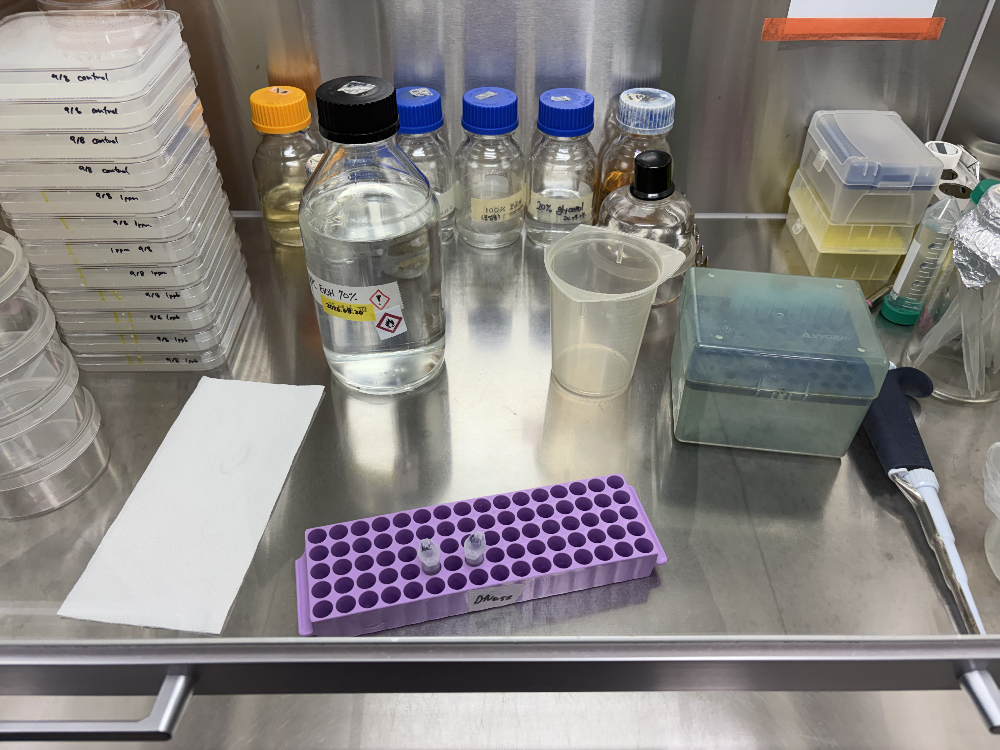
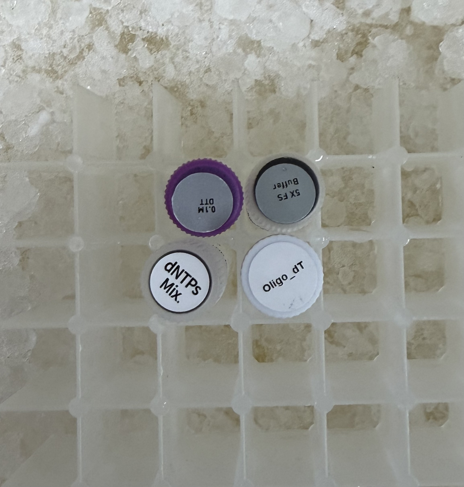
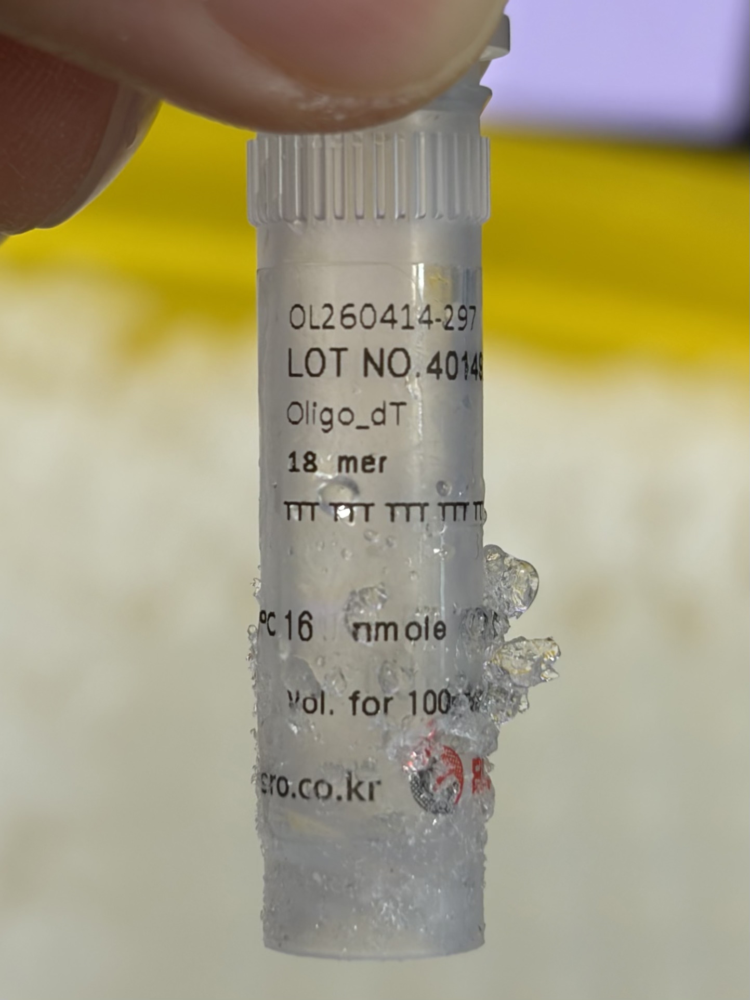
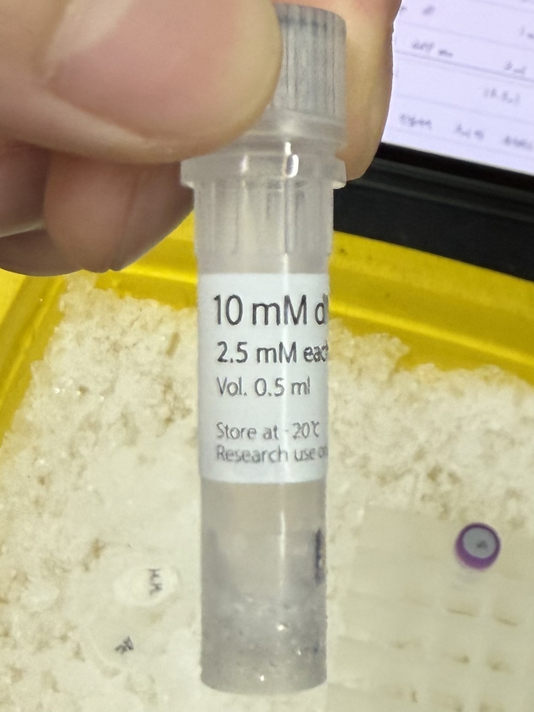
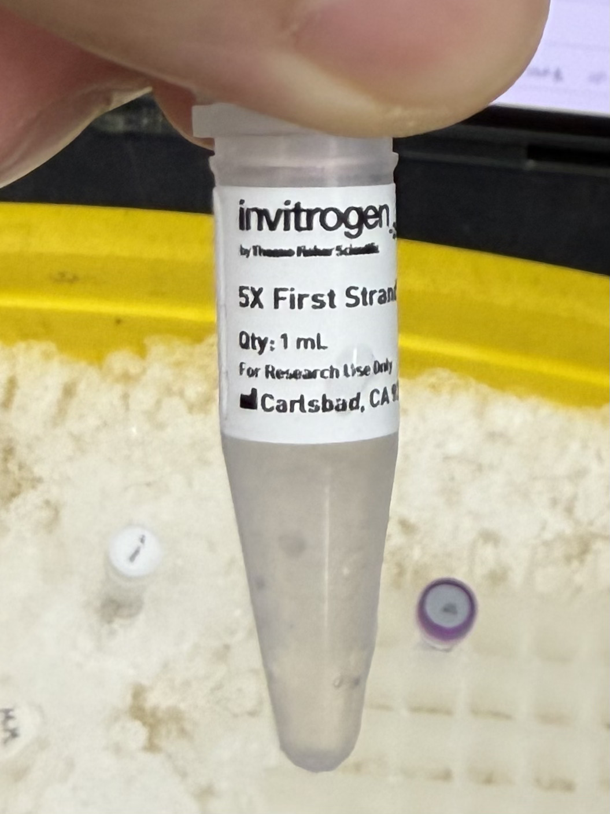
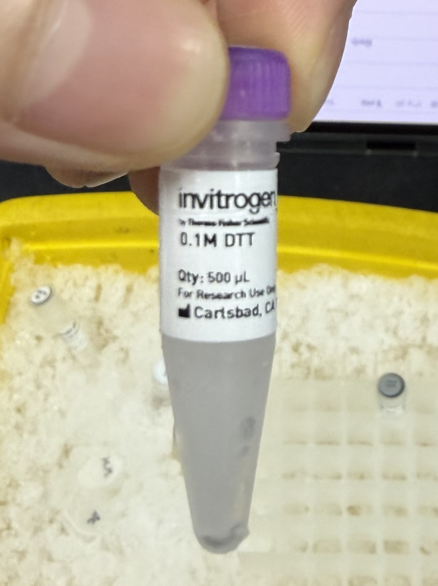
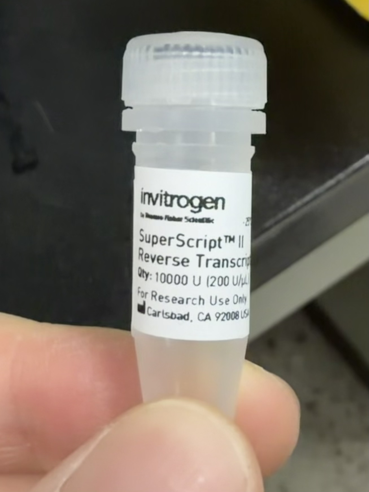
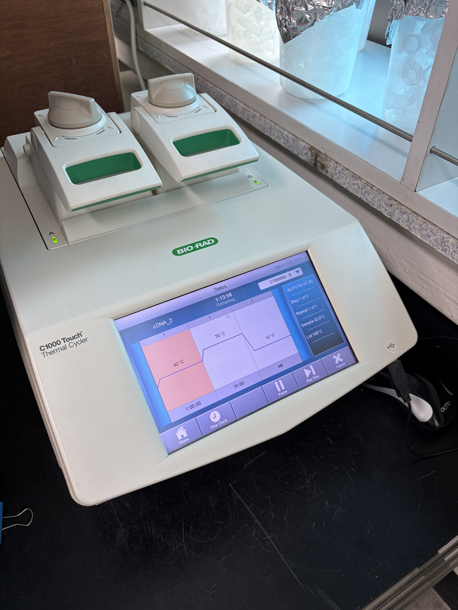
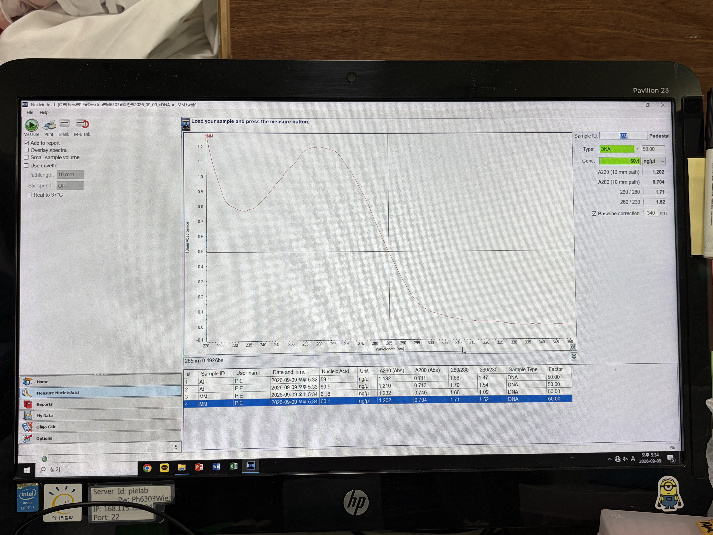

# First-Strand cDNA Synthesis: Arabidopsis Col-0 and Tomato Moneymaker (2026-09-09)

**Date:** 2026-09-09
**Material:** DNase-treated total RNA of *Arabidopsis thaliana* Col-0 (`At`) and *Solanum lycopersicum* cv. Moneymaker (`MM`), recovered from an overnight ethanol precipitation
**Enzyme:** SuperScript II reverse transcriptase (200 U/µL, Invitrogen), oligo(dT) primer
**Output:** 2 × 200 µL diluted cDNA, stored at −20 °C

---

## Background

The cDNA is the template for cloning candidate sequences, including *SNC1* and two other candidates, into a RUBY reporter construct. *SNC1* encodes an NLR immune receptor, and some of its splice isoforms are targets of nonsense-mediated mRNA decay (NMD).

* **Reporter design.** RUBY converts tyrosine into the red pigment betalain. If the transcript carrying a candidate sequence is degraded by NMD, little RUBY enzyme is made and the tissue stays green; if the transcript is stable, the tissue turns red.
* **Why cDNA.** The cloned inserts have no introns, so the assay tests features of the mRNA sequence itself (for example premature termination codons or long 3′ UTRs), not splicing.
* **Species.** Candidates come from Arabidopsis (Col-0) and tomato (Moneymaker), to compare NMD-related sequence features between the two species.

---

## Preparation

* **Consumables:** per sample, one 1.5 mL tube (RNA pellet) and one 0.2 mL PCR tube (cDNA synthesis); two 1.5 mL tubes for the `Step 1` and `Step 2` master mixes.
* **Equipment:** clean bench, Bio-Rad C1000 Touch thermal cycler, Thermo Scientific NanoDrop 2000c, vortex mixer, ice bucket.
* **Solutions:** 70% ethanol made with DEPC water (pellet washes), DEPC water (RNA resuspension), sterile triple-distilled water (3DW; cDNA dilution and NanoDrop blank).

---

## Reference protocols

### 1. DNase treatment

As in 2026-05-29: 25 µL RNA + 3 µL 10X reaction buffer + 2 µL TURBO DNase, 37 °C for 30 min; + 270 µL DEPC water; + 300 µL PCI, 13,000 rpm, 4 °C, 15 min; 200 µL aqueous phase + 20 µL 3 M sodium acetate (pH 5.2) + 1 µL glycogen (10 mg/mL) + 500 µL absolute ethanol, −20 °C overnight. This log starts with the remaining steps:

6. Centrifuge at 13,000 rpm, 4 °C, 15 min.
7. Remove the supernatant, add 1 mL of 70% ethanol (DEPC water) and centrifuge for 1 min.
8. Repeat step 7 once.
9. Air-dry the pellet, dissolve in 50 µL DEPC water and store at −20 °C.

### 2. cDNA synthesis

1. Keep the DNase-treated RNA and the oligo(dT) on ice.
2. Prepare the Step 1 mix (oligo(dT) and dNTPs); put 3.0 µL of mix and 10.5 µL RNA into each PCR tube.

   | Step 1: annealing | Volume |
   | :--- | :---: |
   | Total RNA (DNase-treated) | 10.5 µL |
   | Oligo(dT) | 1.0 µL |
   | 10 mM dNTP mix | 2.0 µL |
   | **Total** | **13.5 µL** |

3. 65 °C for 5 min in a thermal cycler, then directly on ice.
4. Prepare the Step 2 mix on ice and add the reverse transcriptase just before dispensing; add 6.5 µL to each tube (20.0 µL total).

   | Step 2: reverse transcription | Volume |
   | :--- | :---: |
   | 5X First-Strand Buffer | 4.0 µL |
   | 0.1 M DTT | 2.0 µL |
   | Reverse transcriptase | 0.5 µL |
   | **Added per tube** | **6.5 µL** |

5. 42 °C for 60 min (cDNA synthesis), then 70 °C for 15 min (enzyme inactivation).
6. Add 180 µL sterile 3DW (200 µL total), measure on the NanoDrop and store at −20 °C.

---

## Bench record and deviations

1. **Pelleting after the overnight precipitation**
   * The post-DNase precipitation tubes were taken from −20 °C and centrifuged at 13,000 rpm, 4 °C, 15 min.
   * The clean bench was wiped with 70% ethanol and the tubes were moved into it.
   * The supernatant was decanted into the organic waste container without disturbing the pellet, and the rims were blotted on sterile wipes.

   

2. **Two 70% ethanol washes**
   * 1.0 mL of 70% ethanol (DEPC water) per tube; 13,000 rpm, 4 °C, 1 min; decanted in the clean bench; rims blotted.
   * Repeated with a second 1.0 mL: 13,000 rpm, 4 °C, 1 min; decanted; rims blotted.

3. **Removing the remaining ethanol**
   * Empty tubes were centrifuged at 13,000 rpm, 4 °C, 1 min to collect the ethanol from the walls.
   * In the clean bench, the collected ethanol was removed with a 100 µL pipette, with the tip on the wall opposite the white pellet.
   * The collected supernatant and washes were discarded into the organic waste container.

4. **Drying (deviation)**
   * After the usual 5 min of air-drying, the pellets were still white and opaque instead of translucent, so they were dried for another 5 min (10 min in total) until they were translucent.

5. **RNA resuspension**
   * 50 µL DEPC water per pellet; dissolved by gentle pipetting; tubes put on ice.

6. **Reagents**
   * Oligo(dT), 10 mM dNTP mix, 5X First-Strand Buffer and 0.1 M DTT were taken from −20 °C and kept on ice.
   * Two sterile 1.5 mL tubes were labeled `Step 1` and `Step 2`.

   
   
   
   
   

7. **Step 1 mix and annealing setup**
   * Oligo(dT) and dNTP mix were vortexed after thawing.
   * Step 1 mix for 3 reactions (2 samples + 1 extra): 3.0 µL oligo(dT) + 6.0 µL 10 mM dNTP mix = 9.0 µL; vortexed and pulse-spun.
   * Two PCR tubes were labeled; 3.0 µL of Step 1 mix and 10.5 µL RNA per tube (13.5 µL).

8. **Denaturation and Step 2 mix**
   * Bio-Rad C1000 Touch: 65 °C for 5 min, then hold at 12 °C.
   * During the 5 min, the Step 2 base mix for 3 reactions was prepared: 12.0 µL 5X First-Strand Buffer + 6.0 µL 0.1 M DTT, vortexed, pulse-spun and put on ice. The reverse transcriptase was added later, just before use.
   * After the program, the PCR tubes were put directly on ice.

9. **Reverse transcriptase and reaction setup**
   * SuperScript II reverse transcriptase (200 U/µL, Invitrogen) was taken from −20 °C in a bench-top cooler.
   * The viscous enzyme stock was mixed by gentle stirring with the tip and slow pipetting.
   * 1.5 µL enzyme was added to the Step 2 tube (12.0 + 6.0 + 1.5 = 19.5 µL) and mixed gently on ice.
   * 6.5 µL of Step 2 mix was added to each annealed sample (13.5 µL), giving 20.0 µL; mixed gently by pipetting and pulse-spun.

   

10. **cDNA synthesis**
    * Program `cDNA_2` on the Bio-Rad C1000 Touch: 42 °C for 60 min, 70 °C for 15 min, hold at 12 °C.

    

11. **Dilution**
    * 180 µL sterile 3DW per tube (200 µL, 10-fold dilution); vortexed and pulse-spun.

12. **NanoDrop and storage**
    * The diluted reactions were measured twice each on the NanoDrop 2000c (blank: 3DW):

| Sample | Reading | ng/µL | A260 | A280 | A260/A280 | A260/A230 |
| :--- | :---: | :---: | :---: | :---: | :---: | :---: |
| `At` | 1 | 59.1 | 1.182 | 0.711 | 1.66 | 1.47 |
| `At` | 2 | 60.5 | 1.210 | 0.713 | 1.70 | 1.54 |
| `MM` | 1 | 61.6 | 1.232 | 0.740 | 1.66 | 1.60 |
| `MM` | 2 | 60.1 | 1.202 | 0.704 | 1.71 | 1.52 |

   * The diluted cDNA was stored at −20 °C.

   
