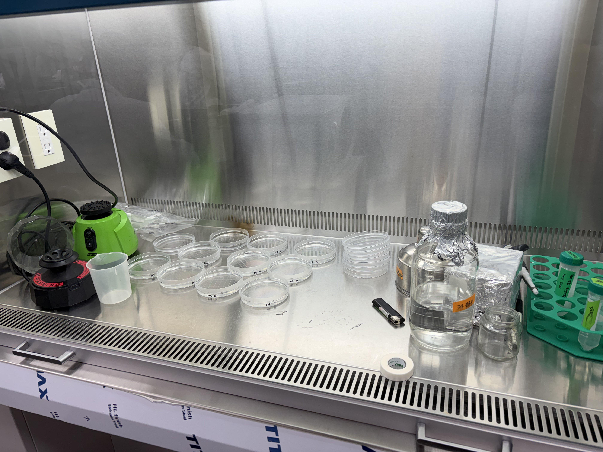
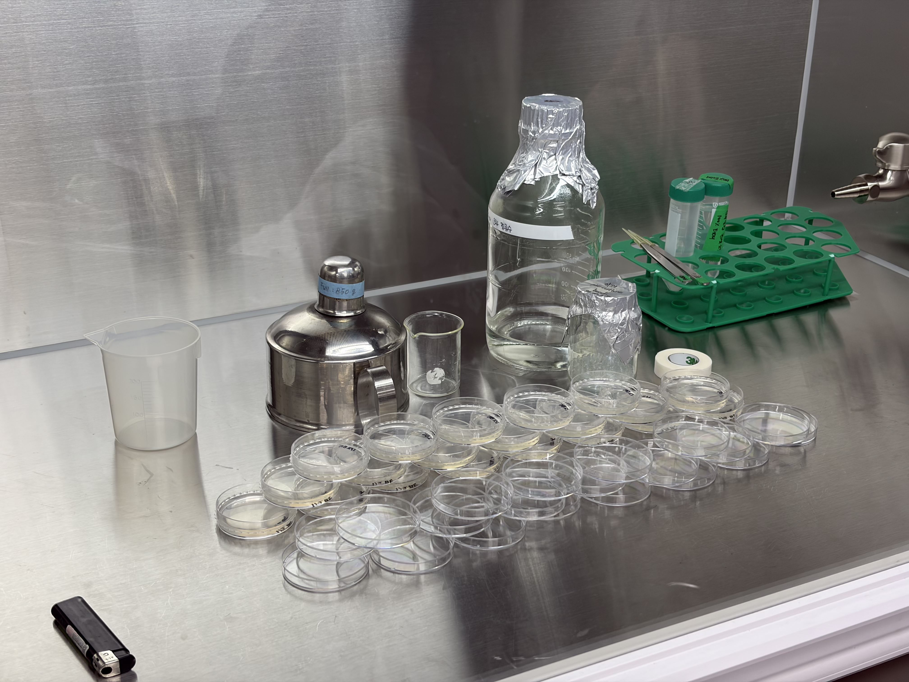
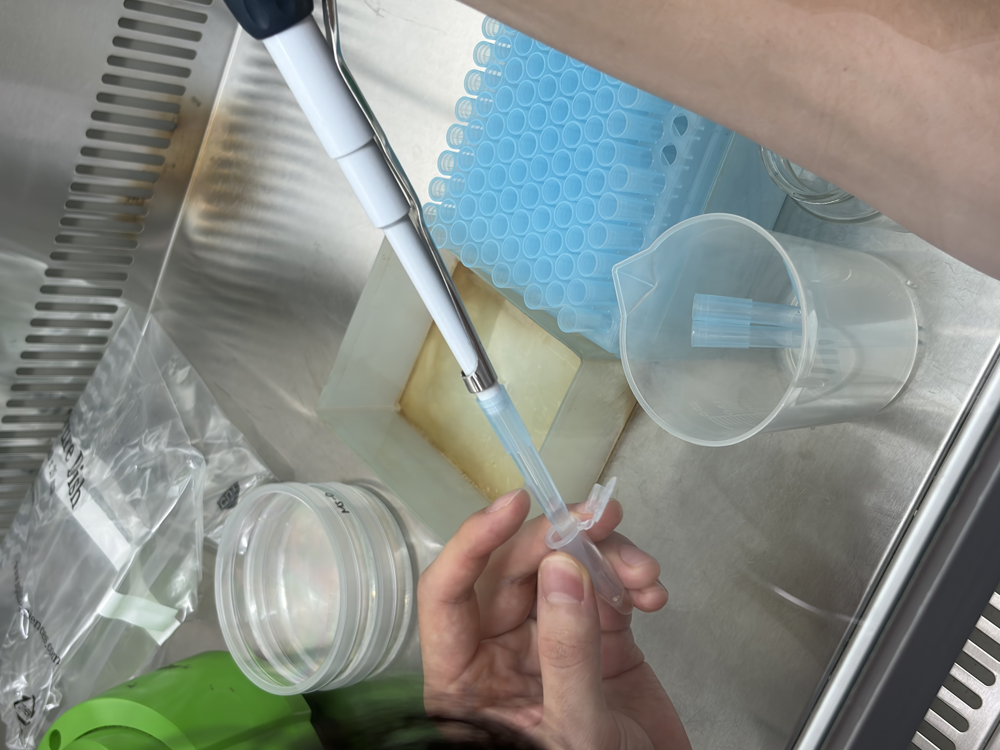
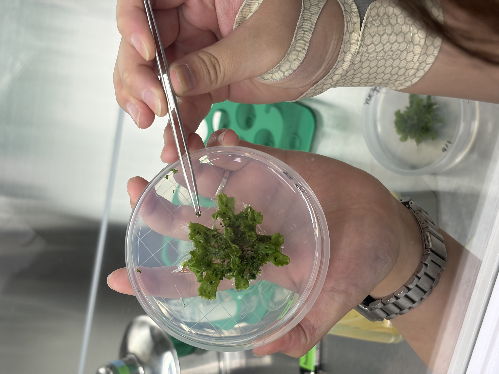
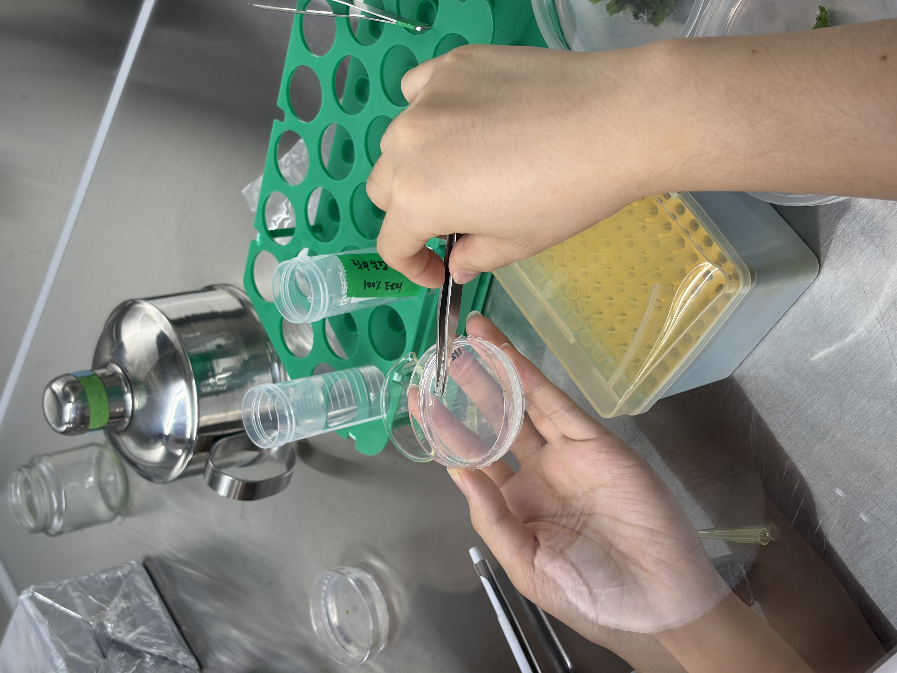
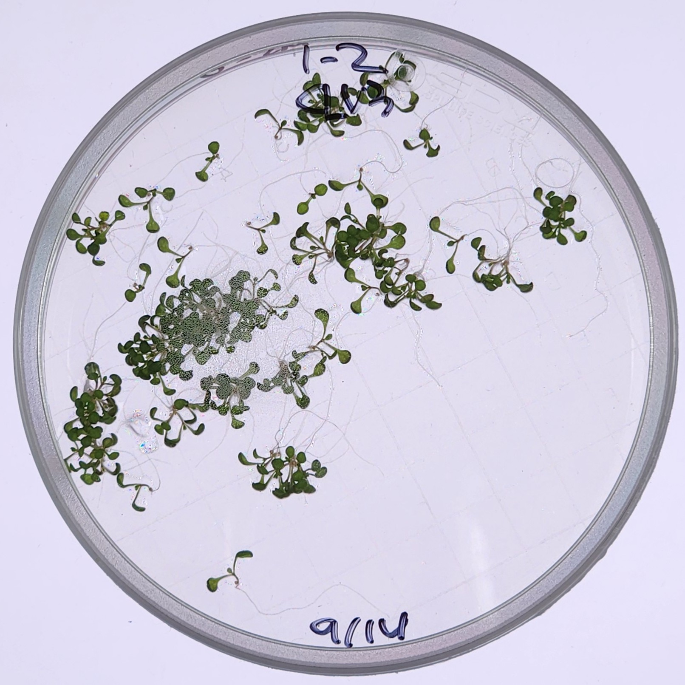
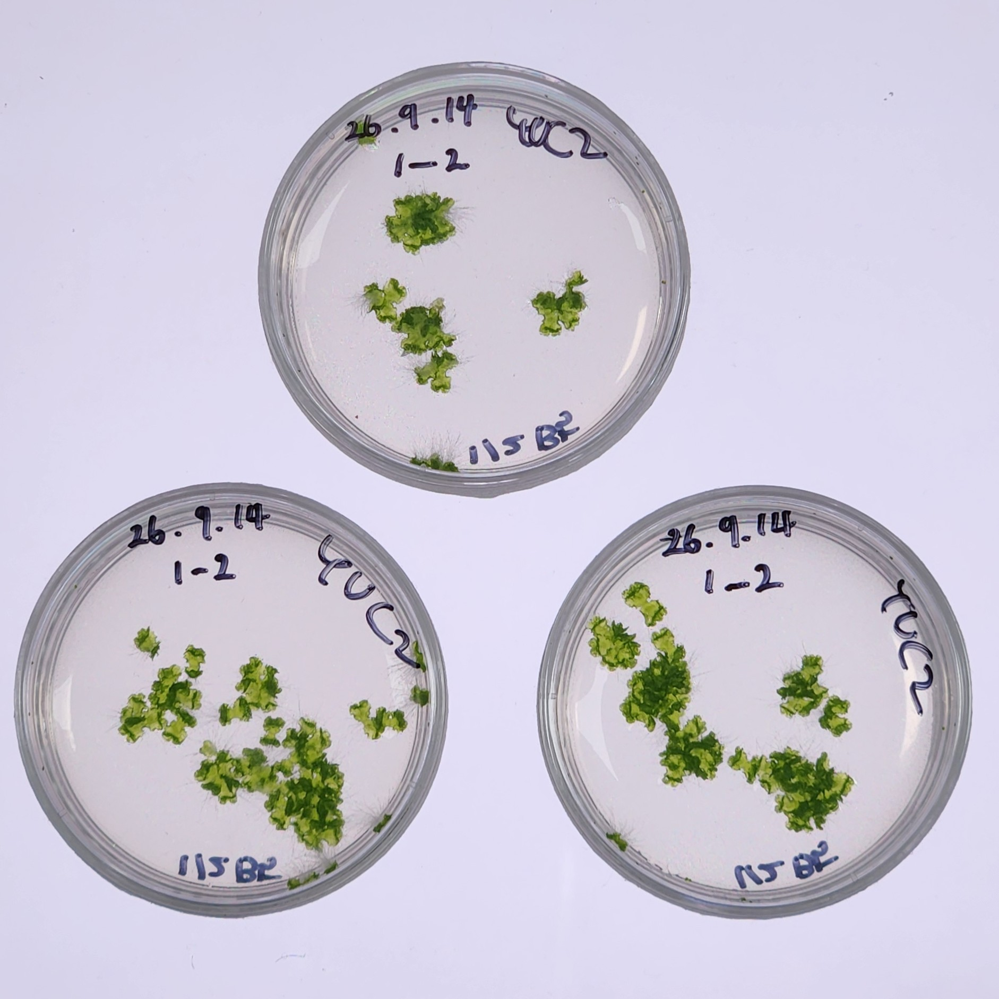

# Course Practical, Week 2: Media, Seed Sterilization and Gemmae Plating (2026-09-14)

**Date:** 2026-09-14 (plates checked on 2026-09-21)
**Type:** practical for the course "Plant Physiology and Laboratory"; media were prepared by the teaching assistants
**Material:** *Arabidopsis thaliana* Col-0, *CLV3p::GUS* and *CYCB1p::GUS*; *Marchantia polymorpha* Tak-1 and *MpYUC2p::GUS*
**Related log:** 2026-09-21 (Week 3: GUS staining and clearing)

---

## Background

The practicals compare drought responses of *Arabidopsis thaliana* (a vascular plant) and *Marchantia polymorpha* (a liverwort) using GUS reporter lines.

* **Lines.** Col-0 is the Arabidopsis wild-type reference. Tak-1 (Takarazuka-1) is the male wild-type accession of *Marchantia*; it propagates clonally through gemmae formed in gemma cups.
* ***CLV3p::GUS*** marks the stem cells in the central zone of the shoot apical meristem (SAM). *CLV3* is part of a feedback loop with *WUSCHEL* (*WUS*): WUS activates *CLV3*, and the CLV3 peptide represses *WUS*, which keeps the stem cell pool constant.
* ***CYCB1;1p::GUS*** marks cells at the G2/M transition of the cell cycle, i.e. dividing cells. CYCB1;1 is a mitotic B-type cyclin that is degraded at the end of mitosis.
* ***MpYUC2p::GUS*** marks auxin (IAA) biosynthesis at the apical notch of *Marchantia*. YUCCA enzymes convert indole-3-pyruvic acid to IAA; Arabidopsis has 11 *YUC* genes, *Marchantia* two (*MpYUC1*, *MpYUC2*).
* **GUS staining.** β-glucuronidase (from the *E. coli uidA* gene) cleaves X-Gluc; the product dimerizes into an insoluble blue precipitate (5,5′-dibromo-4,4′-dichloro-indigo) where the enzyme is active. Plants have little endogenous GUS activity.
* **Expected effect of drought (course hypotheses, not tested here):** weaker *CLV3*, *CYCB1;1* and *MpYUC2* reporter signal, because growth and cell division slow down.

Notes on the methods from the course:

* **Gellan gum vs agar.** Gellan gum gives clear, soft gels that roots grow into easily, but the gel breaks more easily. Agar gives firmer, more turbid gels; roots often grow along the surface.
* **Liquid NaOCl vs chlorine gas.** Seeds sterilized in liquid NaOCl take up water and should be plated soon afterwards. Chlorine-gas sterilization (NaOCl + HCl in a closed container) keeps the seeds dry so they can be stored, but chlorine gas is toxic and needs a fume hood and an airtight container.

---

## Design

| Organism | Line | Medium | Gelling agent | Dish | Plating |
| :--- | :--- | :--- | :--- | :--- | :--- |
| *A. thaliana* | Col-0 | MS + 2% sucrose, pH 6.3 | 0.2% (w/v) gellan gum | 90 mm | sterilized seeds, one per grid square |
| *A. thaliana* | *CLV3p::GUS* | MS + 2% sucrose, pH 6.3 | 0.2% (w/v) gellan gum | 90 mm | sterilized seeds, one per grid square |
| *A. thaliana* | *CYCB1p::GUS* | MS + 2% sucrose, pH 6.3 | 0.2% (w/v) gellan gum | 90 mm | sterilized seeds, one per grid square |
| *M. polymorpha* | Tak-1 | 1/2 B5 + 1% sucrose, pH 6.3 | 1.0% (w/v) agar | 55–60 mm | gemmae in 200 µL 3DW, spread with 5 glass beads |
| *M. polymorpha* | *MpYUC2p::GUS* | 1/2 B5 + 1% sucrose, pH 6.3 | 1.0% (w/v) agar | 55–60 mm | gemmae in 200 µL 3DW, spread with 5 glass beads |

---

## Preparation

* **Consumables and reagents:** 90 mm and 55–60 mm Petri dishes; sterile 1.5 mL tubes; 200 µL and 1000 µL tips; autoclaved borosilicate glass beads (3–5 mm); seed sterilization solution (5.0% v/v NaOCl with 0.05% v/v Triton X-100); sterile triple-distilled water (3DW); 100% ethanol; 3M Micropore tape.
* **Equipment:** laminar-flow clean bench with UV lamp, vortex mixer and microcentrifuge, two pairs of stainless-steel forceps (A: beads; B: gemmae), ethanol burner, growth chamber or incubator at 22–25 °C.

---

## Reference protocols

### 1. Media (per 1 L)

| Component | MS medium | 1/2 B5 medium |
| :--- | :--- | :--- |
| MS basal powder (Duchefa) | 4.30 g | — |
| Gamborg B5 basal powder with vitamins (Duchefa) | — | 1.58 g (half strength) |
| Sucrose | 20.0 g (2.0%) | 10.0 g (1.0%) |
| Water (ddH2O) | dissolve in ~900 mL, make up to 1.0 L | dissolve in ~900 mL, make up to 1.0 L |
| KOH | to pH 6.3 | to pH 6.3 |
| Gellan gum | 2.0 g (0.2%) | — |
| Agar | — | 10.0 g (1.0%) |

1. Weigh the basal powder and sucrose.
2. Dissolve in about 900 mL ddH2O on a magnetic stirrer.
3. Make up to 1.0 L in a graduated cylinder.
4. Adjust to pH 6.3 with KOH.
5. Transfer to Erlenmeyer flasks and add the gelling agent (2.0 g/L gellan gum for MS; 10.0 g/L agar for 1/2 B5).
6. Close with foil and autoclave at 121 °C (15 psi) for 20 min.
7. Cool to 50–55 °C in a clean bench and pour plates.

### 2. Arabidopsis seed sterilization and plating

| Reagent | Volume (10 mL) | Final |
| :--- | :--- | :--- |
| NaOCl (bleach) | 500 µL | 5.0% (v/v) of the stock (0.2–0.25% active chlorine) |
| Triton X-100 | 5 µL | 0.05% (v/v) |
| Sterile ddH2O | 9.495 mL | — |

1. Put the dry seeds of each line (Col-0, *CLV3p::GUS*, *CYCB1p::GUS*) into separate sterile 1.5 mL tubes.
2. Add 500 µL of freshly made sterilization solution.
3. Vortex continuously for 8 min.
4. Let the seeds settle or pulse-spin, remove the solution, and wash with 1.0 mL sterile ddH2O; 5 washes in total.
5. Resuspend the seeds in a small volume of sterile ddH2O and take them up with a pipette.
6. Place one seed per grid square on MS plates.
7. Seal the plates with gas-permeable tape, wrap in foil, and keep at 4 °C in the dark for 48–72 h (stratification) before moving them to the growth chamber.

### 3. Marchantia gemmae plating

1. Put 300 µL sterile ddH2O on the centre of a 1/2 B5 plate.
2. Add 5 sterile glass beads.
3. Pick gemmae from the gemma cups of Tak-1 or *YUC2p::GUS* thalli with a sterile tip or forceps and put them into the water.
4. Roll the beads over the plate in a circular motion to spread the gemmae.
5. Remove the beads.
6. Seal the plate with 3M Micropore tape (allows gas exchange, limits contamination and drying).
7. Grow at 22 °C under continuous white light (50–60 µmol m⁻² s⁻¹).

---

## Bench record and deviations

1. **Media (prepared by the teaching assistants)**
   * The MS and 1/2 B5 media were made, pH-adjusted, mixed with the gelling agents and autoclaved (121 °C, 20 min) in advance by the teaching assistants. Weighing and pH adjustment were therefore not done at the student bench.
   * The molten media were kept at 55–60 °C before pouring, so that they stayed liquid and produced less condensation on the lids.

2. **Pouring plates**
   * The media flasks were moved into the clean bench with sterile Petri dishes and an ethanol burner.
   * MS medium (for Arabidopsis) was poured into 90–100 mm dishes, which leave room for grid plating.

     

   * 1/2 B5 medium (for *Marchantia*) was poured into 50–60 mm dishes.

     

   * The plates were left to set under the airflow, and condensation was allowed to clear before the lids were closed.

3. **Arabidopsis seed sterilization**
   * Seeds of *A. thaliana CLV3p::GUS* in a sterile 1.5 mL tube.
   * 500 µL sterilization solution (5.0% v/v NaOCl with Triton X-100); the bench note says "500 mL", which is a writing error.
   * Vortexed continuously for 8 min; pulse-spun; solution removed.

4. **Washing (deviation)**
   * Five washes: 500 µL sterile 3DW (reference: 1.0 mL), vortexed for about 1 min, pulse-spun, liquid removed.

   

5. **Plating the seeds**
   * The seeds were resuspended in a small volume of sterile 3DW.
   * Single seeds were taken up with a 1000 µL pipette and placed one per grid square on the MS plates.

6. **Gemmae plates and forceps (deviation)**
   * 200 µL sterile 3DW was put on the centre of each 1/2 B5 plate (reference: 300 µL), to limit pooling of water.
   * Forceps were dipped in 100% ethanol, flamed, and allowed to cool in the clean bench before touching any material.
   * Two pairs of forceps were kept separate: A for the glass beads, B for the gemmae, so that the gemmae were not damaged by heat, ethanol or handling.

7. **Gemmae plating**
   * Five autoclaved glass beads were put on the plate with forceps A.
   * Gemmae were picked from the gemma cups of *M. polymorpha MpYUC2p::GUS* thalli with forceps B and put into the water droplet.

     

   * With the lid closed, the plate was tilted gently in circles so that the beads rolled over the surface and spread the gemmae in a single layer.
   * The lid was lifted slightly, and the beads were removed with forceps A without damaging the agar.

     

   * The plates were sealed with gas-permeable tape, which keeps the humidity high and allows gas exchange.

   Only the *CLV3p::GUS* seeds and the *MpYUC2p::GUS* gemmae are recorded in this log.

8. **Check after 7 days (2026-09-21; growth chamber at 22–25 °C)**
   * ***A. thaliana CLV3p::GUS*** (MS, 2.0% sucrose, 0.2% gellan gum): the seeds germinated evenly. The seedlings had expanded green cotyledons, elongated hypocotyls and the first true leaf primordia at the shoot apex. Primary roots grew into the gellan gum and had formed lateral roots. No bacterial or fungal contamination was visible.

     

   * ***M. polymorpha MpYUC2p::GUS*** (1/2 B5, 1.0% agar, three plates): nearly all gemmae had grown into flat, lobed, dark green thalli with apical notches along the margin and many rhizoids on the lower side. No contamination was visible on any of the three plates.

     
