# Arabidopsis Infection with *Pseudomonas syringae* pv. *syringae* B728a (2026-09-15)

**Dates:** sowing 2026-08-18; media 2026-09-07; streak 2026-09-11; starter culture 2026-09-14; infiltration 2026-09-15; sampling and plating 2026-09-18; counting 2026-09-20
**Host:** *Arabidopsis thaliana* Col-0, 28 days old
**Pathogen:** *P. syringae* pv. *syringae* B728a (*Pss* B728a, rifampicin-resistant), OD600 = 0.0001 in 10 mM MgSO4, needleless-syringe infiltration
**Readout:** bacterial counts in leaf discs at 3 days post-inoculation (dpi), 8 leaves
**Result:** 2.24 × 10⁴ to 1.76 × 10⁶ CFU/cm² (Section "Results")

---

## Background

Planned project: the effect of bisphenol A (BPA; 1 ppb and 1 ppm, against an untreated control) on the defence of Arabidopsis against bacterial infection. This run used untreated plants to test the methods: infiltration, leaf sampling, serial dilution and colony counting. *P. syringae* pv. *tomato* DC3000 (*Pst* DC3000) was planned; *Pss* B728a was used because the wrong glycerol stock was taken (bench record, step 4).

Notes on the method:

* **Strains.** *Pst* DC3000 is a pathogen of Arabidopsis and tomato; it produces coronatine, which reopens stomata and suppresses salicylic-acid-dependent defence. *Pss* B728a causes brown spot of bean and survives well on leaf surfaces. Syringe infiltration places the bacteria directly into the leaf, bypassing the surface.
* **Selection.** Rifampicin binds the β-subunit of bacterial RNA polymerase (*rpoB*). The strain carries a resistance mutation, so rifampicin (34.0 µg/mL) on the plates suppresses other bacteria.
* **Media.** King's B (KB) medium (proteose peptone, K2HPO4, MgSO4, glycerol) is a standard medium for *Pseudomonas*; LB (tryptone, yeast extract, NaCl) is a general medium and is used here for the count plates.
* **Two-step culture.** An overnight starter culture is diluted into fresh medium and grown for 3 h, so that the cells are growing exponentially at infiltration. Cultures are shaken (200–230 rpm) for aeration.
* **Inoculum density.** OD600 = 0.0001 (about 5 × 10⁴–1 × 10⁵ CFU/mL) leaves room to measure bacterial growth over 3 days. High densities (OD600 of 0.01–0.1 or more) can cause rapid tissue collapse, which makes growth hard to measure.

---

## Design

| Group | Plants | Treatment | Pathogen | Inoculum | Sample | Dilutions plated |
| :--- | :--- | :--- | :--- | :--- | :--- | :--- |
| Wild type, WT1–WT8 (this run) | 8 (median leaves) | untreated (0 ppm BPA) | *Pss* B728a | OD600 = 0.0001 in 10 mM MgSO4 | leaf disc (0.49 cm²) at 3 dpi | 10⁻², 10⁻³, 10⁻⁴ |
| BPA low dose (planned) | 8 | 1 ppb BPA | *Pst* DC3000 / *Pss* B728a | same | same | same |
| BPA high dose (planned) | 8 | 1 ppm BPA | *Pst* DC3000 / *Pss* B728a | same | same | same |

Plating layout (four LB + rifampicin plates, six 60° sectors each):

| Plate | Sector 1 | Sector 2 | Sector 3 | Sector 4 | Sector 5 | Sector 6 |
| :--- | :--- | :--- | :--- | :--- | :--- | :--- |
| 1 | WT1 (10⁻²) | WT1 (10⁻³) | WT1 (10⁻⁴) | WT2 (10⁻²) | WT2 (10⁻³) | WT2 (10⁻⁴) |
| 2 | WT3 (10⁻²) | WT3 (10⁻³) | WT3 (10⁻⁴) | WT4 (10⁻²) | WT4 (10⁻³) | WT4 (10⁻⁴) |
| 3 | WT5 (10⁻²) | WT5 (10⁻³) | WT5 (10⁻⁴) | WT6 (10⁻²) | WT6 (10⁻³) | WT6 (10⁻⁴) |
| 4 | WT7 (10⁻²) | WT7 (10⁻³) | WT7 (10⁻⁴) | WT8 (10⁻²) | WT8 (10⁻³) | WT8 (10⁻⁴) |

---

## Preparation

* **Per sample:** one 1.5 mL tube (grinding in 200 µL), four wells of a 96-well plate (10⁻¹ to 10⁻⁴), three sectors of an LB + rifampicin plate (half a plate), one autoclaved micro-pestle.
* **Syringe:** one needleless 1.0 mL slip-tip syringe, refilled for all eight plants.
* **Equipment:** growth chamber (25 °C, 12 h photoperiod); shaking incubator (Vision Scientific VS-8480S); clean bench with UV lamp; NanoDrop with the 10 mm cuvette module (Cell Culture mode); microcentrifuge (13,000 rpm); handheld drill for the micro-pestle; 8-channel pipette (Brand Transferpette-8, 20–200 µL); leaf punch (0.49 cm²) and forceps; non-perforated transparent humidity covers and binder clips.

---

## Reference protocol

### 1. Culture and inoculum

Liquid KB per culture tube:

| Component | Stock | Volume | Role |
| :--- | :--- | :--- | :--- |
| KB broth | 1X | 5.0 mL | medium |
| MgSO4 | 10 mM | 16.0 µL | supplement |
| Glycerol | 20% (v/v) | 125.0 µL | carbon source |
| Rifampicin | working stock | 5.0 µL | selection |
| **Total** | — | **~5.15 mL** | per glass tube |

1. Streak *Pst* DC3000 from the glycerol stock on KB agar with rifampicin; 28 °C for 2–3 days.
2. Prepare two glass tubes with 5.0 mL KB broth, 16 µL 10 mM MgSO4, 125 µL 20% glycerol and 5 µL rifampicin each.
3. Inoculate one tube with a single colony and vortex briefly.
4. Shake at 28 °C, 200 rpm, for 16 h.
5. Transfer 1.0 mL of this culture into the second tube.
6. Shake at 28 °C, 200 rpm, for 3 h.
7. Pellet 4.0 mL of the culture in 1.5 mL tubes at 12,000 rpm for 5 min at room temperature (RT).
8. Remove the supernatant and resuspend the cells in 1.0 mL sterile 10 mM MgSO4.

### 2. OD600 and inoculum

1. Dilute the suspension 1:10 in 10 mM MgSO4 (100 µL cells + 900 µL).
2. Measure OD600 against 10 mM MgSO4.
3. Dilute the suspension in 10 mM MgSO4 to OD600 = 0.0001 (about 5 × 10⁴–1 × 10⁵ CFU/mL).

### 3. Plants and infiltration

1. Grow Arabidopsis wild type (and treatment groups) under short days (8 h light / 16 h dark, 22 °C) for about 28 days.
2. Do not water on the day of infiltration.
3. Mark leaves 3, 4 and 5 of each rosette.
4. Fill a needleless 1.0 mL syringe with the inoculum.
5. Support the upper side of the leaf with a gloved finger, press the syringe against the lower side and push the plunger gently until the whole leaf is water-soaked.
6. Let the leaves dry.
7. Water the trays from below once the leaves are dry.
8. Cover the trays with non-perforated transparent covers fixed with binder clips (relative humidity above 90%).
9. Keep in the growth chamber for 3 days (3 dpi).

### 4. Sampling and grinding

1. Rank the marked leaves by visible symptoms (chlorosis, necrosis).
2. Choose 8–12 leaves with median symptoms.
3. Punch one disc (0.49 cm²) per leaf.
4. Dip the disc in 70% ethanol for 5 s to remove bacteria on the surface.
5. Blot dry on sterile paper.
6. Put each disc into a 1.5 mL tube with 200 µL sterile 10 mM MgSO4.
7. Grind with an autoclaved micro-pestle on a handheld drill (tip cleaned with 70% ethanol) until no tissue pieces remain.
8. Clean the pestle with 70% ethanol between samples.

### 5. Serial dilution and spot plating

| Column | Dilution | 10 mM MgSO4 | Sample | From |
| :--- | :--- | :--- | :--- | :--- |
| 1 | 10⁻¹ | 180.0 µL | 20.0 µL | leaf lysate |
| 2 | 10⁻² | 180.0 µL | 20.0 µL | column 1 |
| 3 | 10⁻³ | 180.0 µL | 20.0 µL | column 2 |
| 4 | 10⁻⁴ | 180.0 µL | 20.0 µL | column 3 |
| 5 | 10⁻⁵ | 180.0 µL | 20.0 µL | column 4 |
| 6 | 10⁻⁶ | 180.0 µL | 20.0 µL | column 5 |
| 7 | 10⁻⁷ | 180.0 µL | 20.0 µL | column 6 |
| 8 | 10⁻⁸ | 180.0 µL | 20.0 µL | column 7 |

1. Use LB plates poured at least 3 days earlier (dry surface), at RT.
2. Expose the reservoir, 96-well plates and tip boxes to UV for at least 30 min.
3. Put 180 µL sterile 10 mM MgSO4 into the wells with a multichannel pipette.
4. Add 20 µL lysate to column 1 (10⁻¹) and mix by pipetting 10 times.
5. Continue the 10-fold series to 10⁻⁸ (20 µL into 180 µL each time).
6. Divide each LB plate into 6 sectors (2 samples × 3 dilutions).
7. Spot 20 µL of the chosen dilutions (usually 10⁻² to 10⁻⁴, depending on symptoms) into the sectors.
8. Let the spots dry, seal with Parafilm, and incubate inverted at 28 °C for 24–48 h.

### 6. Counting

1. Use the dilution with 30–300 separate colonies per spot.
2. Bacterial density (CFU/cm²) = colonies × dilution factor × (total volume / plated volume) / disc area, with total volume 200 µL, plated volume 20 µL and disc area 0.49 cm².
3. Log10-transform the values and plot them by group.

---

## Bench record and deviations

1. **Sowing (2026-08-18, day −28; deviation)**
   * Col-0 seeds were sown on moist potting soil and grown in a growth chamber at 12 h light / 12 h dark and 25 °C.
   * Deviation: the reference uses short days (8 h light) at 22 °C; the longer days and higher temperature give faster rosette growth.

2. **LB + rifampicin plates (2026-09-07)**
   * 10.0 g tryptone, 5.0 g yeast extract and 5.0 g NaCl were dissolved in about 900 mL ddH2O and made up to 1.0 L; 15.0 g agar (1.5%) was added.
   * Autoclaved at 121 °C (15 psi) for 20 min and cooled in the clean bench to about 50–55 °C.
   * 1.0 mL rifampicin stock (34.0 mg/mL in 100% methanol, stored at −20 °C) was added: 34.0 µg/mL final. The bench note gave "34 mg/mL" for the final concentration, which was a writing error.

     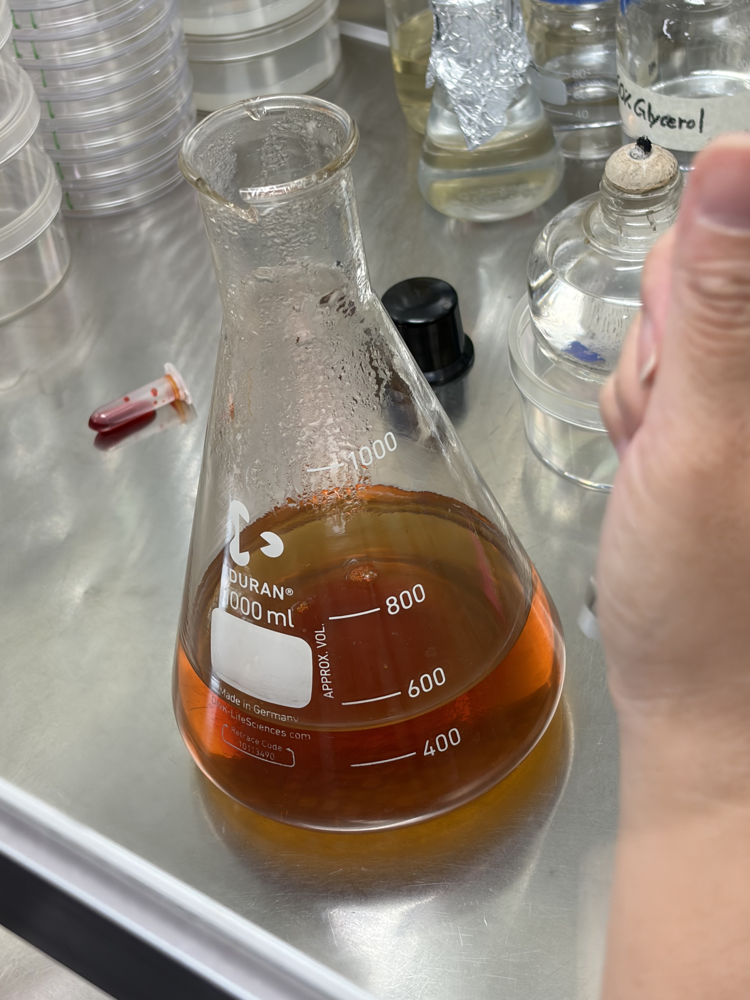

   * Plates were poured in the clean bench, allowed to set, and stored inverted at 4 °C in plastic sleeves.

     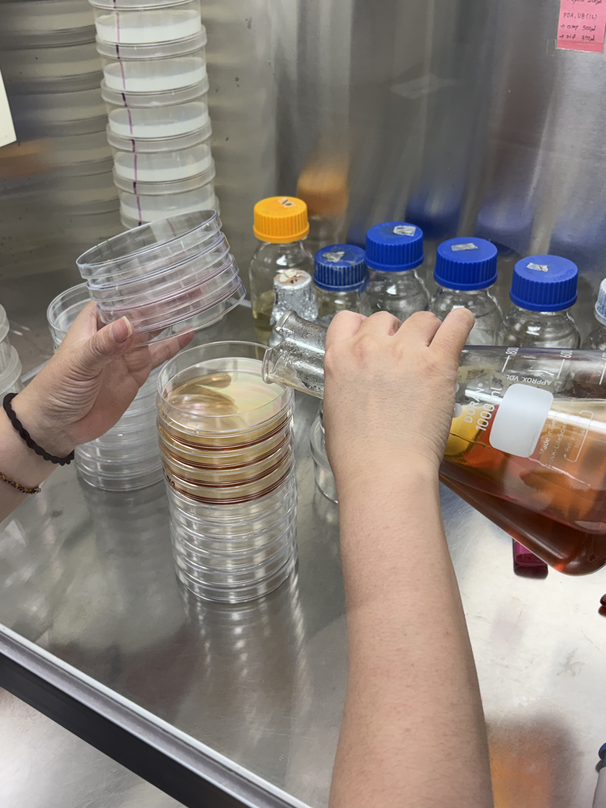

3. **KB medium (2026-09-07)**
   * 10.0 g proteose peptone and 1.5 g K2HPO4 per 1.0 L ddH2O.
   * Solid KB: plus 15.0 g agar (1.5%). Liquid KB: no agar.
   * Autoclaved at 121 °C for 20 min and cooled to 50–55 °C.
   * Added per 1.0 L after autoclaving: 25.0 mL 20% glycerol (0.5% final), 3.2 mL 1.0 M MgSO4 (3.2 mM final) and 1.0 mL rifampicin stock (34.0 µg/mL final).
   * KB + rifampicin plates were stored inverted at 4 °C in sleeves; liquid KB + rifampicin was stored at 4 °C in the dark.

4. **Strain (2026-09-11; deviation)**
   * A glycerol stock was taken from −80 °C.
   * Planned: *P. syringae* pv. *tomato* DC3000 (rifampicin-resistant). Used: *P. syringae* pv. *syringae* B728a (rifampicin-resistant), because the wrong stock vial was taken.
   * The trial was continued with *Pss* B728a under the same conditions (34.0 µg/mL rifampicin, 28 °C) to test infection and the workflow.

5. **Streak (2026-09-11)**
   * Frozen cells were scraped from the *Pss* B728a stock with a sterile 1000 µL tip and streaked on a pre-warmed KB plate with 34.0 µg/mL rifampicin.

     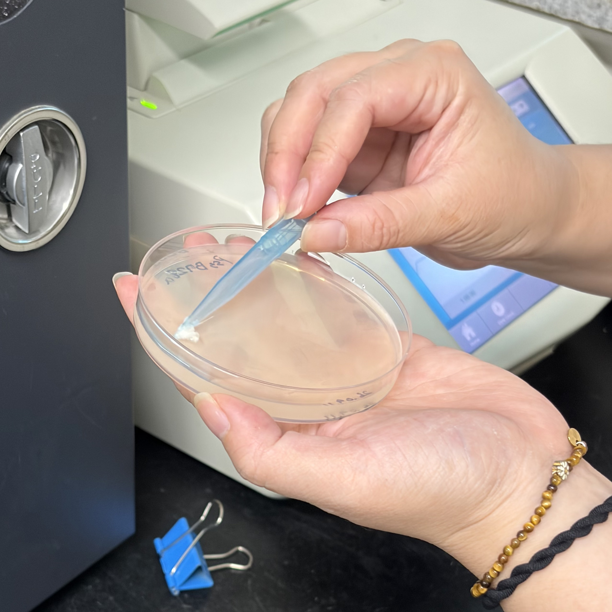

   * The plate was sealed with Parafilm.

     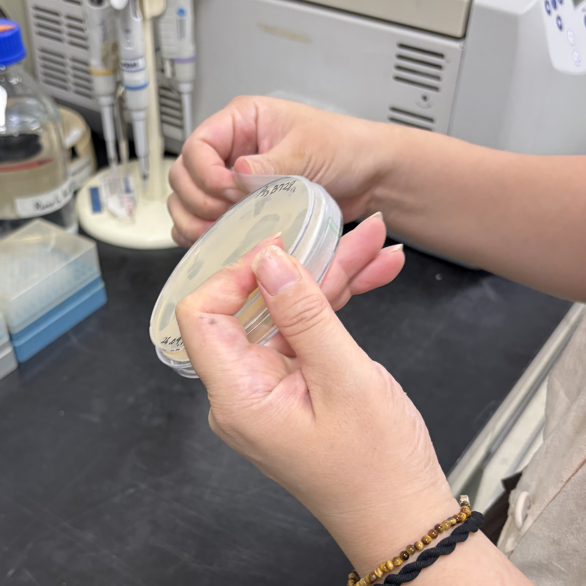

   * 28 °C for 48–72 h, to obtain single colonies.

6. **Culture tubes (2026-09-14)**
   * The clean bench was wiped with 70% ethanol and exposed to UV for 5 min.
   * Two sterile glass tubes (one for the starter culture, one for the subculture), each with 16.0 µL 10 mM MgSO4, 125.0 µL 20% glycerol and 5.0 µL rifampicin stock, made up to 5.0 mL with liquid KB.

7. **Starter culture (2026-09-14)**
   * The KB + rifampicin plate streaked on 2026-09-11 had separate single colonies.

     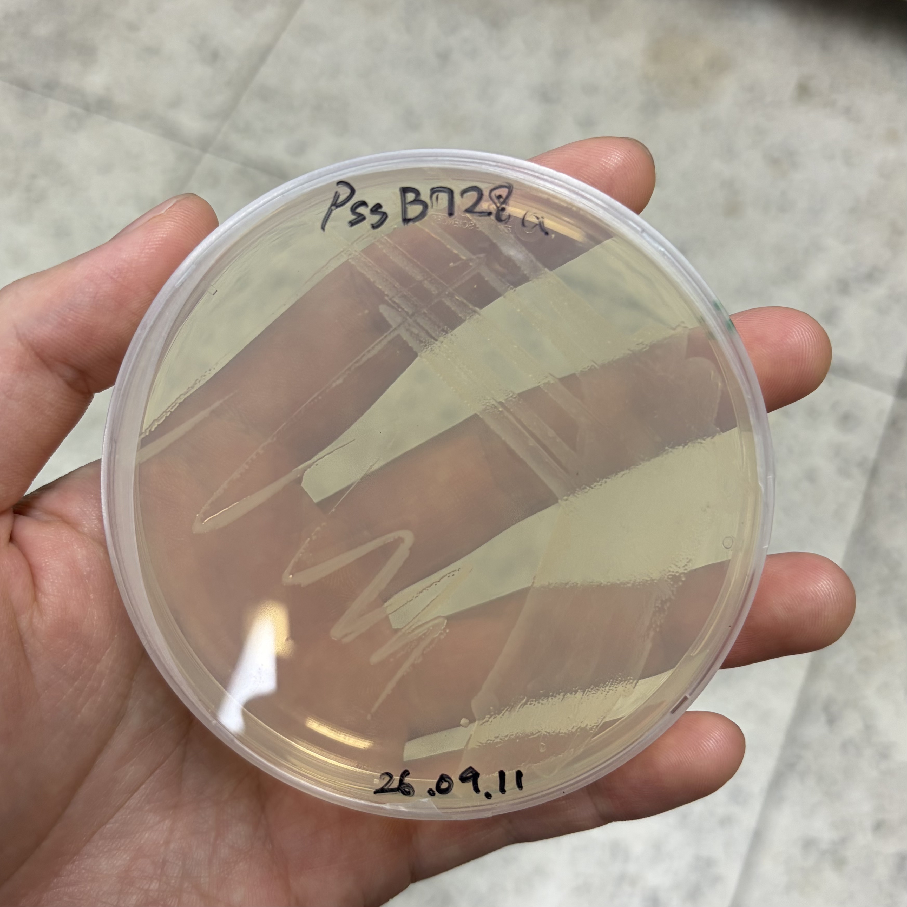

   * One colony was picked with a sterile 200 µL tip into one of the tubes, and the tube was vortexed to disperse the cells.
   * Both tubes went into the shaking incubator (Vision Scientific VS-8480S): set to 28.0 °C (display 27.8 °C) and 230 rpm (display 227 rpm). Deviation: 230 rpm instead of 200 rpm, for better aeration.

     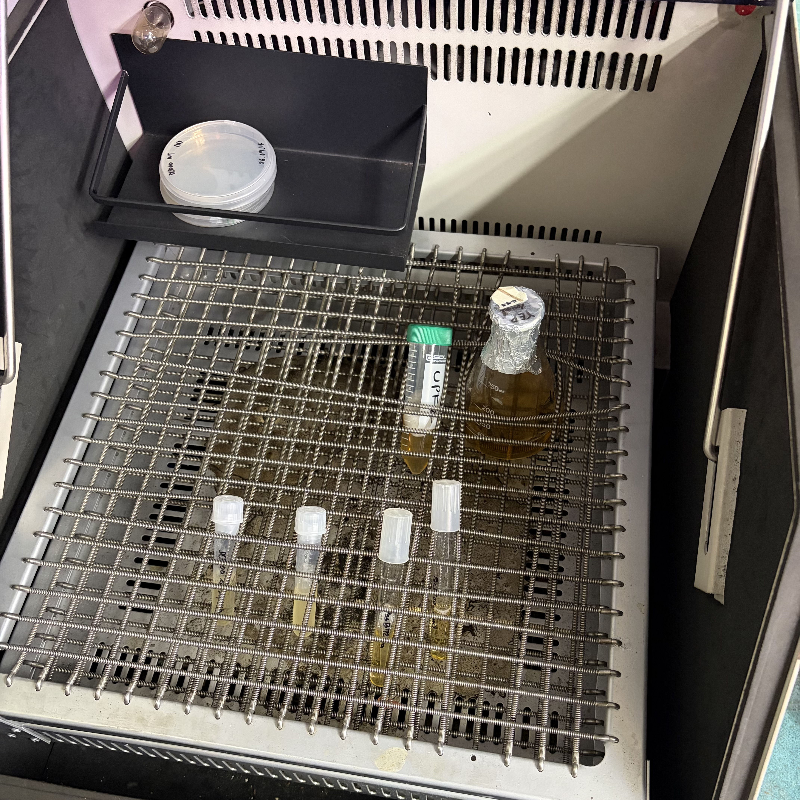
     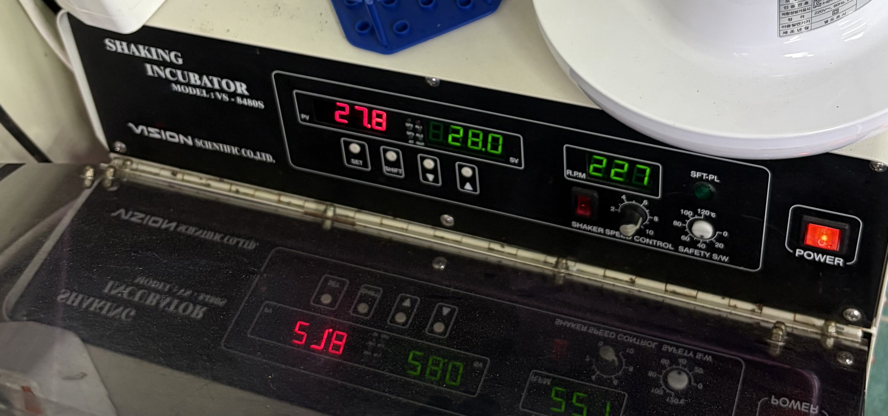

8. **Leaf marking (2026-09-14; deviation)**
   * The plants were not watered before marking.
   * Reference: exclude the cotyledons and leaves 1 and 2, and mark leaves 3, 4 and 5.
   * Deviation: the three largest fully expanded rosette leaves per plant were marked on the petiole, to get leaves of similar size for infiltration despite small differences in development. Cotyledons and leaves 1 and 2 were excluded.

     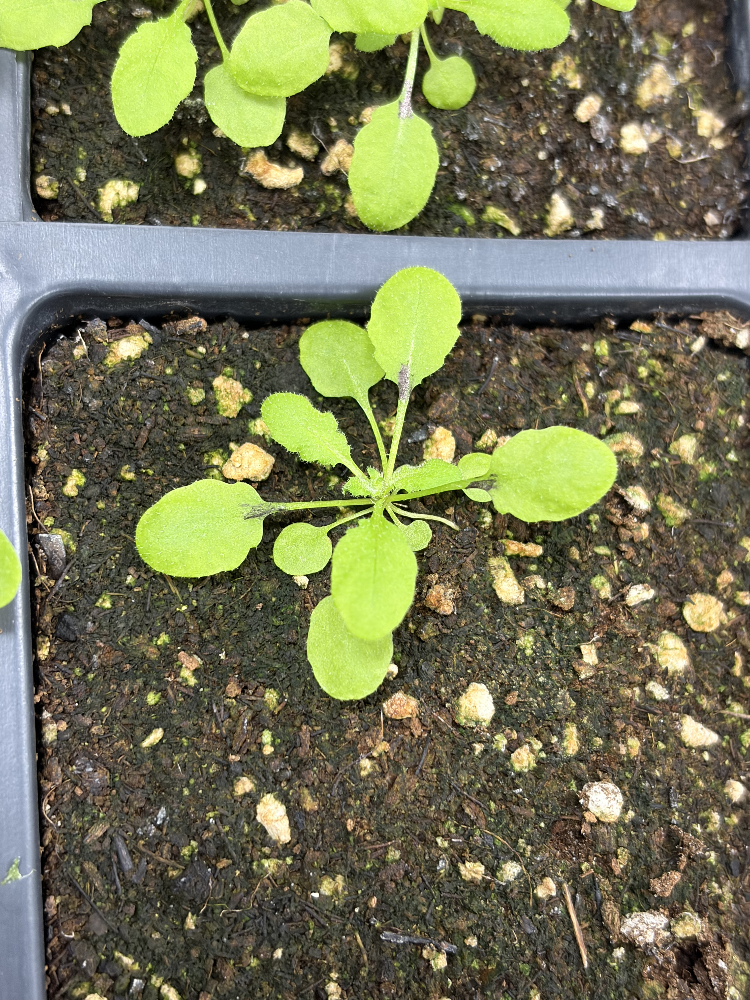

   * After marking, a small amount of water was given to the soil.

9. **Subculture (2026-09-15, 09:00)**
   * After 16 h, the starter culture was turbid and deep yellow.
   * In the clean bench, 1.0 mL of the starter culture was transferred into the second tube; vortexed.

     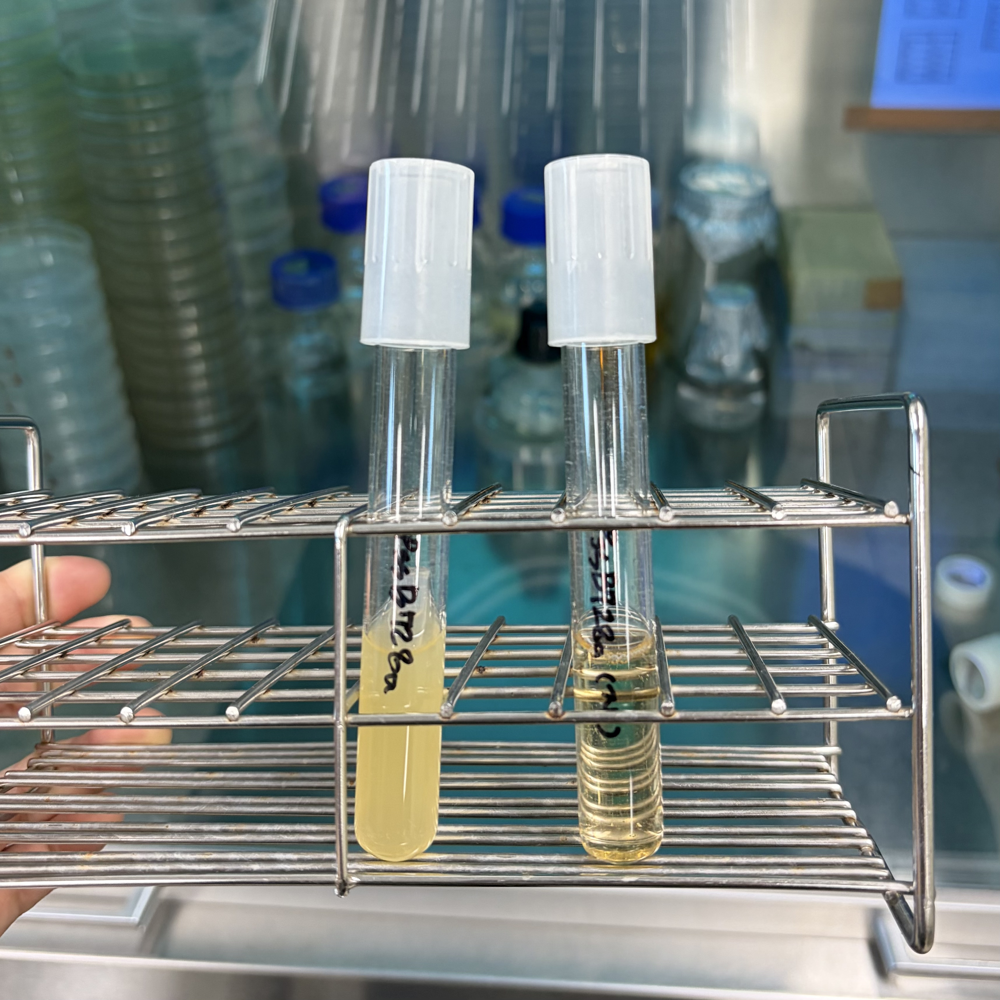

   * 28 °C, 230 rpm, 3 h.

10. **Harvest (2026-09-15, 12:00; deviation)**
    * 150 mL sterile 10 mM MgSO4 was prepared in an autoclaved bottle; four 1.5 mL tubes were labeled 1–4.

      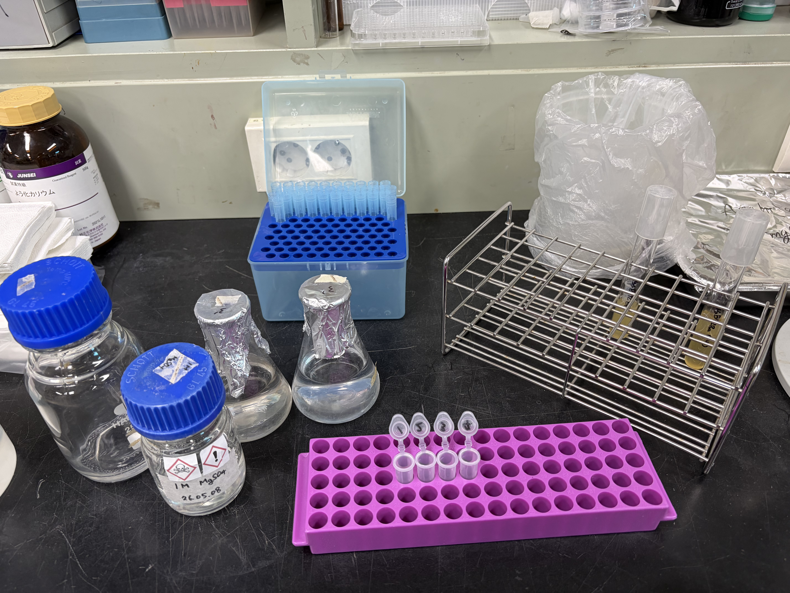

    * 1.0 mL of subculture into each tube (4.0 mL in total); centrifuged at 13,000 rpm for 5 min at RT (reference: 12,000 rpm).
    * The supernatant was removed with a pipette without disturbing the pellets.
    * The four pellets were combined: 1.0 mL 10 mM MgSO4 was used to resuspend the pellet in tube 1, then transferred to tube 2 to resuspend that pellet, and so on through tube 4, giving one 1.0 mL suspension. It was vortexed to break up clumps.

      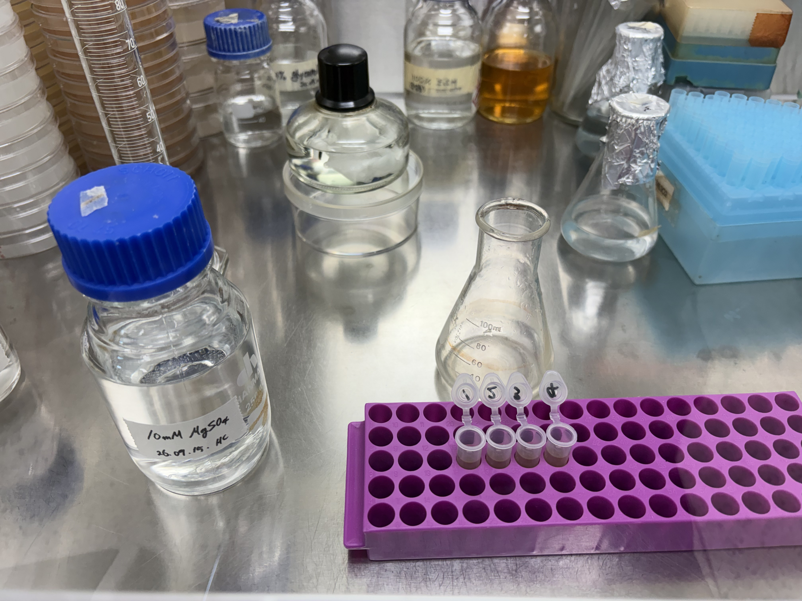

11. **OD600 and inoculum (2026-09-15)**
    * The pooled suspension was labeled `4 St`; a 1:10 dilution (`1/10 st`) was made from 900 µL 10 mM MgSO4 and 100 µL suspension and vortexed.

      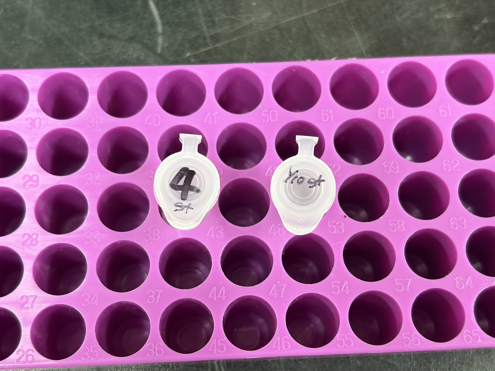

    * NanoDrop in Cell Culture mode with the 10 mm cuvette module; blank: 1.0 mL 10 mM MgSO4.
    * At 12:36, the 1:10 dilution read OD600 = 0.614 (about 6.14 for the undiluted suspension).

      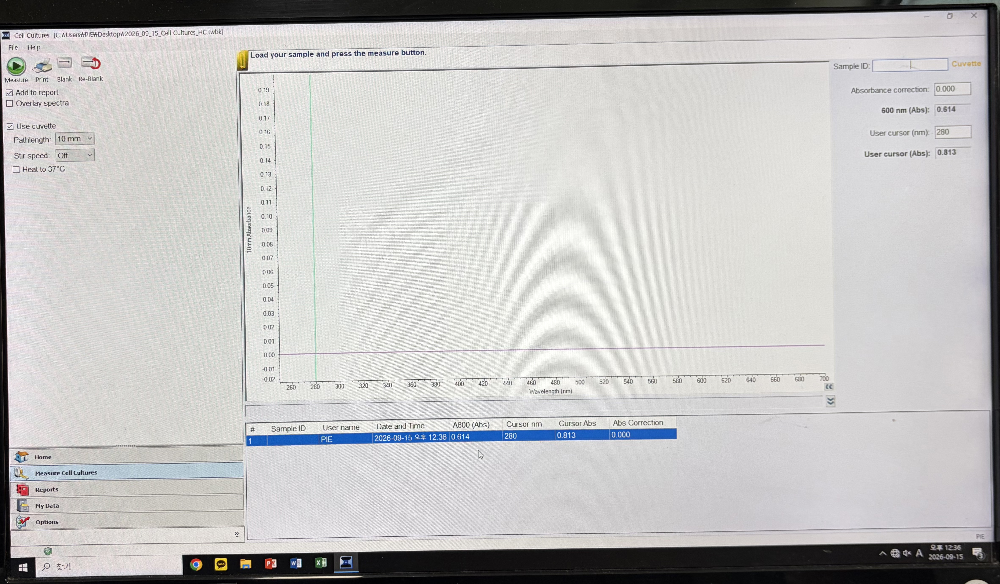

    * The sample was returned from the cuvette to its tube.
    * Volume of the 1:10 dilution needed for 50.0 mL at OD600 = 0.0001:
      V1 = (0.0001 / 0.614) × 50,000 µL ≈ 8.14 µL.
    * 50.0 mL of sterile 10 mM MgSO4 was measured into a 50 mL Falcon tube, 8.14 µL was removed, and 8.14 µL of the 1:10 dilution was added. The tube was inverted and vortexed (OD600 = 0.0001, about 5 × 10⁴–1 × 10⁵ CFU/mL).

12. **Infiltration (2026-09-15)**
    * A needleless 1.0 mL slip-tip syringe was filled with 1.0 mL of inoculum.
    * For each of the three marked leaves, the upper side was supported with a gloved finger, and the syringe tip was pressed against the lower side with light pressure, so that it sealed without bruising the leaf.
    * The plunger was pushed gently until the whole leaf was water-soaked. Tearing, crushing and puncturing were avoided, because wounding triggers defence responses.

      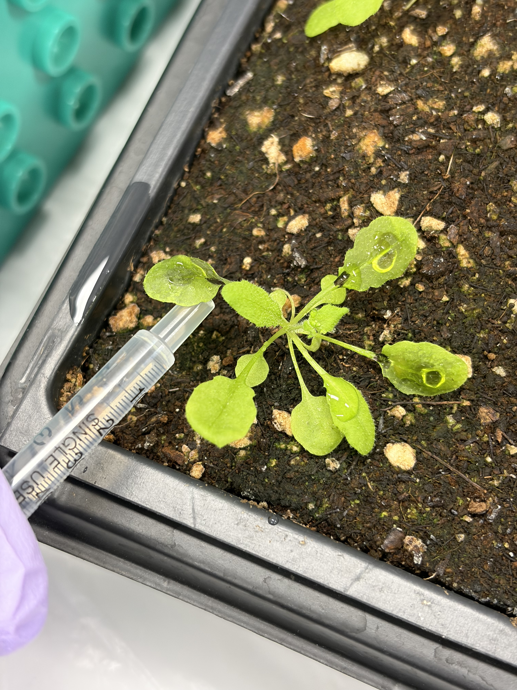

13. **Drying and incubation (deviation)**
    * The plants were left at RT for the infiltrated water to disappear.

      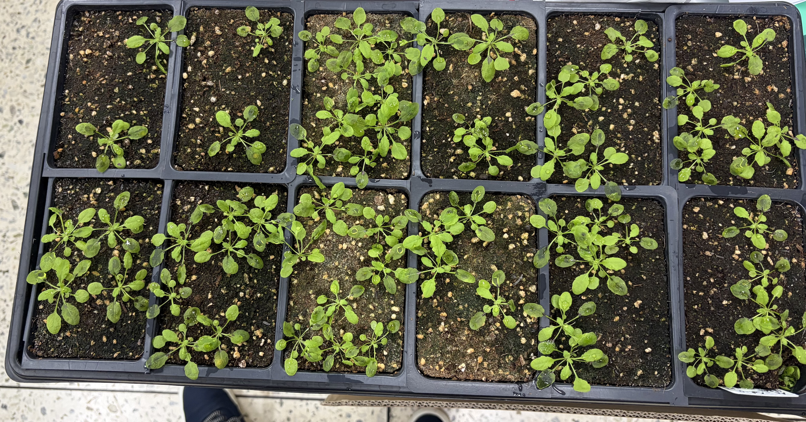

    * Deviation: drying usually takes about 3 h; here the water-soaking took 5 h to disappear, and the plants stayed at RT until the leaves were dry to the touch.
    * The trays were then watered from below until the soil was saturated.
    * Each tray was covered with a non-perforated transparent cover clamped with binder clips, to keep the humidity close to saturation.

      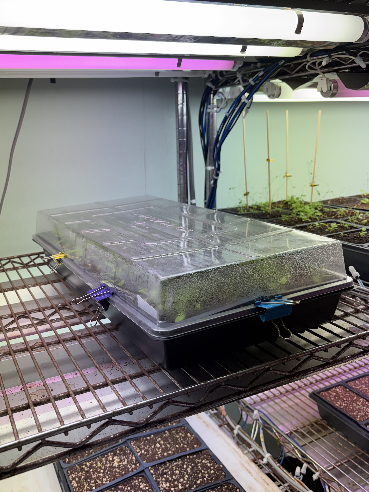

    * Growth chamber at 25 °C, 12 h light / 12 h dark, for 3 days (3 dpi).

14. **Materials for sampling (2026-09-18, 3 dpi)**
    * 100 mL 10 mM MgSO4 was prepared and autoclaved.
    * Reagent reservoir, 96-well plate and multichannel tips were exposed to UV for at least 30 min in the clean bench.
    * 200 µL sterile 10 mM MgSO4 in each of eight labeled 1.5 mL tubes (samples 1–8).
    * 100% ethanol in a sterile 50 mL Falcon tube for cleaning tools.

15. **Leaf selection and discs**
    * Inoculated leaves were cut off with flamed forceps. Leaves with tears, wrinkles or damage from the syringe were excluded, so that only symptoms caused by the infection were sampled.

      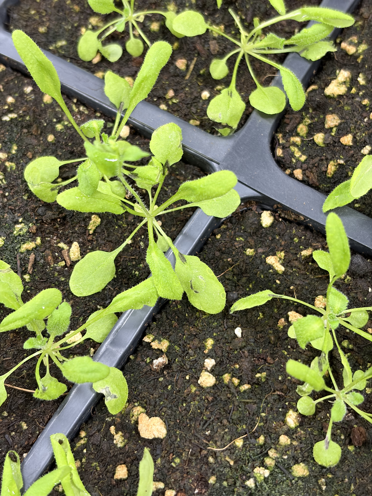

    * The leaves were laid out on a black surface, ranked from mild chlorosis (left) to advanced necrosis (right); damaged or atypical leaves were set aside at the upper left.

      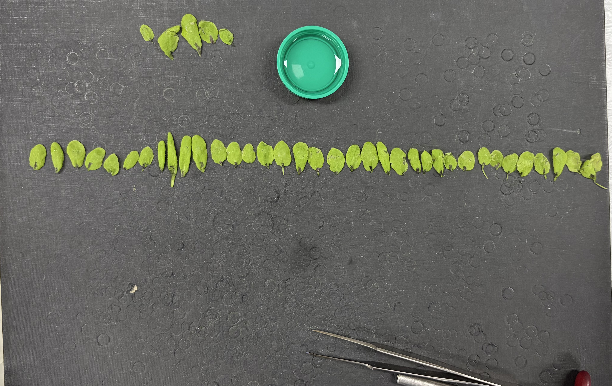

    * The eight leaves in the middle of the ranking (samples 1–8) were used; the extremes at both ends were left out.

      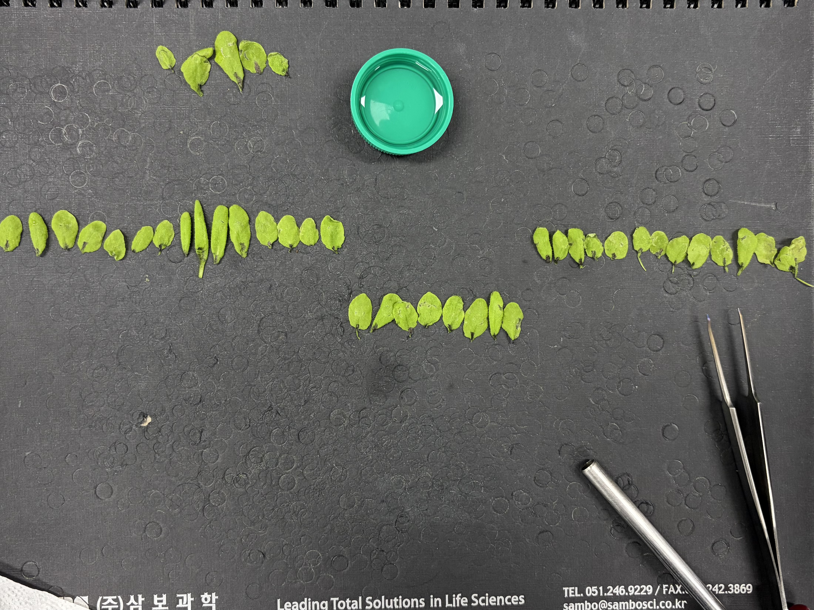

    * One disc (0.49 cm²) was punched from the centre of each leaf with a punch cleaned with 100% ethanol, avoiding the margin and the main veins.

      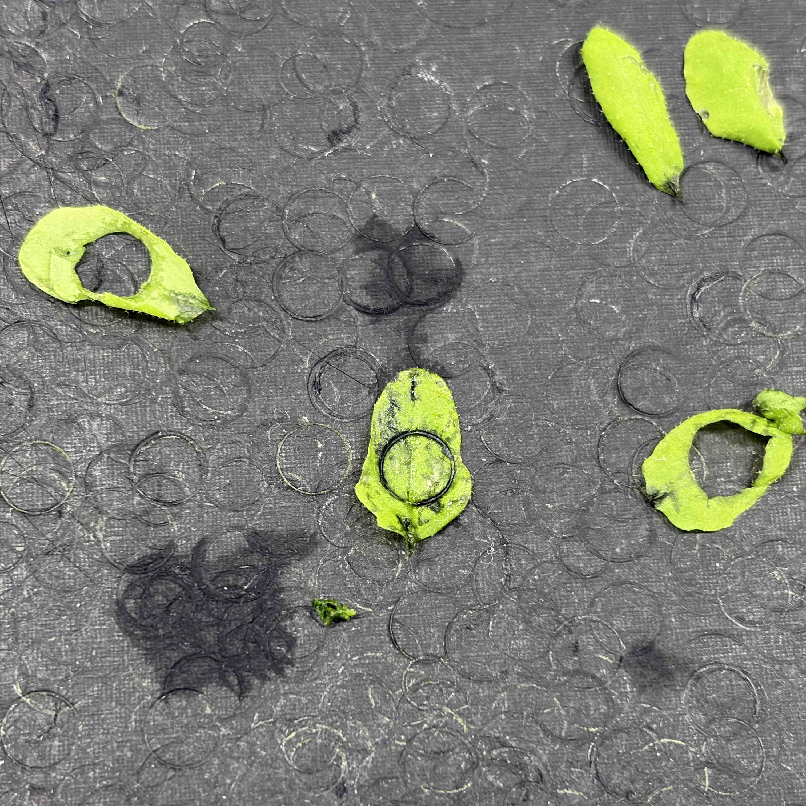

16. **Surface sterilization and grinding (deviation)**
    * Each disc was dipped in 100% ethanol for 2 s (reference: 70% ethanol for 5 s), to limit ethanol entering the damaged tissue while still removing surface bacteria.
    * Discs were blotted dry on sterile napkins and put into their tubes with 200 µL 10 mM MgSO4.
    * Discs were ground with an autoclaved micro-pestle on the handheld drill in short bursts (to avoid heating); the pestle was cleaned with ethanol between samples.

17. **Serial dilution**
    * 10 mM MgSO4 was poured into the UV-treated reservoir.
    * With the 8-channel pipette (Brand Transferpette-8, 20–200 µL), 180 µL was dispensed into columns 1–4 of the 96-well plate (rows A–H = samples 1–8).

      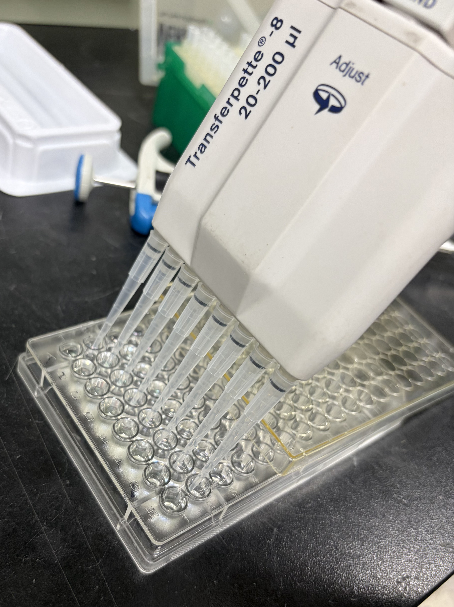

    * 20 µL of lysate into column 1 (10⁻¹), mixed 10 times.
    * 20 µL from column 1 into column 2 (10⁻²), from column 2 into column 3 (10⁻³) and from column 3 into column 4 (10⁻⁴), mixing each time.

18. **Plating**
    * Four LB plates with 34.0 µg/mL rifampicin were each divided on the bottom into six 60° sectors with a marker and labeled for two samples at three dilutions (for example plate 3: WT5 at 2, 3, 4 and WT6 at 2, 3, 4).
    * The sectors were arranged so that the 10⁻⁴ sector of one sample bordered the 10⁻² sector of the other; colonies crossing the border would then be easy to see.

      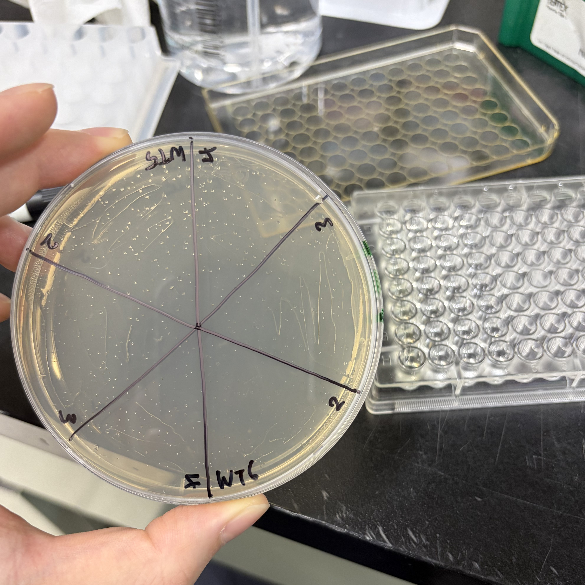

    * 20 µL from columns 2, 3 and 4 was spotted into the matching sectors and spread within the sector with gentle zig-zag movements of the tip.
    * The agar was not scratched: colonies in scratches grow densely and cannot be counted individually.

19. **Incubation (2026-09-18 to 2026-09-20; deviation)**
    * Plating was on a Friday, and the plates could only be counted on Sunday evening (2026-09-20, 22:00), after about 52–54 h instead of the usual 24–36 h.
    * Deviation: the plates were kept inverted in the dark at room temperature (about 21–23 °C) instead of 28 °C, to slow bacterial growth so that the colonies stayed separate over the longer incubation.

20. **Counting (2026-09-20, 22:00)**
    * Colonies were counted under oblique light at 10⁻², 10⁻³ and 10⁻⁴.
    * Choice of dilution: the counting range is 30–300 colonies per spot. For samples with fewer than 30 colonies at all dilutions (WT1, WT2, WT3, WT8), the 10⁻² count was used. For samples with more than 300 colonies at 10⁻² (WT6, WT7), the 10⁻³ count was used.
    * Bacterial density (CFU/cm²) = N × 10^D × (V_total / V_plated) / A_disc, with N = colonies counted, D = dilution index (2, 3 or 4), V_total = 200 µL, V_plated = 20 µL and A_disc = 0.49 cm². This simplifies to CFU/cm² = N × 10^D × 10 / 0.49 ≈ N × 10^D × 20.408.

---

## Results

### Colony counts

| Sample | 10⁻² (column 2) | 10⁻³ (column 3) | 10⁻⁴ (column 4) | Dilution used |
| :--- | :--- | :--- | :--- | :--- |
| WT1 | 20 | 0 | 0 | 10⁻² (N = 20) |
| WT2 | 11 | 0 | 0 | 10⁻² (N = 11) |
| WT3 | 15 | 2 | 0 | 10⁻² (N = 15) |
| WT4 | 130 | 23 | 0 | 10⁻² (N = 130) |
| WT5 | 191 | 31 | 1 | 10⁻² (N = 191) |
| WT6 | 571 (overcrowded) | 86 | 5 | 10⁻³ (N = 86) |
| WT7 | 323 (overcrowded) | 40 | 5 | 10⁻³ (N = 40) |
| WT8 | 23 | 3 | 0 | 10⁻² (N = 23) |

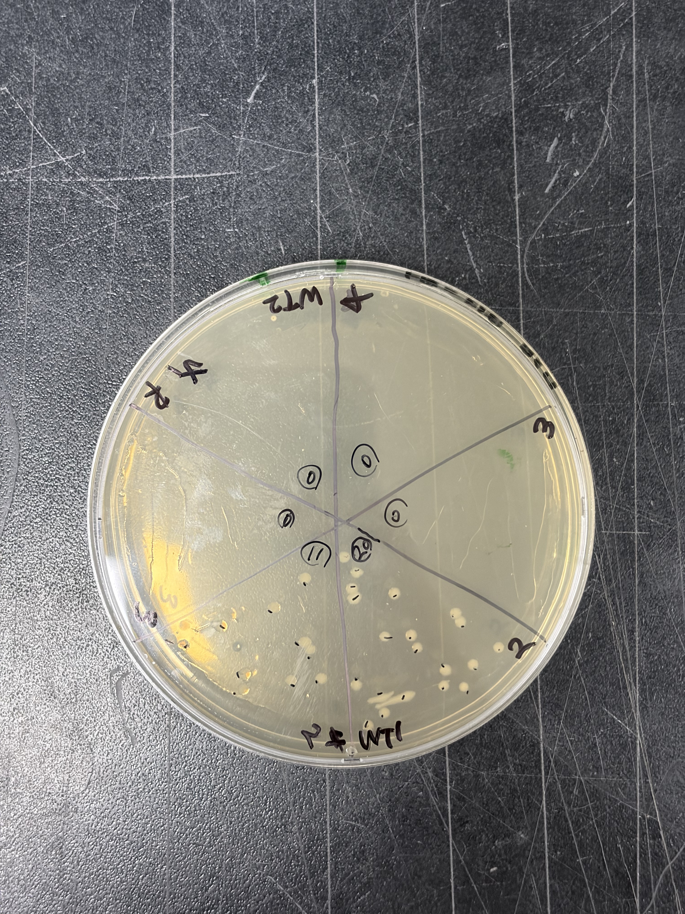
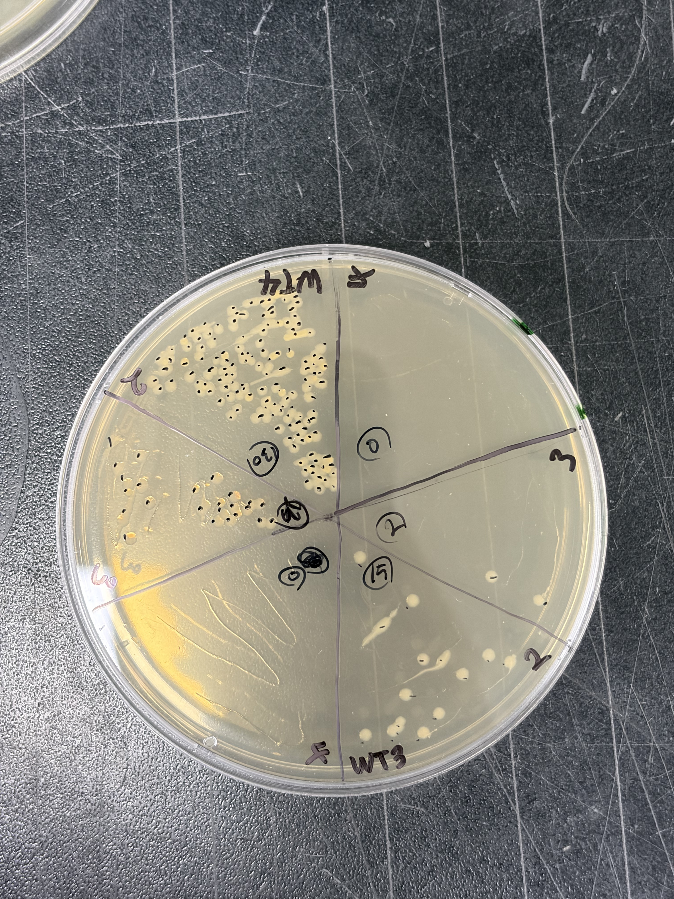
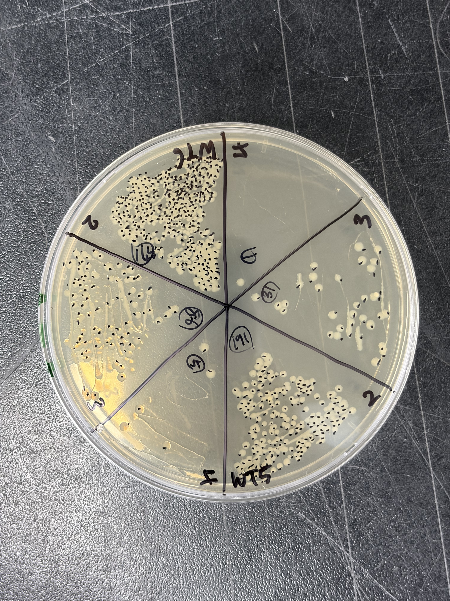
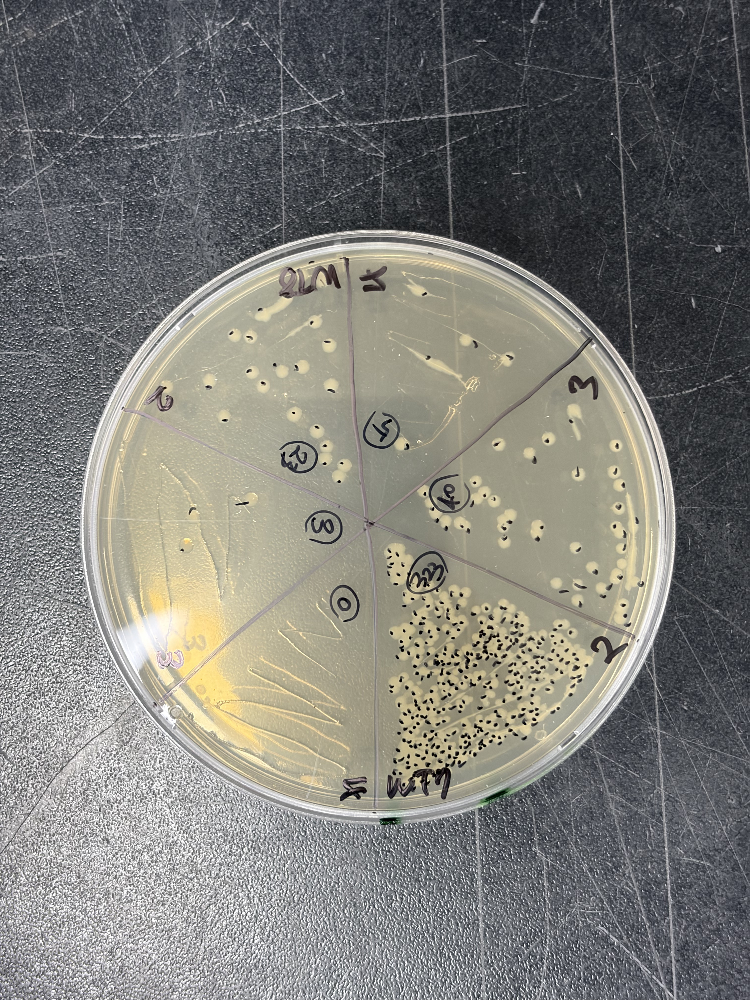

### Bacterial density

| Sample | N | Dilution factor | CFU per disc | CFU/cm² | log10(CFU/cm²) | Note |
| :--- | :--- | :--- | :--- | :--- | :--- | :--- |
| WT1 | 20 | 10² | 2.00 × 10⁴ | 4.08 × 10⁴ | 4.61 | fewer than 30 colonies |
| WT2 | 11 | 10² | 1.10 × 10⁴ | 2.24 × 10⁴ | 4.35 | fewer than 30 colonies; lowest value |
| WT3 | 15 | 10² | 1.50 × 10⁴ | 3.06 × 10⁴ | 4.49 | fewer than 30 colonies |
| WT4 | 130 | 10² | 1.30 × 10⁵ | 2.65 × 10⁵ | 5.42 | within 30–300 |
| WT5 | 191 | 10² | 1.91 × 10⁵ | 3.90 × 10⁵ | 5.59 | within 30–300 |
| WT6 | 86 | 10³ | 8.60 × 10⁵ | 1.76 × 10⁶ | 6.24 | highest value; 10⁻² overcrowded (571) |
| WT7 | 40 | 10³ | 4.00 × 10⁵ | 8.16 × 10⁵ | 5.91 | 10⁻² overcrowded (323) |
| WT8 | 23 | 10² | 2.30 × 10⁴ | 4.69 × 10⁴ | 4.67 | fewer than 30 colonies |

* The values range over about two orders of magnitude, from 2.24 × 10⁴ CFU/cm² (WT2; log10 4.35) to 1.76 × 10⁶ CFU/cm² (WT6; log10 6.24). Mean ± SD: 5.16 ± 0.72 log10(CFU/cm²).
* The values fall into two groups: WT1, WT2, WT3 and WT8 (log10 4.35–4.67), and WT4–WT7 (log10 5.42–6.24).
* This is a single method test with untreated plants and the substituted strain *Pss* B728a. The eight leaves were the middle of a ranking by symptom severity, and no BPA treatment was applied yet.
