# Course Practical, Week 3: GUS Staining and Seedling Clearing (2026-09-21)

**Date:** 2026-09-21 (GUS-stained samples imaged on 2026-09-28)
**Type:** practical for the course "Plant Physiology and Laboratory"; final processing of the GUS samples by the teaching assistants
**Material:** *Arabidopsis thaliana CLV3p::GUS*, *CYCB1;1p::GUS* and Col-0; *Marchantia polymorpha MpYUC2p::GUS* and Tak-1
**Related log:** 2026-09-14 (Week 2: media, sterilization and plating; background on the reporter lines)

---

## Background

Two parts:

* **Track A, GUS staining:** reporter lines that had been permeabilized in 90% acetone and stored at −20 °C were washed twice in staining buffer, stained with 0.5 mg/mL X-Gluc and incubated at 37 °C overnight. GUS cleaves X-Gluc, and the product forms an insoluble blue precipitate (5,5′-dibromo-4,4′-dichloro-indigo) where the promoter is active.
* **Track B, fixation and clearing:** 7-day-old wild-type seedlings (Col-0) and thalli (Tak-1) were fixed in FAA, degassed by centrifugation (13,000 rpm, 1 min), cleared in ClearSee for 10 min and examined by bright-field microscopy.

Reagents:

* **FAA fixative:** 2.5% formaldehyde (cross-links proteins), 2.5% glacial acetic acid, 45% ethanol, 50% water.
* **ClearSee:** 10% (w/v) xylitol, 15% (w/v) sodium deoxycholate, 25% (w/v) urea. It reduces light scattering in the tissue and removes chlorophyll.

### GUS staining buffers

| Component | *Arabidopsis* | *Marchantia* | Role |
| :--- | :--- | :--- | :--- |
| Sodium phosphate buffer, pH 7.0 | 40 mM | 40 mM | buffer at a suitable pH for GUS |
| Potassium ferricyanide, K3[Fe(CN)6] | 5 mM | 1 mM | oxidant; speeds up formation of the blue product so that it stays at the site of activity |
| Potassium ferrocyanide, K4[Fe(CN)6] | — | 1 mM | with ferricyanide, limits over-oxidation and diffusion |
| EDTA | 3 mM | 3 mM | chelator |
| Triton X-100 | 0.05% (v/v) | 0.01% (v/v) | detergent; helps X-Gluc enter the tissue |
| X-Gluc | 0.5 mg/mL | 0.5 mg/mL | substrate |

---

## Samples

| Track | Organism and line | Culture and age | Sample | Target structures |
| :--- | :--- | :--- | :--- | :--- |
| A | *A. thaliana CLV3p::GUS* | MS plates; permeabilized in 90% acetone | 1 tube (about 5–10 seedlings) | shoot apical meristem (SAM) |
| A | *A. thaliana CYCB1;1p::GUS* | MS plates; permeabilized in 90% acetone | 1 tube (about 5–10 seedlings) | dividing cells in SAM and root apical meristem (RAM) |
| A | *M. polymorpha MpYUC2p::GUS* | 1/2 B5 plates; permeabilized in 90% acetone | 1 tube (about 3–5 thalli) | apical notch |
| B | *A. thaliana* Col-0 | MS plates; 7 days after sowing | 3 seedlings | pavement cells, stomata, primary root, vascular cylinder, RAM |
| B | *M. polymorpha* Tak-1 | 1/2 B5 plates; 7 days after plating | 2 thalli | apical notch, thallus, rhizoids |

---

## Preparation

* **Solutions:** FAA; ClearSee; staining buffers for *Arabidopsis* and *Marchantia*, each with and without 0.5 mg/mL X-Gluc; 90% (v/v) acetone at −20 °C; 70% and 100% ethanol.
* **Consumables per student:** five sterile 1.5 mL tubes (labeled `CYCB1`, `CLV3`, `YUC2`, `1-2 Col-0`, `1-2 Mp Tak-1`); glass slides (about 25 × 75 mm) and coverslips (about 24 × 24 mm); 200 µL and 1000 µL tips; wipes.
* **Equipment:** fume hood (formaldehyde and acetic acid); microcentrifuge (up to 13,000 rpm); incubator at 37 °C (dark); upright bright-field microscope with camera; fine forceps and scalpels.

---

## Reference protocols

### 1. GUS staining

1. Put whole seedlings or thalli into ice-cold 90% (v/v) acetone in a 1.5 mL tube and keep at −20 °C for 1 h (permeabilizes the tissue and stops metabolism).
2. Remove the acetone without damaging the tissue.
3. Add staining buffer without X-Gluc, invert several times, pulse-spin and remove the buffer; repeat once (two washes).
4. Add the species-specific staining buffer with 0.5 mg/mL X-Gluc until the tissue is covered.
5. Apply vacuum for 15 min (open or vented tubes in a vacuum desiccator) to draw the substrate into the tissue.
6. Close the tubes and incubate at 37 °C in the dark overnight (12–16 h).

### 2. Stopping, decolorizing and dehydration

1. Replace the staining buffer with 70% (v/v) ethanol to stop the reaction.
2. Replace with ethanol:acetic acid (6:1, v/v) and agitate gently until the chlorophyll is removed.
3. Replace with 70% (v/v) ethanol for 2 h.
4. Dehydrate through 70%, 80%, 90%, 95% and 100% ethanol. Going directly to 100% ethanol causes shrinkage and cell collapse.
5. Mount in mounting medium or glycerol for bright-field microscopy.

### 3. Fixation

| Component | % (v/v) |
| :--- | :--- |
| Formaldehyde | 2.5 |
| Glacial acetic acid | 2.5 |
| Ethanol (100%) | 45.0 |
| Deionized water | 50.0 |

Formaldehyde is toxic, volatile and carcinogenic; prepare and handle FAA in a fume hood.

1. Take whole seedlings or gemmalings from the plates with fine forceps and remove the agar.
2. Put them into a 1.5 mL tube with fixative, fully covered.
3. Remove air from the tissue by vacuum, or by centrifuging at maximum speed (13,000 rpm or more) for 1 min.
4. Keep in fixative at 25 °C for clearing on the same day, or at 4 °C for longer storage.

### 4. Clearing and mounting

| ClearSee component | % (w/v) |
| :--- | :--- |
| Xylitol | 10 |
| Sodium deoxycholate | 15 |
| Urea | 25 |
| Deionized water | to volume |

1. **ClearSee:** move the fixed samples into ClearSee for exactly 10 min. Longer exposure softens young tissue and makes it fall apart.
2. **Alternative:** ethanol:acetic acid (6:1, v/v) for 10 min, then mount.
3. Place the cleared seedlings on a clean slide.
4. Under a stereomicroscope, dissect cotyledons, shoot apex, true leaves and roots with a scalpel.
5. Add a drop of ClearSee and lower a coverslip without trapping air.

---

## Bench record and deviations

1. **Acetone removal and washes (Track A)**
   * Acetone-permeabilized material stored at −20 °C was used for three lines: *At CYCB1;1p::GUS*, *At CLV3p::GUS* and *Mp YUC2p::GUS*.
   * The acetone was removed without disturbing the tissue.
   * 400 µL of the matching staining buffer without X-Gluc was added; the tubes were inverted, pulse-spun, and the buffer was removed.
   * This wash was repeated once with another 400 µL (two washes in total), to remove the acetone and equilibrate the tissue in 40 mM sodium phosphate, pH 7.0.

2. **Staining (deviation)**
   * 400 µL staining buffer with 0.5 mg/mL X-Gluc (stocks `At-GUS(X)` and `Mp-GUS(X)`) was added to the tubes `CYCB1`, `CLV3` and `YUC2`, covering all tissue.
   * Deviation: no vacuum infiltration (reference: 15 min); the substrate entered the permeabilized tissue by diffusion during the incubation.
   * The closed tubes were incubated in the dark at 37 °C overnight (about 14–16 h).

   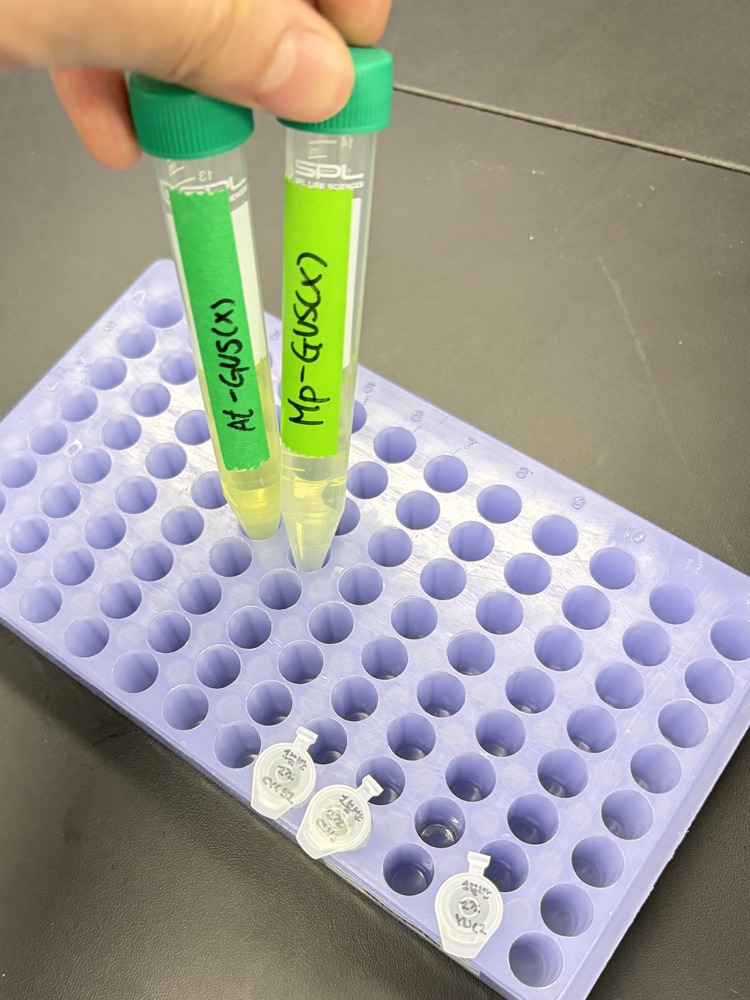

3. **Sampling and fixation (Track B)**
   * *A. thaliana* Col-0: three 7-day-old seedlings, germinated on 2026-09-14 on MS plates.
   * *M. polymorpha* Tak-1: two thalli grown since 2026-09-14 on B5 plates.
   * With ethanol-cleaned forceps, the seedlings went into tube `1-2 Col-0` and the thalli into tube `1-2 Mp Tak-1`, without agar.
   * 400 µL FAA per tube; tubes inverted to wet all surfaces.
   * Centrifuged at 13,000 rpm for 1 min at room temperature (RT), to push the fixative into the tissue, sink floating samples and remove trapped air.
   * The FAA was removed with a pipette without disturbing the samples.

   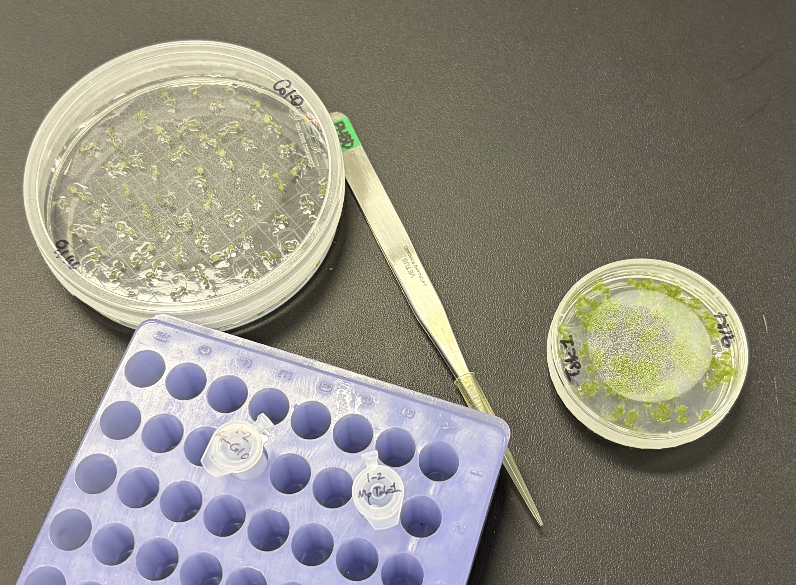

4. **Clearing**
   * 400 µL ClearSee was added to `1-2 At-Col-0` and `1-2 Mp Tak-1`; the tubes were inverted to suspend the samples.
   * RT for exactly 10 min; the chlorophyll was removed and the tissue became translucent.
   * Clearing was kept to 10 min to avoid softening the young tissue before mounting.

   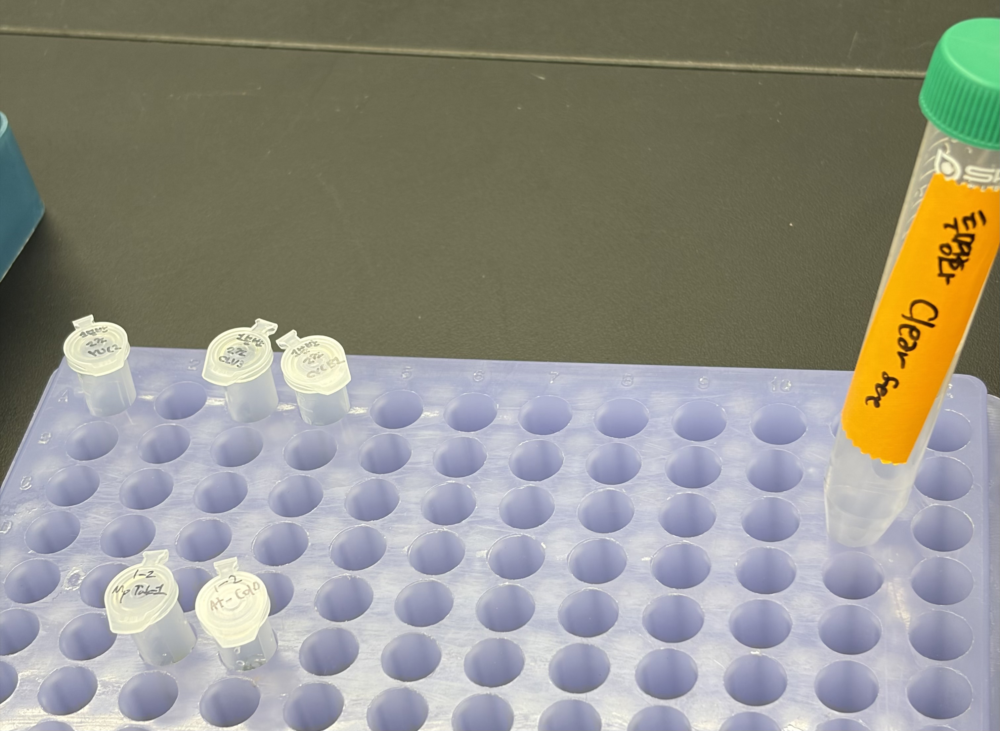

5. **Mounting and microscopy (Track B)**
   * The cleared seedlings and thalli were moved onto clean slides with fine forceps, laid flat in a drop of ClearSee, and covered with a coverslip lowered at an angle to avoid air bubbles.
   * Upright bright-field microscope with camera: 4×–10× to find the structures, 20×–40× for detail.
   * ***A. thaliana* Col-0:**
     * Leaf epidermis: lobed (jigsaw-shaped) pavement cells and stomata with pairs of guard cells.

       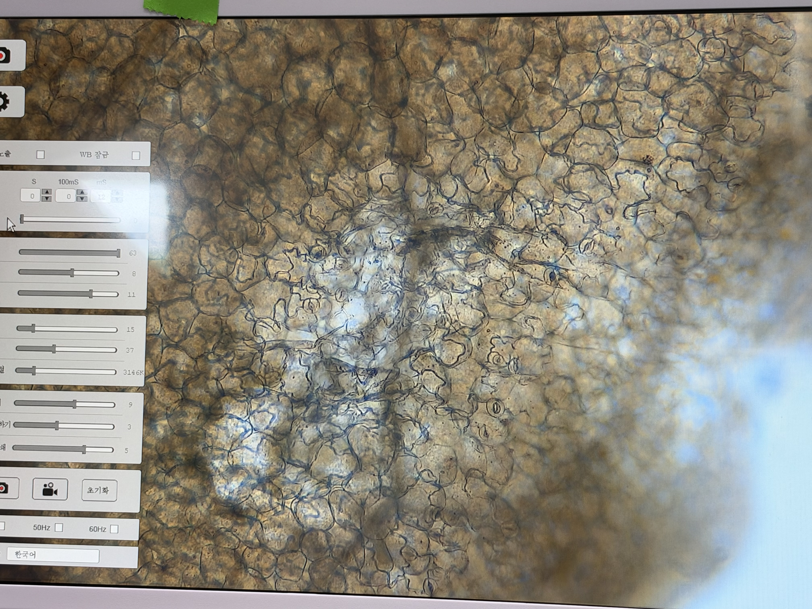

     * Root tip: root cap, columella cell files, the quiescent centre within the root apical meristem (RAM), and the zone of cell division and elongation behind it.

       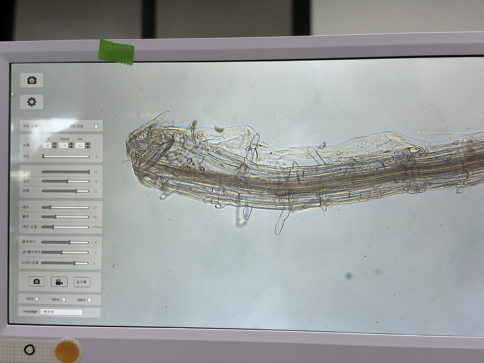

     * Differentiation zone: central vascular cylinder with xylem elements showing wall thickenings, surrounded by cortex and epidermis with emerging root hairs.

       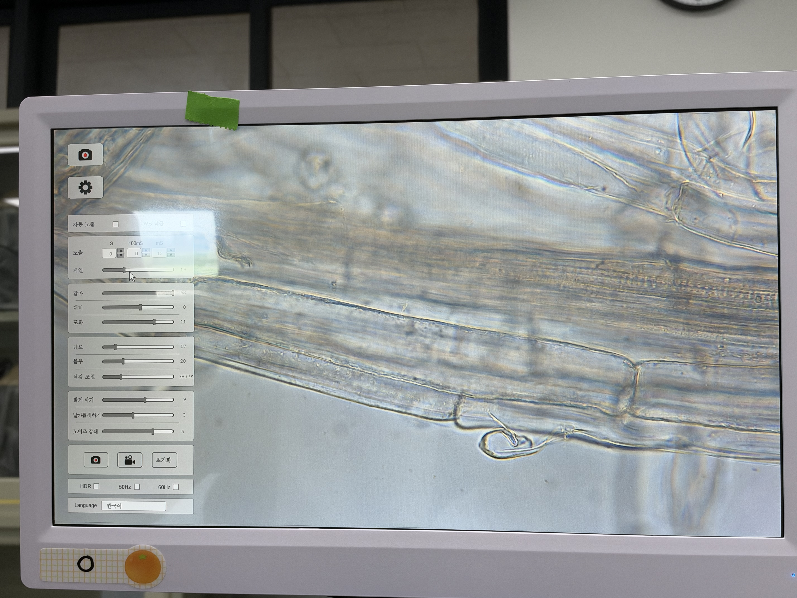

   * ***M. polymorpha* Tak-1:**
     * Apical notch: a deep notch at the thallus margin containing the meristematic cells, with mucilage papillae.

       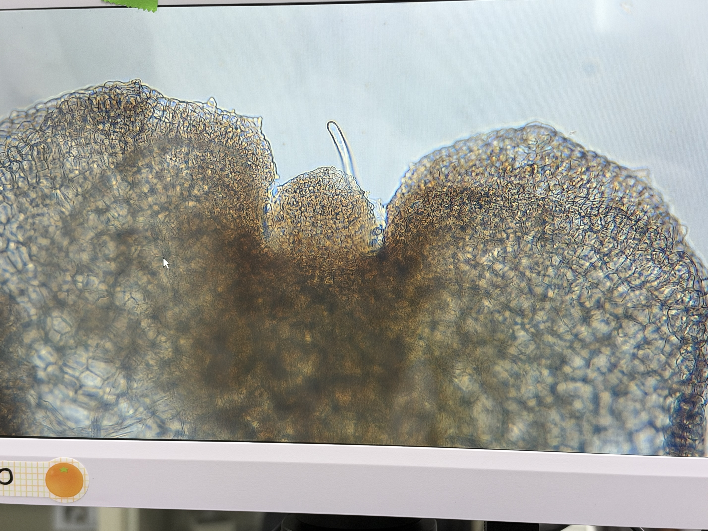

     * Thallus: a network of polygonal cells.

       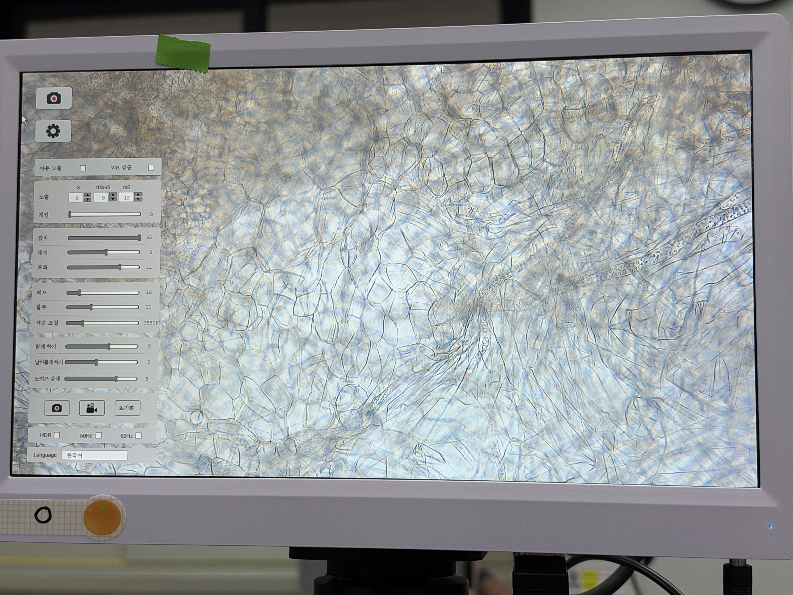

     * Rhizoids: long unicellular rhizoids on the ventral side; smooth and pegged rhizoids were distinguished.

       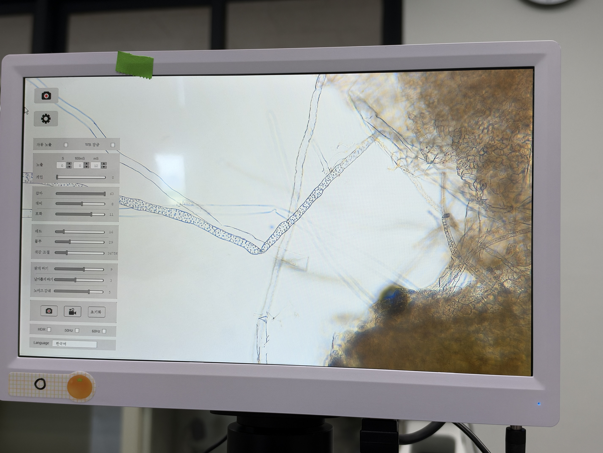

6. **Microscopy of the GUS-stained lines (2026-09-28)**
   * Stopping, decolorizing, dehydration and mounting of the Track A samples were done by the teaching assistants, not at the student bench; the processed samples were received for imaging.
   * Bright-field microscope with camera. Staining was judged by whether the blue precipitate was confined to the expected meristem region against unstained surrounding tissue.
   * Limitation: with teaching-grade optics, signal could be assigned to tissues and organs but not to individual cells. Several images are partly out of focus and contain air bubbles.
   * ***A. thaliana CLV3p::GUS* (shoot apical meristem):**
     * Whole seedling: cotyledons, hypocotyl and root unstained; one distinct blue spot at the shoot apex, where the cotyledons meet. The circular rings are air bubbles, not GUS signal.

       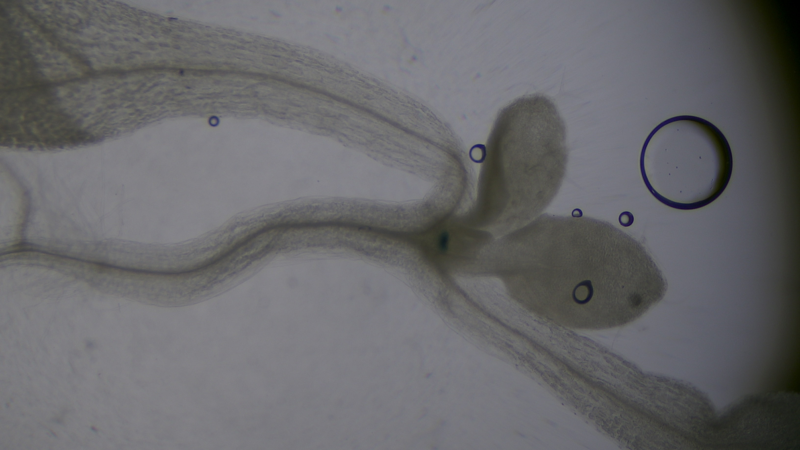

     * Shoot apex, higher magnification: compact, sharply bounded signal in the centre of the apex between the cotyledon bases, consistent with *CLV3* promoter activity in the SAM. The central zone could not be distinguished at this resolution. The centre of the signal was almost opaque, indicating dense precipitate.

       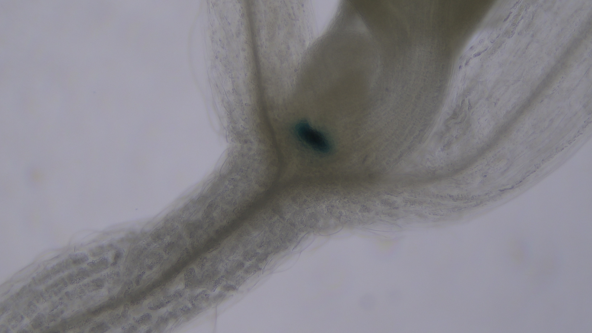

   * ***A. thaliana CYCB1;1p::GUS* (dividing cells):**
     * Root tip, overview: diffuse blue staining in the distal root tip with scattered, more intense spots; the differentiation zone further up was unstained. The dark blue arc at the upper right is the edge of an air bubble.

       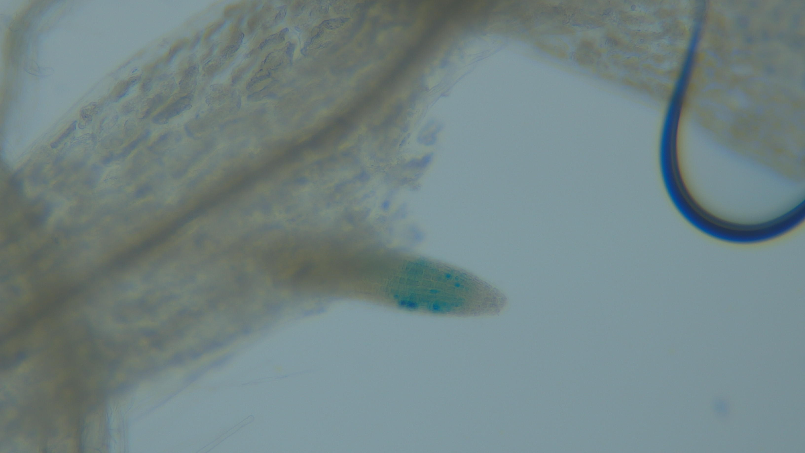

     * Root meristem, higher magnification: strong blue signal across the distal meristem with patches of higher intensity, weaker towards the root cap and the elongation zone; consistent with *CYCB1;1* promoter activity in the RAM.

       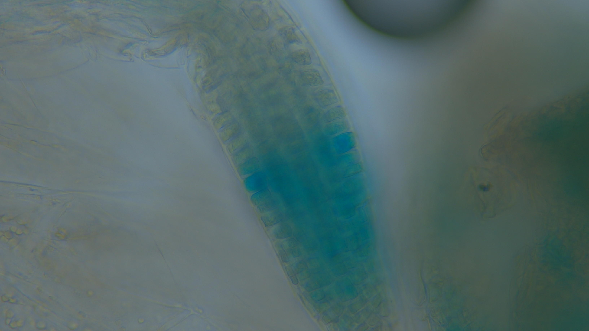

     * Shoot: diffuse blue signal at the apex, fading outwards; the surrounding tissue was mostly unstained.

       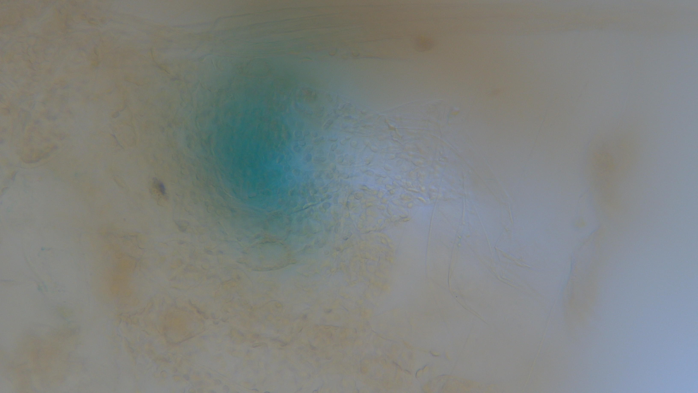

   * ***M. polymorpha MpYUC2p::GUS* (apical notch):**
     * Single notch: blue precipitate only at the innermost point of the apical notch; a second spot is partly visible in a neighbouring notch at the lower edge of the image. The thallus away from the notch was unstained.

       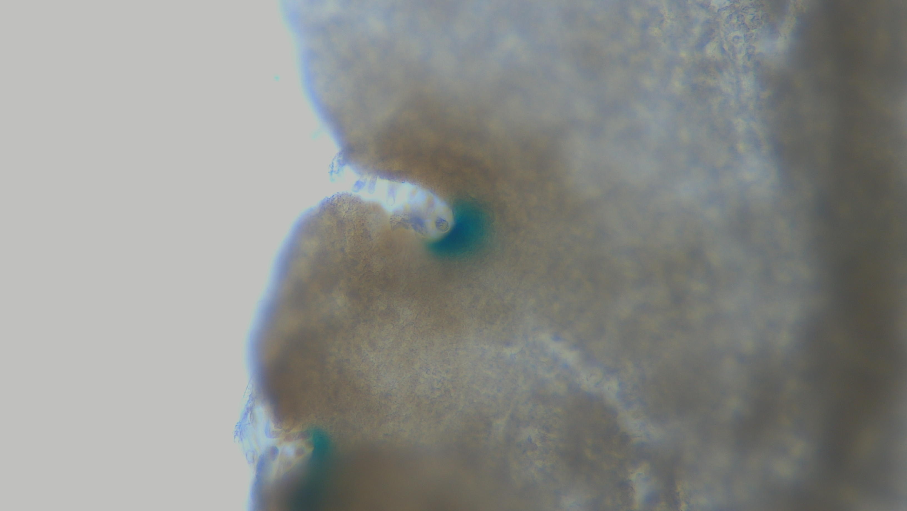

     * Two notches: two distinct blue spots at the bases of neighbouring notches on the same lobe, with mucilage papillae and rhizoids at the margin.

       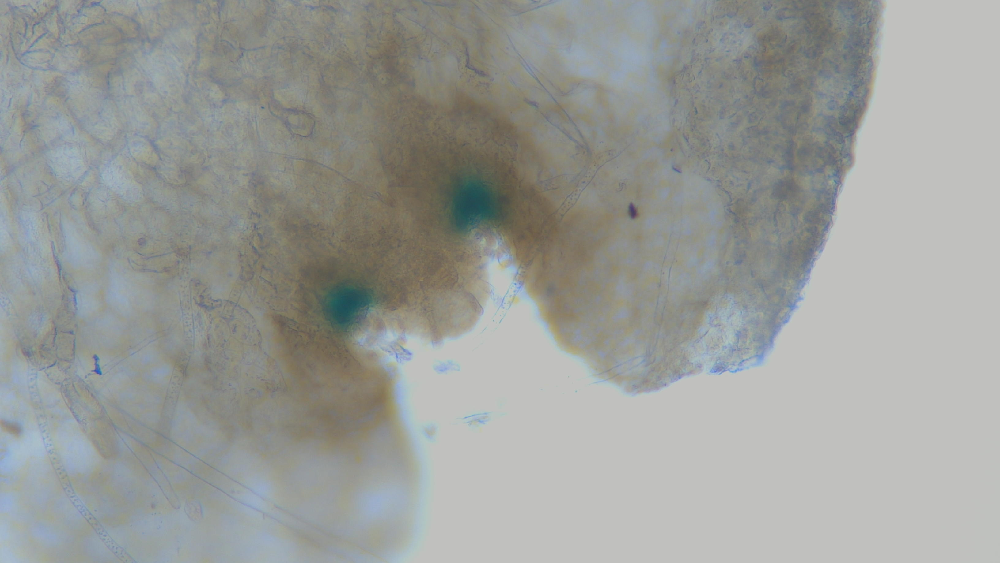

   * **Summary:** all three reporters gave blue precipitate in the expected meristem regions (shoot apex for *CLV3*; root and shoot apices for *CYCB1;1*; apical notches for *MpYUC2*) and no signal in cotyledons, hypocotyl or mature thallus. These plants were well watered; no drought treatment was applied.
