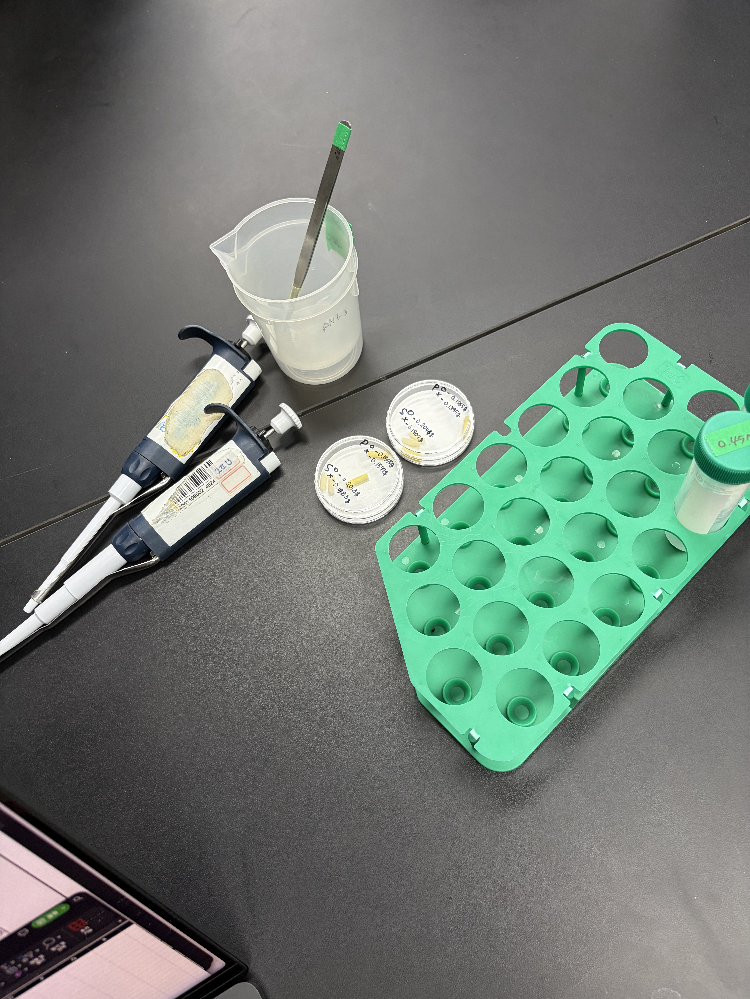
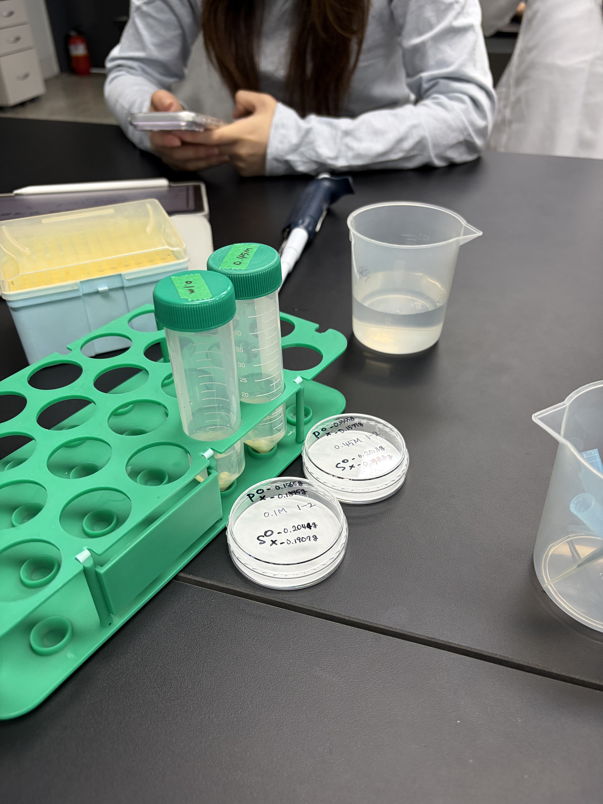
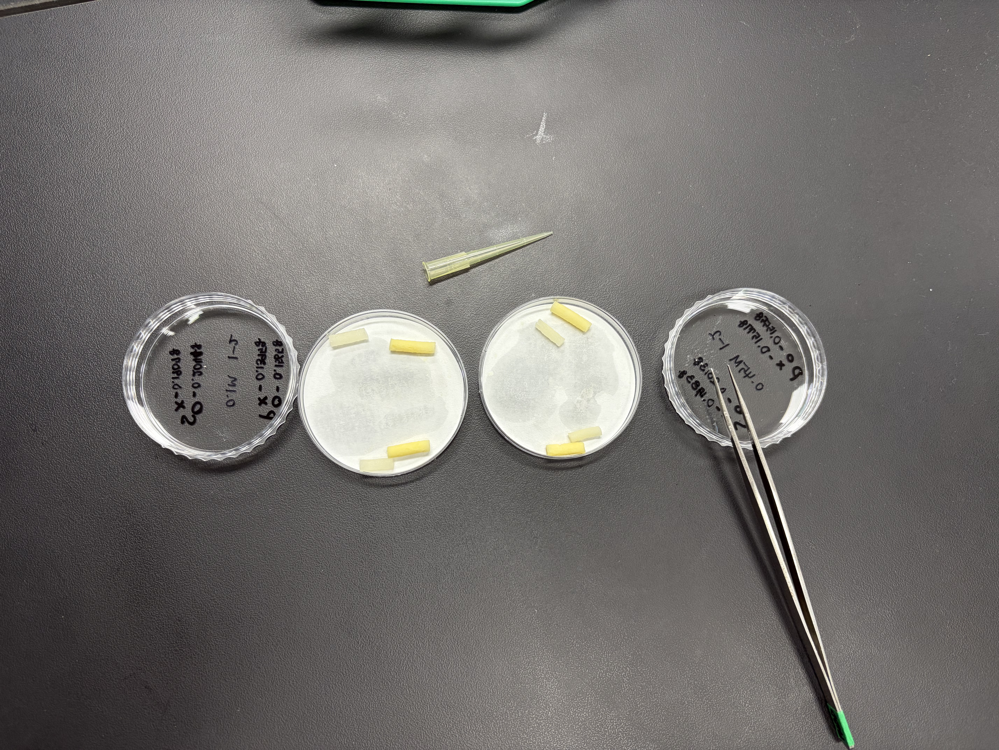
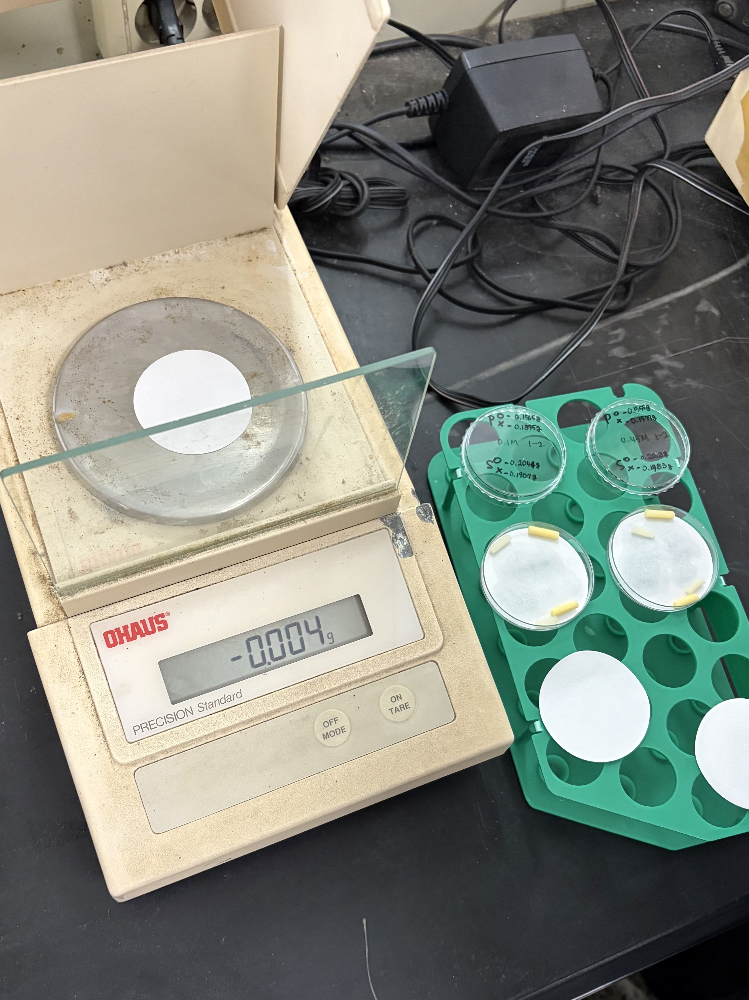
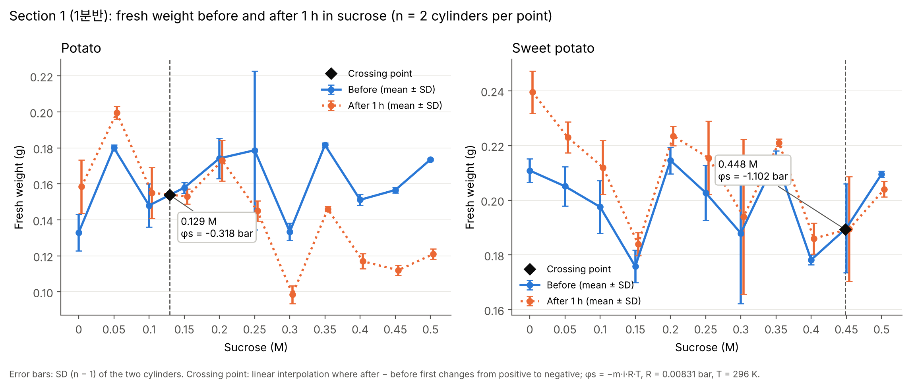

# Course Practical, Week 6: Water Potential of Potato and Sweet Potato Tissue (2026-10-12)

**Date:** 2026-10-12
**Type:** practical for the course "Plant Physiology and Laboratory"; the teaching assistants made the 1 M sucrose stock and cut the tissue cylinders; the initial weights were written on the Petri dish lids; the 0 M, 0.25 M and 0.3 M treatments were run by the teaching assistants
**Material:** potato (P) and sweet potato (S) tissue cylinders
**Related log:** none

---

## Background

- Aim: measure the water potential of potato and sweet potato tissue.
- Principle: tissue cylinders are kept in a series of sucrose solutions for 1 h and weighed before and after. The sucrose solution in which the tissue weight does not change has the same potential as the tissue.
- The osmotic potential of a sucrose solution is calculated as φs = −miRT (m, molality of the solution; i, ionization constant, 1 for sucrose and glucose; R, gas constant, 0.00831 bar; T, absolute temperature, 0 °C = 273 K).
- One of the two cylinders of each species is notched so that the two can be told apart.

---

## Design

Concentrations were divided among the groups of the section. This note is from group 2 of Section 1 (1분반). Each group put two potato and two sweet potato cylinders in each of its two solutions.

| Group | Sucrose concentrations |
|---|---|
| 1 | 0.05 M, 0.5 M |
| 2 | 0.1 M, 0.45 M |
| 3 | 0.15 M, 0.4 M |
| 4 | 0.2 M, 0.35 M |
| Teaching assistants | 0 M, 0.25 M, 0.3 M |

Group 2 cylinders:

| Solution | Species | Cut at the bottom | Label on dish | Initial weight (g) |
|---|---|---|---|---|
| 0.1 M sucrose | Potato | yes | P O | 0.1565 |
| 0.1 M sucrose | Potato | no | P X | 0.1395 |
| 0.1 M sucrose | Sweet potato | yes | S O | 0.2044 |
| 0.1 M sucrose | Sweet potato | no | S X | 0.1907 |
| 0.45 M sucrose | Potato | yes | P O | 0.1555 |
| 0.45 M sucrose | Potato | no | P X | 0.1577 |
| 0.45 M sucrose | Sweet potato | yes | S O | 0.2013 |
| 0.45 M sucrose | Sweet potato | no | S X | 0.1783 |

---

## Preparation

- **Consumables:** potato, sweet potato (the slides also list radish and carrot), 1 M sucrose solution (200 mL), distilled water, Falcon tubes, filter paper.
- **Equipment:** 100 mL graduated cylinder, 150 or 250 mL beakers (10), 10 mL volumetric pipette, ruler (mm), cork borer (5 mm diameter), scalpel, electronic balance.
- **Solutions:** sucrose solutions of 0.05–0.5 M, diluted from 1 M sucrose with distilled water.

---

## Reference protocols

### Sucrose dilution series

1. Dilute 1 M sucrose with distilled water to 0.05, 0.1, 0.15, 0.2, 0.25, 0.3, 0.35, 0.4, 0.45 and 0.5 M, 50 mL each, in Falcon tubes.

### Water potential measurement

1. Cut potato and sweet potato into 20 mm thick slices. With a 5 mm cork borer, make two cylinders of each.
2. Notch one cylinder so that the two cylinders can be told apart.
3. Choose three of each, weigh them, and place them in each sucrose solution.
4. Leave for 1 h.
5. Take the cylinders out of the solution and remove the surface solution with filter paper.
6. Weigh each cylinder again.
7. Calculate the osmotic potential (φs) of the sucrose solutions. Slide example: m = 1, i = 1 (sucrose): −1 × 1 × 0.00831 × (23 + 273) = −2.45976.

---

## Bench record and deviations

1. **Sucrose solutions (deviation)**
   * 0.1 M and 0.45 M sucrose were made by group 2 by diluting the 1 M sucrose stock (made by the teaching assistants) with dH2O in Falcon tubes. Final volume 10 mL (reference: 50 mL), as recorded in the group 2 data file (06_1-2_실험데이터.xlsx). All groups of the section made 10 mL.

   | Solution | 1 M sucrose | dH2O | Final volume | Final concentration |
   |---|---|---|---|---|
   | 0.1 M | 1.0 mL | 9.0 mL | 10 mL | 0.1 M |
   | 0.45 M | 4.5 mL | 5.5 mL | 10 mL | 0.45 M |

2. **Samples (done by others)**
   * Potato (P) and sweet potato (S) cylinders, cut by the teaching assistants, were received: two of each species per solution. Of each pair, one cylinder had been notched at the bottom (marked O) and one had not (marked X).
   * The cylinders had been weighed before they were handed out. The initial weights were written on the Petri dish lids (see Design).

3. **Incubation in sucrose**
   * The cylinders were placed in the 0.1 M and 0.45 M solutions for 1 h (11:10–12:10).

4. **Surface-solution removal**
   * The cylinders were taken out and the surface solution was removed. In the photo, four cylinders (two pale, two yellow) lie on filter paper in each dish.

5. **Final weighing**
   * Each cylinder was weighed on the balance (OHAUS Precision Standard). Final weights were recorded to 0.001 g; the initial weights on the lids are to 0.0001 g.

6. **Results, group 2**

   | Solution | Cylinder | Initial (g) | Final (g) | Final − initial (g) |
   |---|---|---|---|---|
   | 0.1 M | P O | 0.1565 | 0.165 | +0.0085 |
   | 0.1 M | P X | 0.1395 | 0.145 | +0.0055 |
   | 0.1 M | S O | 0.2044 | 0.219 | +0.0146 |
   | 0.1 M | S X | 0.1907 | 0.205 | +0.0143 |
   | 0.45 M | P O | 0.1555 | 0.114 | −0.0415 |
   | 0.45 M | P X | 0.1577 | 0.110 | −0.0477 |
   | 0.45 M | S O | 0.2013 | 0.203 | +0.0017 |
   | 0.45 M | S X | 0.1783 | 0.176 | −0.0023 |

7. **Section 1 (1분반) data (06_1-1 to 06_1-4_실험데이터.xlsx and 06_1-조교_실험데이터.xlsx)**
   * Two cylinders per species and concentration. Fresh weight (g), mean ± SD (n = 2; sample SD):

   | Sucrose (M) | Source | Potato, before | Potato, after 1 h | Sweet potato, before | Sweet potato, after 1 h |
   |---|---|---|---|---|---|
   | 0 | TAs | 0.1330 ± 0.0102 | 0.1585 ± 0.0148 | 0.2109 ± 0.0043 | 0.2395 ± 0.0078 |
   | 0.05 | group 1 | 0.1801 ± 0.0016 | 0.1995 ± 0.0035 | 0.2051 ± 0.0072 | 0.2230 ± 0.0057 |
   | 0.1 | group 2 | 0.1480 ± 0.0120 | 0.1550 ± 0.0141 | 0.1976 ± 0.0097 | 0.2120 ± 0.0099 |
   | 0.15 | group 3 | 0.1579 ± 0.0031 | 0.1530 ± 0.0042 | 0.1758 ± 0.0059 | 0.1840 ± 0.0042 |
   | 0.2 | group 4 | 0.1742 ± 0.0113 | 0.1730 ± 0.0113 | 0.2146 ± 0.0049 | 0.2235 ± 0.0035 |
   | 0.25 | TAs | 0.1787 ± 0.0441 | 0.1450 ± 0.0057 | 0.2028 ± 0.0101 | 0.2155 ± 0.0134 |
   | 0.3 | TAs | 0.1334 ± 0.0049 | 0.0985 ± 0.0049 | 0.1880 ± 0.0257 | 0.1940 ± 0.0283 |
   | 0.35 | group 4 | 0.1816 ± 0.0011 | 0.1460 ± 0.0014 | 0.2150 ± 0.0030 | 0.2210 ± 0.0014 |
   | 0.4 | group 3 | 0.1512 ± 0.0030 | 0.1170 ± 0.0042 | 0.1782 ± 0.0018 | 0.1860 ± 0.0057 |
   | 0.45 | group 2 | 0.1566 ± 0.0016 | 0.1120 ± 0.0028 | 0.1898 ± 0.0163 | 0.1895 ± 0.0191 |
   | 0.5 | group 1 | 0.1736 ± 0.0006 | 0.1210 ± 0.0028 | 0.2095 ± 0.0011 | 0.2040 ± 0.0028 |

   * Potato: the mean weight after 1 h was higher than before from 0 to 0.1 M and lower from 0.15 to 0.5 M.
   * Sweet potato: the mean weight after 1 h was higher than before from 0 to 0.4 M and lower at 0.45 and 0.5 M.
   * The largest SD (potato before, 0.25 M) comes from the two TA cylinders of 0.2099 g and 0.1475 g. In the teaching assistants' file, the first 0.25 M potato cylinder and the first 0.25 M sweet potato cylinder have the same initial weight (0.2099 g).

8. **Crossing point and osmotic potential (T = 23 °C)**
   * The crossing point is where the mean "after" line meets the mean "before" line. It was found by linear interpolation between the two concentrations where after − before changes from positive to negative. There was one crossing for each species.
   * φs = −miRT with i = 1, R = 0.00831 bar and T = 23 + 273 = 296 K, as in the slide example. The concentration in M was used for m, as in the slide example. The temperature is the slide value; the room temperature was not recorded.

   | Species | Between | After − before (g) | Crossing point (M) | φs (bar) |
   |---|---|---|---|---|
   | Potato | 0.1 M and 0.15 M | +0.0070 and −0.0049 | 0.129 | −0.318 |
   | Sweet potato | 0.4 M and 0.45 M | +0.0078 and −0.0003 | 0.448 | −1.102 |

   * φs of each sucrose solution, for reference:

   | Sucrose (M) | 0 | 0.05 | 0.1 | 0.15 | 0.2 | 0.25 | 0.3 | 0.35 | 0.4 | 0.45 | 0.5 |
   |---|---|---|---|---|---|---|---|---|---|---|---|
   | φs (bar) | 0 | −0.123 | −0.246 | −0.369 | −0.492 | −0.615 | −0.738 | −0.861 | −0.984 | −1.107 | −1.230 |
